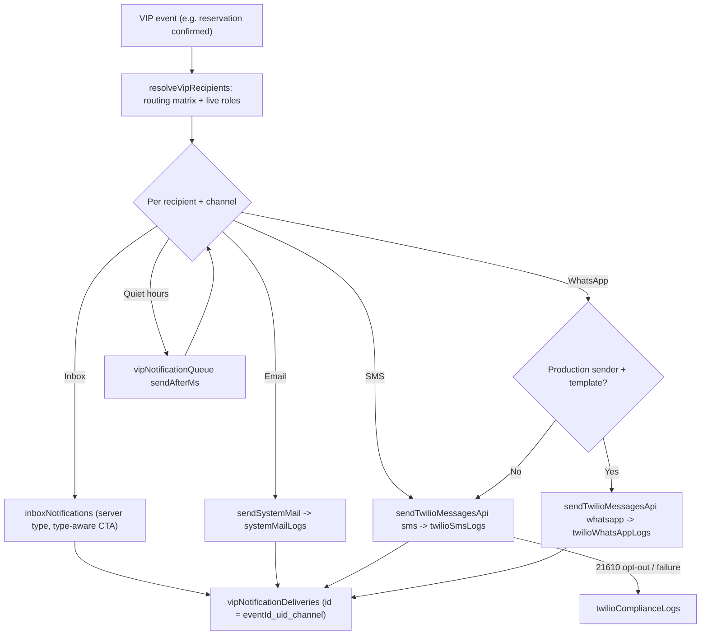
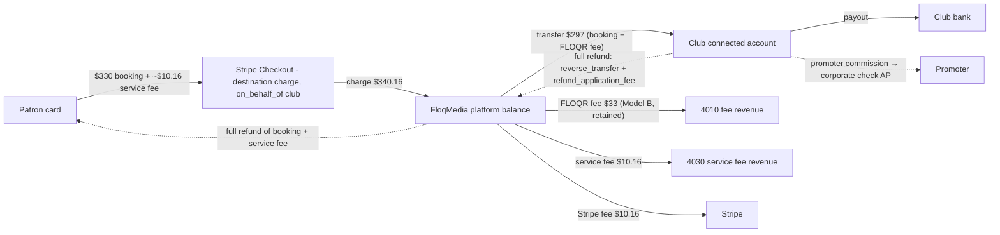
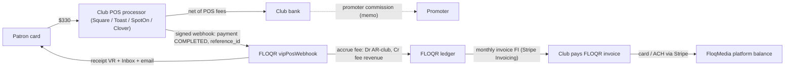
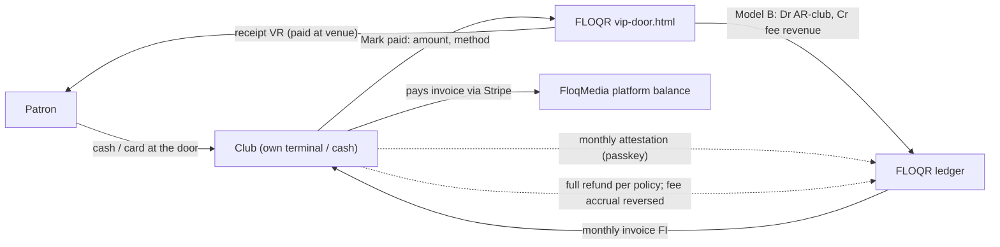
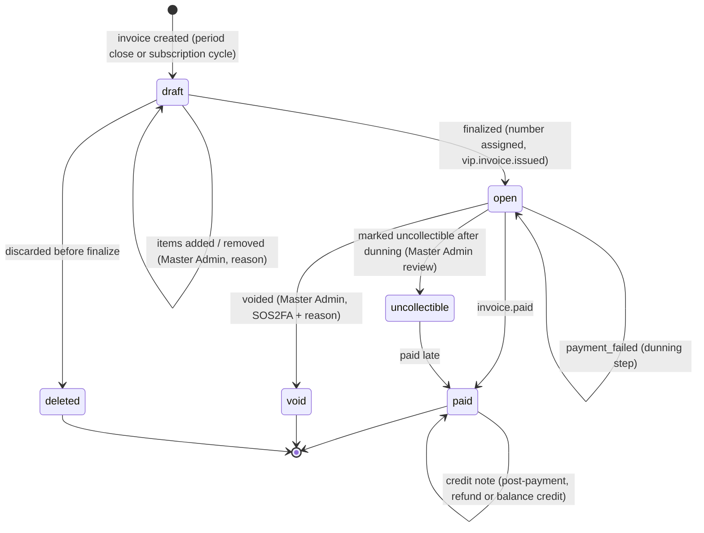
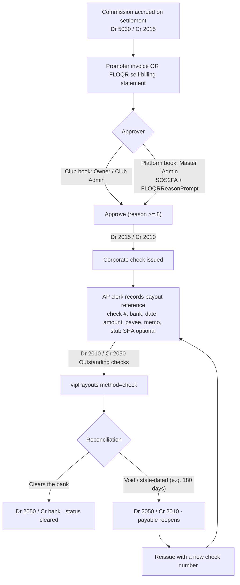
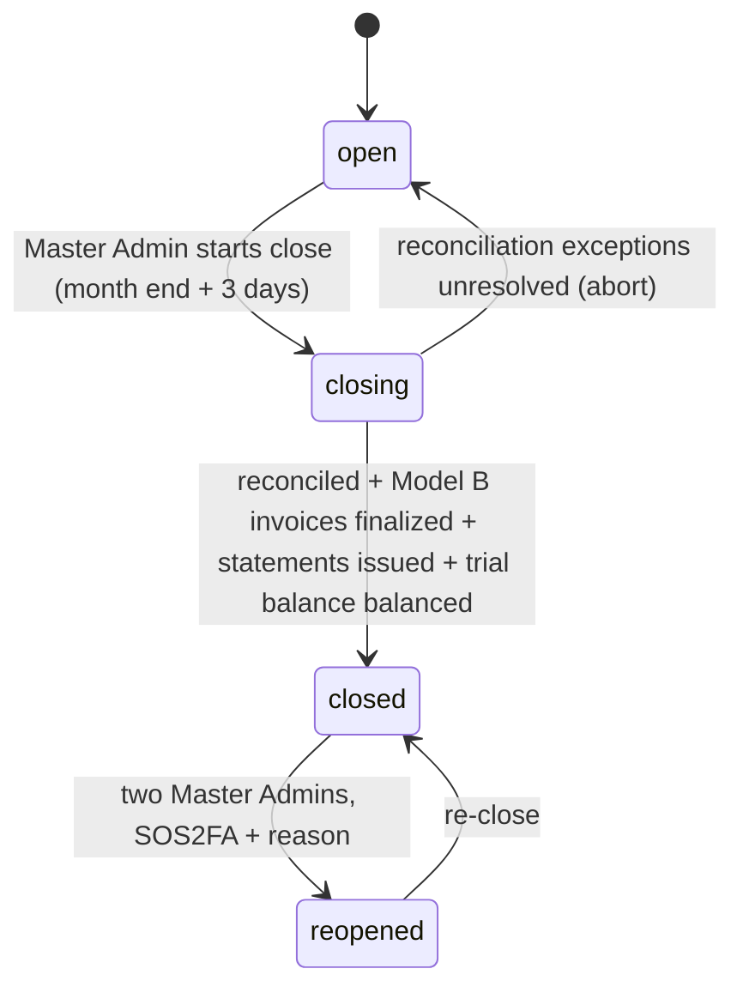

# VIP Reservations — notifications, receipts, invoicing and AR/AP ledger (proposal)

Status: **PROPOSAL — awaiting owner approval. Nothing is built, published or deployed.** No Firestore, Functions, rules, Stripe, Twilio or SendGrid changes were made.
Date: Oct 15 2026 · Workspace package at writing: s3.1.42 · Resume: `@vip-billing$` / `$vip-ledger$`
Companion to: [`vip-reservations-proposal.md`](vip-reservations-proposal.md) (§8 callables, §11 Stripe, §14 notifications) and `vip-pos-integrations.md` (POS report, written separately). Design note: `.cursor/rules/design-notes-vip-reservations.mdc`.

> Not legal, tax or accounting advice. Every compliance, tax and accounting statement below is a checklist for the owner's counsel and accountant to confirm.

### Owner decisions (Oct 15 2026)

Recorded verbatim-ish from the owner. Prototype that encodes them: `reports/vip-ledger-prototype/` (pure Node, no Firebase; pending approval — not wired into any page or Function).

1. **Stripe processing fee on path (a):** the **patron** pays it, shown as a **service fee** line at checkout.
2. **Refunds — no partials.** If the club / event venue policy requires a refund, it is a **full refund funded by the club / venue**. If Stripe did not collect a payment, nobody collects anything (no FLOQR fee, no commission). No-shows: per club / venue policy, either **no refund** (all commissions calculated normally) or **full refund**. Owner quote: *"I hate partial payments for refund. If a policy requires full refund, it is full refund by the clubs or event venue. If Stripe does not collect payment so does nobody. For no shows, depending on club or event venue policy, either no refund (all commissions are calculated appropriately) or full refund.. again based on clubs policy."*
3. **Promoter commissions:** *"Invoiced and paid out via Corporate check. Account payable enters a reference payout information in a ledger. Develop these clean ledger and wire them appropriately."* → promoter invoice (or FLOQR-generated self-billing statement) → club / FloqMedia AP approval → corporate check → AP clerk records payout reference → ledger clears the payable → reconciliation when the check clears / is voided / stale-dated / reissued. See §7.6.

---

## 1. Executive summary

| Area | Proposal in one line |
|---|---|
| Club notifications | **Inbox (System Messages) is always on**. SMS, WhatsApp and Email are optional per recipient and per event. The Club Owner / Club Admin picks **who** receives each event type from the club roster (Owner, Club Admins, VIP Managers, specific staff, promoter of record) in **Club Admin → Notifications → VIP bookings**. |
| Delivery rails | Reuse the existing senders only: `sendSystemMail` (SendGrid, `systemMailLogs`) and `sendTwilioMessagesApi` (Twilio, `twilioSmsLogs` / `twilioWhatsAppLogs` / `twilioComplianceLogs`), both already redacted by `secret-redaction.js`. No new provider path. |
| WhatsApp | Shown as **"Not available yet"** until the production sender and the Meta template exist (`whatsapp-twilio-incomplete.mdc`). The routing matrix stores the choice, but sends fall back to SMS/Inbox until then. |
| Receipts | One immutable receipt of record (`vipReceipts`) per money event. It is **emailed (HTML + PDF) and delivered to the Inbox** for the patron, the club and (when applicable) the promoter. Numbered per issuer, kept 7 years, localized later (Tier A). |
| Payment paths | (a) **FLOQR / Stripe Connect collects** — destination charge to the club. (b) **The club's POS collects** (Square / Toast / SpotOn / Clover) — FLOQR records the reservation, confirms payment by POS webhook, still issues the receipt and **invoices the fees owed to FLOQR**. (c) **Manual / pay at venue** — staff record the payment; same receipt and fee accrual as (b). |
| Invoicing | **Stripe Invoicing on the FloqMedia platform account**: Model A $20/month via Billing subscription; Model B % fee invoiced monthly **only when FLOQR did not collect the money** (paths b and c). Lifecycle draft → open → paid / void / uncollectible, dunning, credit notes. Visible in **Club Admin → VIP Reservations → Billing** and **Master Admin → Features & Services → VIP Reservations** service page. |
| Ledger | **Double-entry, integer cents, immutable, hash-chained** (`vipLedgerEntries`, per-book chain heads + daily RFC 3161 anchor). Two kinds of book: FloqMedia's **platform book** (real money FloqMedia owns or owes) and a **club memo book** per club (club ↔ promoter commissions, customer deposits to apply to the tab). AR/AP aging 0–30 / 31–60 / 61–90 / 90+, monthly statements per party, reconciliation to Stripe balance transactions and POS settlements, monthly period close, CSV export now and QuickBooks / Xero later. |
| Controls | Functions-only writes; Master Admin adjustments need SOS2FA + `FLOQRReasonPrompt` + chained audit (passkey step-up and a second Master Admin above a threshold); ISO 27001 A.8.15 / NIST AU controls as in Features & Services; 7-year retention. |

**Three things found in existing code that this design must not copy** (they are noted here only; no code was changed):

1. `functions/receipt-delivery.js` → `sendTwilioSms` posts to Twilio with `fetch` directly, **bypassing `sendTwilioMessagesApi`**, so paid-ShoutOut receipt SMS leave no `twilioSmsLogs` / compliance row. VIP must use `sendTwilioMessagesApi` only (the WhatsApp rule already forbids a second path).
2. The current invoice number `FLOQR-YYYYMMDD-XXXXXXXX` (8 upper-cased characters of the order id) **is masked by `redactSecrets`** whenever those 8 characters avoid `0 1 I O`. That happens about 4 times in 10, because `EMAIL_OTP_TOKEN` treats such a token as an email OTP. When it happens, `systemMailLogs.subject` shows `FLOQR receipt FLOQR-20261015-••••••`. `FLOQR-TEST-NNNNNN` is always masked, because it is a 6-digit run. VIP numbers are designed to pass the redactor unchanged (§3.4).
3. `recordRefundEvent` / `recordDisputeEvent` leave destination-charge refunds at `payoutRecoveryStatus: "manual-transfer-reversal-review"`. VIP refunds must set `reverse_transfer` (and `refund_application_fee` per agreement) at refund time, and the ledger must carry dispute losses as a receivable from the club until recovered (§7.4).

---

## 2. Club notifications

### 2.1 Channels

| Channel | Default | Who pays | Rail | Log |
|---|---|---|---|---|
| **Inbox (System Messages)** | **On, always** for every routed recipient | — | `inboxNotifications` (server-written, type-aware) | `vipNotificationDeliveries` + chained `vip.notify.*` for mandatory events |
| Email | Off (opt-in per recipient) | FloqMedia (SendGrid) | `sendSystemMail({kind: "vip-…"})` | `systemMailLogs` (30-day diagnostic / 90-day security; body redacted) |
| SMS | Off (opt-in per recipient + recipient's own consent) | Club's `clubMessagingCredits` SMS pack for club-ops alerts (existing $10 packs) | `sendTwilioMessagesApi({channel: "sms"})` | `twilioSmsLogs` (+ `twilioComplianceLogs` on failures / opt-outs) |
| WhatsApp | Off; **disabled in the UI until the production sender + Authentication / Utility templates exist** | Club's WhatsApp pack | `sendTwilioMessagesApi({channel: "whatsapp", contentSid})` | `twilioWhatsAppLogs` (+ compliance) |
| Push (FCM) | Later | — | — | — |

WhatsApp details: business-initiated messages outside the 24-hour customer-service window need an **approved template** (error `63016`); the sandbox only reaches numbers that joined it (`63015`). Booking alerts need a **Utility** template per event type, not only the OTP Authentication template. Until `TWILIO_WHATSAPP_FROM` is a production sender and the template SIDs exist, the routing matrix shows the WhatsApp chip as "Not available yet", and `describeOutboundSkip` records `whatsapp-unavailable` while the message goes by SMS / Inbox instead.

### 2.2 Who receives what — recipient routing

Club Admin → **Notifications** → new pane **VIP bookings** (next to the existing Message templates pane). It is editable by the Club Owner and Club Admins. VIP Managers can see it but not change it.

**Recipients are people on the club roster, never free-text numbers.** The picker uses `getPeopleDirectory` in club mode. A recipient row is one of these:

| Recipient kind | Resolves at send time to |
|---|---|
| `role:owner` | every uid in `clubLocations.ownerUids` |
| `role:clubAdmin` | every current club manager (`canManageClub`) |
| `role:vipManager` | every `vipManagerAssignments/{clubId}_{uid}` with status `active` |
| `role:vipManagerOnDuty` | VIP Managers with a confirmed shift tonight (Staff Scheduling), else all VIP Managers |
| `user:{uid}` | one specific staff member, re-checked at send time: they must still hold a non-rejected `clubEmployeeDesignations` row at this club |
| `role:promoterOfRecord` | the promoter on that reservation, for promoter events only, and only if the promoter is still `approved` at this club |

Contact details come from the recipient's **own verified profile**: `users/{uid}` verified email, verified phone (`phoneNumber` from Auth or an OTP-verified profile phone). A club admin cannot type a phone number or email for someone else. This keeps VIP alerts from becoming another arbitrary-recipient relay (open security finding 1 in `design-notes-feature-services.mdc`). The legacy club `alertPhone` may be added as a "Club line" recipient only after an SMS OTP proves the club controls it.

Resolution happens **at send time**. A staff member who was removed stops receiving alerts immediately, without anyone editing the matrix.

### 2.3 Event types and defaults

The matrix has one row per event type and one column per recipient, and each cell holds channel chips (Inbox · Email · SMS · WhatsApp). **Mandatory** rows always reach the Owner by Inbox and email; the matrix can add recipients and channels to them but cannot remove that floor.

| Event key | When | Default recipients | Default channels | Mandatory | Inbox type · CTA → landing |
|---|---|---|---|---|---|
| `vip.booking.new` | Reservation confirmed (any path) | VIP Managers, Club Admins | Inbox | — | `vipClubOps` · **Open tonight** → `vip-door.html?location=&night=` |
| `vip.booking.promoter` | Promoter booked / sent a pay link | VIP Managers, Club Admins | Inbox | — | `vipClubOps` · **Open reservation** → `admin.html?tab=vip&sub=reservations&id=` |
| `vip.booking.modified` | Party size, section move, night change | VIP Managers | Inbox | — | `vipClubOps` · **Open reservation** |
| `vip.booking.cancelled` | Cancelled by patron / club / expiry | VIP Managers, Club Admins | Inbox | — | `vipClubOps` · **Open reservation** |
| `vip.booking.noShow` | Marked no-show (manual or sweep) | Club Admins | Inbox | — | `vipClubOps` · **Open reservation** |
| `vip.payment.received` | Stripe paid / POS confirmed / staff marked paid | Club Admins | Inbox | — | `vipReceipt` · **View receipt** → `admin.html?tab=vip&sub=billing&receipt=` |
| `vip.payment.failed` | Async payment failed, POS decline, pay link expired | VIP Managers | Inbox + SMS (if opted in) | — | `vipClubOps` · **Open reservation** |
| `vip.refund.issued` | Any refund / credit receipt | Club Admins | Inbox | — | `vipReceipt` · **View receipt** |
| `vip.dispute.opened` | `charge.dispute.created` (path a) / POS dispute webhook | **Owner**, Club Admins | Inbox + Email | **Yes** | `vipDispute` · **Review dispute** → `admin.html?tab=vip&sub=billing&dispute=` |
| `vip.dispute.closed` | Won / lost | Owner | Inbox + Email | **Yes** | `vipDispute` · **Review dispute** |
| `vip.invoice.issued` | FLOQR invoice finalized for the club | Owner | Inbox + Email | **Yes** | `vipInvoice` · **View invoice** → `admin.html?tab=vip&sub=billing&invoice=` |
| `vip.invoice.overdue` | Dunning step (§6.4) | Owner | Inbox + Email | **Yes** | `vipInvoice` · **Pay invoice** |
| `vip.payout.sent` | Stripe Connect payout to the club | Owner | Inbox | — | `vipPayout` · **View payout** |
| `vip.statement.ready` | Monthly statement issued | Owner | Inbox + Email | **Yes** | `vipStatement` · **View statement** |
| `vip.admin.access` | Master Admin change / break-glass on this club (proposal §5) | **Owner** | Inbox + Email | **Yes** | `vipAdminAccess` · **View activity** |

Patron-side and promoter-side events (confirmation, reminder, receipt, refund, pay link) are not routed by the club. They go to the patron or promoter by their own channel preferences (§2.6).

Opening any of these links **never changes state**. For example, a "payment failed" alert never retries a charge. Labels are type-aware and never "Open Related ShoutOut" (`notify-inbox-ctas.mdc`).

### 2.4 Message templates

Templates live with the existing ones in `clubNotificationSettings.messageTemplates`, under new ids `vip-booking-new`, `vip-booking-cancelled`, `vip-payment-received`, and so on. Each template has `{title, body, smsBody}`.

- **Placeholders (allowlist):** `{club} {section} {area} {night} {arrival} {party} {guest} {promoter} {amount} {deposit} {balance} {reservation} {receipt} {invoice} {due} {status} {link}`. Unknown placeholders are refused when the template is saved, through a callable (§2.8).
- **PII by channel:**
  - Inbox and email may use `{guest}` as the lead guest's full name.
  - SMS and WhatsApp render `{guest}` as **first name + last initial**, and never include phone, email or amounts beyond `{amount}`.
- **Rendering:** values are HTML-escaped for email/Inbox and stripped of control characters for SMS. SMS is capped at 320 characters (2 segments). Links always come from the canonical-origin helper, so they are `https://www.floqr.com/...` after cutover and never carry `v=`.
- **Brand chrome:** "ShoutOut" and "FloqR" are never translated. Templates are English until Tier B translation, and the body language follows the recipient's `uiLanguage` once packs exist.
- **Test send:** a "Send test to me" button sends only to the signed-in admin's own verified contacts.

### 2.5 Quiet hours, digests and urgency

| Setting | Scope | Default |
|---|---|---|
| Quiet hours | Per recipient, in the **club's time zone** | Off. Suggested preset 03:00–11:00 for nightlife staff |
| Urgent override | Per recipient, opt-in | Off |
| Daily digest | Per recipient: replace individual non-mandatory alerts with one 15:00 digest | Off |

- **Inbox** is always written immediately; quiet hours only defer the noisy channels.
- During quiet hours, **SMS / WhatsApp / Email are queued** in `vipNotificationQueue` with `sendAfterMs` set to the end of quiet hours.
- A queued item is dropped if it is stale by then — for example a "booking modified" alert for a reservation that has since been cancelled.
- **Urgent events** skip quiet hours only for recipients who opted in. They are `vip.payment.failed` for tonight, `vip.booking.new` or `vip.booking.cancelled` within 3 hours of arrival, `vip.dispute.opened`, and `vip.admin.access`.
- `dispatchVipNotificationQueue` runs every 5 minutes.

### 2.6 Consent, opt-out and compliance

| Rule | Design |
|---|---|
| Staff SMS / WhatsApp consent is the **recipient's**, not the admin's | When an admin adds SMS for a staff member, that person gets an Inbox request: **Turn on SMS alerts**, shown with the TCPA-style disclosure (who sends, frequency, "Reply STOP to opt out, HELP for help", message and data rates). Until they accept, SMS to them is skipped and logged with the reason `recipient-consent-pending`. |
| Patron transactional SMS / WhatsApp | A separate, unticked-by-default checkbox at booking: "Text me my confirmation, reminder and pass". It is never bundled with marketing, and marketing consent stays a separate checkbox (proposal §3.1 step 10). |
| Consent record | `vipContactConsents/{uid}_{channel}`: `status` `granted` / `revoked` / `optedOutByCarrier`, `scope` (`clubOps:{clubId}` / `patronTransactional`), disclosure text version + SHA-256, `grantedAtMs`, truncated IP, UA. Immutable history goes into the `history` subcollection. |
| STOP / HELP | Use a Twilio Messaging Service with **Advanced Opt-Out**, so Twilio handles STOP / START / HELP itself. When a send returns `21610` (already a security code in `twilio-log.js`), the consent is marked `optedOutByCarrier`, Inbox continues, and the admin sees "Opted out of SMS". The inbound webhook (`messagingInboundWebhook`) also records STOP for the audit trail. |
| Email | Booking alerts, receipts and invoices are **transactional**, so CAN-SPAM's opt-out duty does not apply, but every email still carries the sender identity and a "Manage notifications" link. Marketing is never sent on this rail. |
| GDPR / CPRA | Lawful basis is the contract for patron transactional messages and legitimate interest / employment for staff alerts (counsel to confirm). Data is minimized as described in §2.4, and the new collections are added to DSAR export and deletion. |
| WhatsApp | Meta also requires an opt-in for business-initiated messages. The same consent record carries `channel: "whatsapp"`. |
| Time-of-day limits | Some US states limit when automated texts may be sent (for example Florida's Telephone Solicitation Act, Oklahoma, Maryland), mostly for **marketing** messages. Booking alerts are transactional, but quiet hours exist partly for this reason. Counsel should confirm whether staff alerts are in scope. |

### 2.7 Delivery, idempotency and logs



- **Idempotency.** Each delivery doc id is `{eventId}_{uid}_{channel}`. It is created in a transaction before the send, so webhook retries (`stripeWebhookEvents` already de-duplicates Stripe events) never double-text anyone.
- **Delivery doc fields.** `vipNotificationDeliveries` stores only ids, status, masked destination, the provider log id (`mailLogId` / Twilio `logId`) and the skip reason. It never stores the message body.
- **Retention.** Delivery docs are kept for 13 months. The provider logs keep their own retention (30-day diagnostic, 90-day security, 7-year compliance rows).
- **Mandatory events** (dispute, invoice, statement, admin access) also write a chained `vip.notify.mandatory_delivered` row. This lets the club owner prove that FLOQR told them.
- **Club visibility.** Club admins already read `twilioSmsLogs` / `twilioWhatsAppLogs` for their club. `systemMailLogs` is Master-only, so the club's **Delivery log** view uses a club-filtered callable that returns masked rows.

### 2.8 Settings storage (why not just `clubNotificationSettings`)

`clubNotificationSettings/{clubId}` is client-writable by any club manager with no field validation (`firestore.rules` L1119), and it carries the legacy free-text `alertPhone`. VIP routing is therefore stored in **`vipNotificationRouting/{clubId}`**, which is **Functions-write only** and saved through `saveVipNotificationRouting`. That callable:

- validates the recipient kinds and event keys;
- refuses non-roster uids;
- enforces the mandatory floor;
- validates template placeholders;
- writes a chained `vip.notify.routing_changed` audit row with before / after.

VIP templates stay in `clubNotificationSettings.messageTemplates`, where admins already edit copy. The server re-validates them at render time.

### 2.9 Inbox rules change (needed)

`isConstrainedInboxCreate` refuses a **denylist** of server-only `type`s. Any new VIP type that is not added there could be **forged by any signed-in user**, for example a fake "receipt" or "invoice overdue" in a club owner's Inbox. Two options:

- Add every new type to the denylist: `vipClubOps`, `vipReservation`, `vipReceipt`, `vipInvoice`, `vipStatement`, `vipPayout`, `vipDispute`, `vipAdminAccess`, `vipConsentRequest`, `legalDocument`.
- **Recommended:** add a prefix rule — `!d.get("type", "").matches("^(vip|legal|ledger).*")` — so future types are protected by default.

Either way, `rules-tightening.test.js` gets a case for it. Note that the recipient may delete their Inbox copy, which is why the **receipt of record is never the Inbox row** (§3.1).

---

## 3. Receipts

### 3.1 Principles

- **One receipt of record per money event**, in `vipReceipts/{receiptId}`. It is immutable and Functions-written; corrections are new credit receipts, never edits.
- **Every receipt is delivered twice:** to the Inbox (type `vipReceipt`, CTA **View receipt**) and by email (HTML body + PDF attachment through `sendSystemMail`, so it is logged and redacted). SMS / WhatsApp carry only a short "Receipt VR-… — View" link, and only with consent.
- **Recipients:**

| Party | Gets | Patron data shown |
|---|---|---|
| Patron (payer) | Every receipt on their reservation | Full (own data) |
| Club | A copy of every receipt, sent to the event's routed recipients (default Owner + Club Admins), plus the searchable Billing → Receipts list | Lead guest name; contact masked |
| Promoter | A copy when they booked or paid, or when a commission applies | Lead guest **first name + last initial**; no contact; amounts shown |
| FloqMedia | Master Admin service page → Invoices / Receipts | Break-glass only for patron contact |

### 3.2 Receipt types

| Type | Number prefix | Issued when | Path |
|---|---|---|---|
| Payment receipt | `VR` | Stripe `checkout.session.completed` (a) · POS payment webhook confirmed (b) · staff "Mark paid" (c) | a, b, c |
| Credit receipt (refund / partial refund / waiver) | `VC` | `charge.refunded` (a) · POS refund webhook (b) · staff refund record (c) | a, b, c |
| Forfeit notice (no-show deposit kept) | `VN` | No-show marked and deposit retained per policy (no new charge, but the patron must be told what was kept and why) | a, b |
| Balance settlement (tab closed against minimum) | `VS` | POS check closed (b) or staff closes the reservation with the final spend (c), when the club enables it | b, c |

### 3.3 Contents

The header shows:

- the **merchant of record**, which is the club in paths a, b and c (with `on_behalf_of`, the club is also the settlement merchant on the card statement);
- the line "Booking processed by FLOQR (FloqMedia)";
- club legal name, address, tax id if the club provides it;
- receipt number, issue date / time in the club's time zone + ISO UTC;
- reservation id, night, section label, area, party size.

**Line items** (amounts in integer cents, currency ISO code):

| Line | Example | Notes |
|---|---|---|
| Section minimum spend | "Table C3 minimum spend $1,000.00 — **not charged now**, applies to your tab" | Informational unless the section is "full prepay" |
| Deposit | $250.00 | Applied to the minimum at the venue (proposal §11.2) |
| Extra-guest VIP entry fee | 2 × $40.00 = $80.00 | Charged when the party exceeds the section's included guests (club setting `includedGuests`, `extraGuestEntryCents`) |
| FLOQR booking fee | $0.00 or the patron fee | Only if the owner approves a patron fee (proposal §20 Q5). Price shown all-in before checkout |
| Discount / comp | −$40.00 | Promoter or house comp, with reason code |
| Tax | per line, jurisdiction label + rate | From Stripe Tax when enabled, else the club's configured rate. Shown even when $0.00. Deposit taxability is an accountant / counsel question (proposal §11.5) |
| Gratuity / service charge | $0.00 at booking | Auto-gratuity must be disclosed as such, and a **voluntary tip** is labelled separately. Never mix a service charge with a tip (DC rules on service charges; counsel to confirm) |
| **Total charged now** | $330.00 | |
| Balance due at venue | "Minimum $1,000.00 − deposit $250.00 = $750.00 before tax and gratuity" | Informational |
| Payment | Visa ···· 4242 · Stripe / Square / Cash | Only brand + last 4 from the processor (PCI DSS allows it). Never the PAN |
| Refunds to date | −$0.00 | On credit receipts: the original receipt number |
| Policy footer | Terms version + short SHA-256, cancellation window summary, how to dispute ("contact the venue first") | Links to the published Terms and the Privacy Policy `https://www.floqr.com/privacy.html` (cutover rule) |

The receipt never shows the door **QR pass** (that is a separate page), and never shows patron phone / email to the promoter.

### 3.4 Numbering

| Series | Format | Issuer | Example |
|---|---|---|---|
| Patron receipts | `VR-{CLUB}-{YYYY}-{seq7}` | Club (via FLOQR) | `VR-DEC-2026-0000042` |
| Credit receipts | `VC-{CLUB}-{YYYY}-{seq7}` | Club | `VC-DEC-2026-0000003` |
| Forfeit / settlement | `VN-…` / `VS-…` | Club | |
| FLOQR invoices to clubs / promoters | `FI-{YYYY}-{seq7}` | FloqMedia | `FI-2026-0000118` |
| FLOQR credit notes | `FC-{YYYY}-{seq7}` | FloqMedia | |
| Statements | `ST-{CLUB}-{YYYY}-{MM}` | FloqMedia | `ST-DEC-2026-10` (never `ST-DEC-202610` — a 6-digit run is masked by the redactor) |

- `{CLUB}` is a 3–5 **letter** code assigned at certification. It contains no digits and is unique.
- Sequences come from a transaction on `vipCounters/{series}_{issuer}_{yyyy}`. They are gapless per issuer and year, which accountants and some tax authorities expect. A voided number is kept with status `void`, never reused.
- **Survives `redactSecrets`.** The redactor masks any standalone 6-digit run, any 8-character token from the OTP alphabet, and 6-character mixed letter + digit tokens. Every segment above avoids those shapes: 4-digit year, 7-digit sequence, 2-digit month, letters-only club code. A unit test asserts that `redactSecrets(n) === n` for generated numbers. Stripe invoice numbers are separate: they are configured with a custom prefix, kept in `stripeInvoiceNumber`, and passed through the same test.

### 3.5 Formats, storage and retention

- **HTML** (email body + Inbox detail view) and **PDF** (attachment + download).
- **PDF rendering.** `buildInvoicePdfBase64` in `receipt-delivery.js` renders a minimal single-page Helvetica PDF. That is fine for English ASCII, but it cannot render Arabic, Greek, Cyrillic or the `·` / `—` glyphs used above. For VIP, render with an embedded font: `pdf-lib` + Noto Sans subsets, with RTL handled for `ar` when localized.
- **PDF storage.** Stored at `vipReceipts/{clubId}/{number}.pdf` in a private Storage path, with `pdfSha256` on the doc. Downloads use short-lived signed URLs from `getVipReceiptPdf`, and each download is logged.
- **Retention.** Receipts, credit receipts, invoices, credit notes and statements are kept **7 years** (`retentionYears: 7`, `expireAtMs`). No Firestore TTL may be shorter than that. When patron PII is anonymized after 24 months (proposal §10.2), the receipt keeps amounts, numbers and ids, and the lead-guest name is replaced by "Guest".
- **Localization later (Tier A).** The receipt renders in the patron's `uiLanguage` once packs exist. Legal footer text stays in the counsel-approved language. Currency and number formats follow the locale. ShoutOut / FloqR are never translated.

---

## 4. Payment paths

Each club picks a **payment mode** in Billing → Payment settings: `stripe` (a), `pos` (b) or `venue` (c). A club may allow (c) as a fallback next to (a) or (b), per section or per night. The billing model (A $20/month or B %) is independent of the payment mode, but what FLOQR invoices depends on both (§6.1).

### 4.1 (a) FLOQR / Stripe Connect collects

As in proposal §11, with the Oct 15 2026 owner decision that the **patron pays the Stripe processing fee**:

- **Charge.** A destination charge to the club's connected account, with `on_behalf_of` the club. Checkout total = booking amount (deposit + entry fees) + **patron service fee** (gross-up so the booking amount survives Stripe's ~2.9% + 30¢). The service fee is a separate checkout line ("Service fee"). Model B adds `application_fee_amount = feeBps × bookingAmount` (not on the service fee).
- **Refunds.** Full refund only (`refunds.create({reverse_transfer: true, refund_application_fee: true})` when the club/venue policy requires a refund). The patron service fee and the FLOQR application fee are both returned. Stripe does **not** return its processing fee; that cost is recharged to the club as a recoverable (see §5 / §7.4). Partial refunds are refused.
- **Ledger posting.** The webhook (`stripeFloqrWebhook`, `orderType: "vipReservation"`) posts to the ledger from the actual **balance transactions**: charge (incl. service fee), transfer to club, application fee and Stripe fee. Prototype: `recordStripeBooking` / `refundFull` in `reports/vip-ledger-prototype/`.



Amounts are illustrative: a $250 deposit + 2 × $40 extra-guest entry = $330, Model B at 10% ($33), US card list rate. The exact service fee is computed so the net after Stripe equals the booking (see `serviceFeeCents` in the prototype).

### 4.2 (b) The club's POS processes the payment

FLOQR still owns the reservation, the inventory lock, consent, the receipt and the notifications. The POS only moves the money. POS-specific mechanics are in `vip-pos-integrations.md`; this section covers only the billing side.

1. **Booking.** FLOQR creates the reservation in `pendingPosPayment`, with the same 30-minute hold. It then opens a POS payment link, or a deposit order on the POS for card-on-file / at-the-door payment, carrying `reference_id = vipReservationId`.
2. **Payment confirmation.** The POS webhook arrives — for example a Square `payment.updated` with status `COMPLETED`, or the Toast / Clover / SpotOn equivalent. `vipPosWebhook?provider=` verifies the provider signature, rejects replays (`posWebhookEvents` claim, like `stripeWebhookEvents`), and maps `reference_id` back to the reservation. It stores a `vipPosPayments` doc with provider ids only (no card data).
3. **Confirm and receipt.** The reservation becomes `confirmed`, a `VR` receipt is issued ("Payment processed by Square for {club}"), and the notifications go out. The POS also prints or emails its own sales receipt; the FLOQR receipt says so, which avoids the patron reading it as a double charge.
4. **Fees owed to FLOQR.** Under Model B, each confirmed POS payment posts an accrual: Dr AR-club / Cr fee revenue. The fee is billed on the monthly invoice (§6). Under Model A, nothing accrues beyond the subscription.
5. **Refunds / disputes.** Full refund only, funded by the club through the POS. The POS refund webhook issues a `VC` credit receipt and **reverses the FLOQR fee accrual** (credit on the next invoice / AR). Partial refunds are refused. Disputes are handled by the POS processor; FLOQR records them for statistics and the evidence pack only. If the POS never collected, nobody collects (no FLOQR fee, no commission).
6. **Settlement reconciliation.** Where the POS exposes settlements or payouts (for example Square Payouts), FLOQR matches each confirmed payment to a settlement. POSes without a settlement API rely on a monthly club attestation (§8.3).



### 4.3 (c) Manual / pay at venue

- **Booking.** The reservation is `confirmed` without online payment, and the section shows "Pay at venue". The club may still require a card guarantee through path (a) as a no-show fee (proposal §11.2, Could).
- **Marking paid.** A VIP Manager uses **Mark paid** in `vip-door.html`, entering the amount, the method (`cash`, `card-terminal`, `pos-ref`, `comp`) and an optional reference. That creates a `VR` receipt "Paid at venue — recorded by {club}" and writes a chained audit row (actor, amount, method).
- **Fees.** Under Model B the fee accrues on the recorded amount, exactly as in (b).
- **Under-reporting risk.** FLOQR cannot see money it did not process. Mitigations:
  - monthly **club attestation** of totals, signed by the Owner with a passkey;
  - variance flags (reservations checked in with no payment recorded);
  - the subscription agreement grants audit rights.

  Alternatively, Model B clubs may be restricted to paths (a) and (b) (still open — §14).



### 4.4 Who owes whom (by path)

| Obligation | (a) Stripe collects | (b) POS collects | (c) Pay at venue |
|---|---|---|---|
| Patron → club (deposit, entry fee) | Settled at checkout into the club's connected account | Settled by the POS | Settled at the venue |
| Patron → FloqMedia: Stripe service fee | **Paid at checkout** (service fee line); FloqMedia uses it to cover Stripe's processing fee | — (POS fees stay with the club / POS) | — |
| Club → FloqMedia: % fee (Model B) | **Taken at source** (`application_fee_amount`); nothing to invoice | **AR**: monthly invoice | **AR**: monthly invoice |
| Club → FloqMedia: $20/month (Model A) | AR: subscription invoice (auto-charged) | Same | Same |
| FloqMedia → club: payout of patron funds | **None** — destination charges settle to the club, so FloqMedia never holds club funds | None | None |
| Club → FloqMedia: Stripe fee on a full refund | **AR** (`1150`) — Stripe does not return its fee; recharged to the club | — | — |
| Club → FloqMedia: dispute / chargeback recovery | **AR** (`1150`) until the transfer reversal or a debit succeeds | — (POS processor bears it) | — |
| Club → promoter: commission (default) | **AP** in the club book → corporate check AP flow (§7.6); club pays | Same | Same |
| FloqMedia → promoter: platform commission (if a FloqMedia–promoter agreement grants one) | **AP** (`2010`) → corporate check AP flow on the platform book | Same | Same |
| Promoter → FloqMedia: subscription | AR (`1110`), Billing subscription | Same | Same |
| FloqMedia → patron: full refund | Platform refunds booking + service fee; club funds via `reverse_transfer` + `refund_application_fee` | None (POS refunds) | None (club refunds) |
| Uncollected payment | No Stripe charge → **no entries**, no FLOQR fee, no commission | Same (no POS capture) | Comp / never paid → `recordUncollected` |

---

## 5. Refunds, chargebacks and promoter commissions in the money flow

**Rules (owner, Oct 15 2026):** no partial refunds. A policy that requires a refund means a **full** refund funded by the club / event venue. If nothing was collected, nobody earns anything. No-shows follow the club / venue policy: **no refund** (fees and commissions stay) or **full refund**.

| Event | Path (a) Stripe | Path (b) POS | Path (c) Venue |
|---|---|---|---|
| Full refund | Refund booking + service fee to patron; `reverse_transfer` + `refund_application_fee`; reverse FLOQR fee + service fee in the ledger; reverse / claw back promoter commissions; recharge unreturned Stripe fee to club AR `1150` | POS refunds patron; reverse FLOQR fee AR + club Due to FloqMedia; reverse commissions | Club refunds patron; same fee and commission reversals as (b) |
| No-show, no refund | Keep booking, service fee, FLOQR fee; forfeit deposit to club revenue; commissions accrue normally | Same | Same |
| No-show, full refund | Same journals as full refund | Same | Same |
| Uncollected | No charge → no journals | No webhook → no journals | Comp / never paid → no journals |
| Partial refund | **Rejected** (`PARTIAL_REFUND_FORBIDDEN`) | Rejected | Rejected |

```mermaid
sequenceDiagram
  participant Pt as Patron
  participant FL as FLOQR (Functions)
  participant St as Stripe (platform)
  participant Cl as Club connected account
  participant LG as Ledger
  participant PR as Promoter AP
  Pt->>FL: cancelVipReservation (policy requires refund)
  Note over FL: Full refund only — partials refused
  FL->>St: refunds.create(reverse_transfer, refund_application_fee true)
  St->>Pt: full refund (booking + service fee)
  Cl->>St: transfer reversal
  St-->>FL: charge.refunded webhook
  FL->>LG: reverse FLOQR fee + service fee; recharge Stripe fee to club AR
  FL->>LG: reverse / claw back promoter commissions
  FL->>PR: payable reduced (or clawback if already invoiced)
  FL->>Pt: credit receipt VC (Inbox + email)
  FL->>Cl: vip.refund.issued notification
  Note over St,Cl: Dispute: platform balance is debited first
  St-->>FL: charge.dispute.created
  FL->>LG: Dr 1150 recoverable from club, Cr 1000 Stripe balance
  FL->>Cl: vip.dispute.opened (Owner, mandatory) + evidence pack
  FL->>St: transfer reversal (or debit) to recover
  FL->>LG: Dr 1000, Cr 1150 when recovered
```

---

## 6. Invoicing

### 6.1 What FLOQR invoices

| Billing model × payment mode | Invoice lines (FloqMedia → club) |
|---|---|
| A ($20/month) × any | Subscription line, auto-generated by Stripe Billing each period. Plus a processing pass-through only if FloqMedia does not take it at source |
| B (%) × (a) Stripe | **No fee invoice** (fee taken at source). A monthly **fee statement** shows the fees withheld (statement, not invoice) |
| B (%) × (b) POS / (c) venue | Monthly invoice with one line per reservation payment, or one summarized line + CSV detail: `feeBps × confirmed amount`, minus credits for refunds reported in the period |
| Promoter (A) | Subscription invoice to the promoter |
| Adjustments | Credit notes (§6.5) or one-off invoice items (SOS2FA + reason) |

### 6.2 Stripe objects

- **Customers.** One Stripe **Customer per club and per promoter** on the platform account (`vipSubscriptions.stripeCustomerId`). This is separate from the club's connected account. Billing contact = the Owner's verified email, plus an optional accounts-payable email.
- **Model A.** A Billing subscription created through the existing subscription-mode `createFloqrCheckoutSession`, as Staff Scheduling does (`orderType: "vipSubscription"`). Stripe generates and charges the invoices.
- **Model B fees for paths (b) and (c).** **The ledger is the source of truth.** At period close, `issueVipFeeInvoices` creates invoice items from the period's open AR accruals, then a `collection_method: "charge_automatically"` invoice if the club saved a payment method (card / ACH Direct Debit), otherwise `send_invoice` with `days_until_due: 15`. Invoice metadata carries `vipInvoiceId`, `periodId` and `clubLocationId`.
- **Why not Billing Meters:** meters would make Stripe the source of truth. Invoice items generated from the ledger keep reconciliation one-directional (ledger → Stripe).
- **Hosted invoice page + PDF.** The club pays from the Stripe hosted page, linked from Inbox / email / Billing. FLOQR also stores its own `FI-` numbered PDF that matches the Stripe invoice.
- **Customer emails.** Stripe's own customer emails are **off**. FLOQR sends Inbox + email through `sendSystemMail`, so every notice is logged once, in one place, with the type-aware CTA.

### 6.3 Lifecycle (mirrored in `vipInvoices`)



- **Webhooks** (extend `stripeFloqrWebhook`, branching on `metadata.vipInvoiceId` / the subscription's `orderType`): `invoice.created`, `invoice.finalized`, `invoice.paid`, `invoice.payment_failed`, `invoice.payment_action_required`, `invoice.voided`, `invoice.marked_uncollectible`, `invoice.overdue`, `credit_note.created`, `credit_note.voided`.
- **Mirror doc.** Each event updates the mirror doc and posts ledger entries: finalize = AR recognized (if not already accrued), paid = cash, void / uncollectible = reversal / bad debt.
- **Integrity.** `vipInvoices` is a mirror, not a second truth. A daily job compares it with Stripe and raises an exception on any mismatch.

### 6.4 Dunning (owner to confirm the days)

| Day after due / failure | Action |
|---|---|
| 0 | Stripe Smart Retries start (cards). Inbox + email `vip.invoice.overdue` to the Owner |
| 3 | Reminder (Inbox + email) |
| 7 | Reminder + banner in Club Admin → VIP Reservations ("Invoice FI-… is overdue") |
| 14 | Final notice: "New bookings pause on day 21" |
| 21 | **Restrict**: subscription state `pastDue` → `suspended` (reason `nonPayment`). New bookings stop and existing reservations are honored. The club is told; Master Admin can extend (SOS2FA + reason) |
| 30+ | Master Admin review → mark `uncollectible` (bad debt) or agree a payment plan; reinstate when paid |

Model A Billing subscriptions use the same timeline through Stripe's subscription settings (retry schedule; leave the subscription `past_due`, do not cancel automatically). FLOQR's state machine (proposal §9.1) owns the decision to suspend.

### 6.5 Credit notes

- Issued on `open` invoices, which reduces the amount due, or on `paid` invoices, as a refund to the payment method or a credit to the customer balance.
- **Reasons:** `duplicate`, `fraudulent`, `order_change`, `product_unsatisfactory` (Stripe's set), plus a FLOQR `reasonCode` (`refundReported`, `goodwill`, `pricingError`, `negotiatedAdjustment`) and the `FLOQRReasonPrompt` text.
- **Who.**
  - Master Admin issues credit notes (SOS2FA + reason).
  - A second Master Admin must approve credits above the threshold (owner to set; suggested $500). That is CM-3(2) / AC-5.
  - Club Owners can **request** a credit from Billing, which creates a Master Admin queue item.
- **Ledger.** Each credit note is a reversing journal entry referencing the invoice. It gets an `FC-` number and a PDF, and is delivered by Inbox + email.

### 6.6 Where invoices appear

- **Club Admin → VIP Reservations → Billing** (Owner + Club Admins; VIP Managers have no access) and the hub link `admin.html?tab=vip&sub=billing`.
- **Master Admin → Features & Services → VIP Reservations service page → Invoices** (all clubs and promoters).
- **Promoter tools → VIP → Billing** (`promoter-admin.html?tab=vip&sub=billing`): the promoter's subscription invoices and commission statements.

---

## 7. AR / AP ledger

### 7.1 Principles

1. **Double-entry, integer cents, one currency per book** (USD in beta). Every journal entry balances (Σ debits = Σ credits). Validated server-side; an unbalanced entry is refused.
2. **Immutable.** Entries are never edited or deleted. Corrections are reversal + re-post, linked by `reversesEntryId`.
3. **Hash-chained** like `vipAuditLogs`: `prevHash`, `seq`, `hash = SHA-256(canonical JSON of the entry + prevHash)`.
   - There is one chain head per book (`vipLedgerHeads/{bookId}`), so a busy club never contends with the platform head.
   - A daily `anchorVipLedger` timestamps a Merkle root of all heads with RFC 3161 (`vipLedgerAnchors/{yyyy-mm-dd}`), next to the audit anchors.
4. **Idempotent posting.** Every entry has a deterministic `idempotencyKey` — `stripe:bt_…`, `stripe:in_…:finalized`, `pos:square:pay_…`, `venue:{reservationId}:paid:{n}`, `adj:{uuid}`. The posting transaction refuses a key that already exists.
5. **External systems are evidence; the ledger is the books.** Stripe balance transactions and POS settlements are reconciled **into** the ledger (§8), never edited to match it.
6. **Server-only.** Only Functions write ledger collections. Posting runs in one Firestore transaction: the entry, the head update, the balance projections and the period check.

### 7.2 Books and chart of accounts

| Book | Whose money | Purpose |
|---|---|---|
| `platform` | FloqMedia | FloqMedia's real receivables, payables, revenue and Stripe balance for VIP. Feeds QuickBooks / Xero |
| `club:{clubId}` | Memo for the club | What FLOQR knows about the club's VIP money: gross bookings, deposits to apply to tabs, fees to FloqMedia, commissions owed to promoters. Drives club statements; **not** the club's official books |
| `promoter:{uid}` | Memo for the promoter | Commissions earned per club, subscription charges. Drives promoter statements |

**Platform book accounts** (codes are proposals; mapped to the owner's QuickBooks / Xero chart later):

| Code | Account | Type | Party dimension |
|---|---|---|---|
| 1000 | Stripe balance — available | Asset | — |
| 1010 | Stripe balance — pending | Asset | — |
| 1100 | Accounts receivable — clubs | Asset | club |
| 1110 | Accounts receivable — promoters | Asset | promoter |
| 1150 | Recoverable from connected accounts (dispute / refund losses) | Asset | club |
| 1200 | Patron funds clearing (destination charges; must net to 0) | Asset (clearing) | reservation |
| 2010 | Accounts payable — promoters (FloqMedia commissions) | Liability | promoter |
| 2100 | Refunds payable to patrons (in flight) | Liability | reservation |
| 2200 | Sales tax payable on FLOQR fees (if applicable) | Liability | jurisdiction |
| 2300 | Deferred revenue — subscriptions | Liability | club / promoter |
| 2400 | Customer credit balances (credit notes not yet applied) | Liability | club / promoter |
| 4000 | Revenue — VIP subscriptions (Model A) | Revenue | club / promoter |
| 4010 | Revenue — VIP percentage fees (Model B) | Revenue | club |
| 4020 | Revenue — patron booking fees | Revenue | club |
| 4030 | Revenue — processing pass-through | Revenue | club |
| 5000 | Stripe processing fees | Expense | — |
| 5010 | Dispute fees and losses | Expense | club |
| 5020 | Bad debt (uncollectible invoices) | Expense | club / promoter |
| 5030 | Promoter commissions (FloqMedia-paid) | Expense | promoter |
| 3900 | Period close / retained earnings (closing entries only) | Equity | — |

**Club memo book accounts:** `Gross VIP bookings` · `Customer deposits to apply to tab` (liability) · `Entry fee revenue` · `Fees to FloqMedia` (expense) · `Due to FloqMedia` (AP, mirror of platform 1100) · `Due to promoters` (AP, per promoter) · `Connected account balance` (path a) · `POS clearing` (path b) · `Cash / terminal at venue` (path c) · `Refunds to patrons`.

### 7.3 Example journals

The worked example is a $250 deposit + 2 × $40 extra-guest entry = **$330**, with Model B at 10% (**$33**), a patron service fee of **$10.16** (so Stripe's ~$10.16 fee is covered), and a promoter commission of 10% of the deposit (**$25**). Prototype account codes differ slightly from the chart above where the prototype is more specific (e.g. `2500` club payouts in transit, `2015` accrued commissions); the mapping is in `reports/vip-ledger-prototype/README.md`.

**(a) Stripe collects** — patron pays the service fee (owner decision):

| Book | Dr | Cr | Amount |
|---|---|---|---|
| platform | 1000 Stripe balance | 2500 Club payouts in transit + 4030 Service fee | 330.00 + 10.16 |
| platform | 2500 Club payouts in transit | 1000 (transfer to club) + 4010 FLOQR fee | 297.00 + 33.00 |
| platform | 5000 Stripe fees | 1000 Stripe balance | 10.16 |
| club | Connected account balance + Fees to FloqMedia | Deposits held + Entry fee revenue | 297.00 + 33.00 → 250.00 + 80.00 |
| club | Promoter commission expense | Accrued promoter commissions (2015) | 25.00 |

**(b) POS collects** — at the webhook, then at invoicing (no patron service fee):

| Book | Dr | Cr | Amount | When |
|---|---|---|---|---|
| club | POS clearing | Deposits held / Entry fee revenue | 250.00 / 80.00 | POS payment confirmed |
| platform | 1100 AR — club | 4010 FLOQR fee | 33.00 | Same webhook (accrual) |
| club | Fees to FloqMedia | Due to FloqMedia | 33.00 | Same |
| platform | 1000 Stripe balance (net) + 5000 fees | 1100 AR — club | 33.00 | `invoice.paid` for FI-… |
| club | Due to FloqMedia | POS clearing / bank (memo) | 33.00 | Same |

**(c) Pay at venue:** the same as (b), with `Cash / terminal at venue` replacing `POS clearing`, posted when the VIP Manager presses **Mark paid**. Uncollected / comps: **no journals**.

**Model A subscription (any path):** at `invoice.finalized`, Dr 1100 AR / Cr 2300 Deferred revenue $20. At `invoice.paid`, Dr 1000 / Cr 1100. Across the service period, Dr 2300 / Cr 4000. Recognition is daily or at month end (accountant to choose).

### 7.4 Refunds, disputes and chargebacks in the ledger

Partial refunds are **not posted** — the Functions callable rejects them. Full refunds reverse every component that was collected.

| Event | Path | Entries (platform book unless noted) |
|---|---|---|
| Full refund (`refund_application_fee: true`) | a | Reverse FLOQR fee (4010) and service fee (4030) against Stripe balance; recharge unreturned Stripe fee to club AR 1150 (and club Due to FloqMedia / refund processing cost); reverse club deposits held + entry fee; reverse / claw back promoter commissions |
| No-show, no refund | a/b/c | Club: Dr deposits held / Cr forfeited deposits. Fees and commissions **unchanged** |
| No-show, full refund | a/b/c | Same as full refund |
| Uncollected | any | No entries |
| Dispute opened | a | Dr 1150 Recoverable (club) / Cr 1000 (amount + dispute fee) |
| Dispute recovered by transfer reversal | a | Dr 1000 / Cr 1150 |
| Dispute won | a | Stripe returns the funds: Dr 1000 / Cr 1150. The dispute fee stays in 5010 unless Stripe returns it |
| Recovery fails | a | Stays in 1150 and ages like AR; written off to 5010 by Master Admin (SOS2FA + reason + second approver) |
| POS / venue full refund | b, c | Dr 4010 / Cr 1100 (credit on the next invoice); club reverses deposits / entry fee and Due to FloqMedia; reverse commissions |
| Invoice uncollectible | b, c | Dr 5020 Bad debt / Cr 1100 |

### 7.5 Aging, statements and balances

- **Aging buckets:** current (not yet due) · 0–30 · 31–60 · 61–90 · 90+ days past **due date**.
  - AR items: open invoices and recoverables (1100, 1110, 1150).
  - AP items: promoter payables (2010) and, in the memo books, club → promoter commissions.
- **Snapshots.** `snapshotVipAging` runs nightly and writes `vipAgingSnapshots/{yyyy-mm-dd}_{book}`, so reports are fast and historical aging can be re-read at any date.
- **Statements.** Monthly per party (club, promoter) at period close: opening balance, activity (invoices, payments, credits, fees withheld at source, commissions), closing balance, aging, and the list of receipts. Each statement is a PDF + Inbox + email (`vip.statement.ready`), numbered `ST-{CLUB}-{YYYY}-{MM}`, and kept 7 years.
- **Balances.** `vipLedgerBalances/{book}_{account}_{party}` holds the projections, updated in the posting transaction. A nightly `verifyVipLedger` recomputes them from the entries and alerts on any drift.

### 7.6 Promoter commissions (corporate check AP — owner decision Oct 15 2026)

Commissions are **invoiced and paid out via corporate check**. Account Payable records payout reference information in the ledger. Prototype: `accrueCommission` → `approvePromoterInvoice` → `recordCheckPayout` → `recordCheckCleared` / `voidCheck` / `reissueCheck` in `reports/vip-ledger-prototype/`.

#### Who pays the promoter

| Agreement | Book | Who issues the check |
|---|---|---|
| Club ↔ promoter (default) | `club:{clubId}` memo book | The **club** (Club Owner / Club Admin approves; club AP clerk records the check) |
| FloqMedia ↔ promoter (platform commission) | `platform` book | **FloqMedia** (Master Admin approves with SOS2FA + `FLOQRReasonPrompt`; FloqMedia AP clerk records the check; segregation of duties — approver ≠ payout clerk) |

#### AP flow



1. **Accrue** on settlement (check-in / completed night): Dr 5030 / Cr 2015. Terms from `promoterFeeAgreements` (`percentOfDeposit`, `flatPerTable`, `percentOfMinimum`). Reversed on full refund; kept on a no-show only when the club policy is no-refund.
2. **Document.** The promoter sends an invoice, **or** FLOQR generates a self-billing statement under a signed self-billing agreement (`documentType: promoterInvoice | selfBillingStatement`).
3. **Approve.** Club book: Club Owner / Club Admin. Platform book: Master Admin with SOS2FA session + `FLOQRReasonPrompt` (reason ≥ 8). Moves 2015 → 2010 AP.
4. **Corporate check issued** outside FLOQR (the club's or FloqMedia's bank).
5. **AP clerk records the payout reference** in `vipPayouts`: `method: "check"`, `checkNumber`, `bankName`, `checkDateMs`, `amountCents` (must equal the approved invoice), `payee`, `memo`, optional `stubSha256` of a scanned stub. Posts Dr 2010 / Cr 2050. Idempotent; duplicate check numbers on the same bank are refused.
6. **Clear.** When the check clears the bank statement: Dr 2050 / Cr operating bank; `status: cleared`, `clearedAtMs`.
7. **Void / stale-dated / reissue.** Outstanding checks older than e.g. **180 days** are flagged. Void (approver role + reason) reopens AP 2010. Reissue requires a **new** check number; the original stays `void` with `reissueOf` on the new payout.

#### Tax note (flag for counsel — not advice)

US promoters paid by corporate check likely need a **W-9** on file and may receive a **1099-NEC** (or successor form) from the paying entity (club or FloqMedia). The current filing threshold and backup-withholding rules change; **counsel and the accountant must confirm** before go-live. FLOQR should store `taxIdOnFile` / `w9ReceivedAtMs` flags on the promoter party and produce year-end export totals from the payer's book — it must not file forms itself without counsel sign-off.

Stripe Connect transfers for promoter payouts remain an optional later path (`method: "stripe"` on `vipPayouts`) and need a money-transmission review before enablement.

### 7.7 Period close



- Close checklist (`closeVipPeriod`):
  1. Stripe and POS reconciliation has 0 open exceptions, or each one is accepted with a reason.
  2. Clearing account 1200 nets to 0.
  3. Model B fee invoices are finalized.
  4. The aging snapshot is taken.
  5. Statements are issued.
  6. The trial balance is balanced.
  7. The period hash is anchored.
- **Posting rule.** No entry may carry `periodId` of a closed period. Late events post to the current open period, with `effectiveAtMs` holding the original date and `lateForPeriodId` noting the closed period.
- Reopening needs **two** Master Admins (AC-5 separation of duties) and writes a chained `vip.ledger.period_reopened` row.

### 7.8 Export

| Export | Format | When | Who |
|---|---|---|---|
| Journal (entries + lines) | CSV (UTF-8, ISO dates, cents and decimal columns) | On demand / at close | Master Admin; Club Owner for their memo book |
| Trial balance | CSV / PDF | At close | Master Admin |
| AR / AP aging | CSV / PDF | Any date | Master Admin; club and promoter for their own aging |
| Invoices, receipts, credit notes | CSV + ZIP of PDFs | On demand | Master Admin; Club Owner for their own |
| QuickBooks Online | Journal Entry API (or IIF / CSV import first) | **Later** | Master Admin |
| Xero | Manual Journals API | **Later** | Master Admin |

Every export is logged as a chained `vip.ledger.exported` row (who, what, range, row count, file SHA-256). Large exports go to a signed URL valid for 5 minutes, and exports that contain patron names require the break-glass session.

### 7.9 RBAC

| Data | Patron | Promoter | VIP Mgr | Club Admin | Club Owner | Counsel | Master Admin | FloqMedia Finance (proposed) |
|---|---|---|---|---|---|---|---|---|
| Own receipts | ✔ | ✔ own bookings (masked) | — | — | — | — | ◐ break-glass for PII | ◐ masked |
| Club receipts list | — | — | ◐ tonight only | ✔ | ✔ | — | ✔ | ✔ masked |
| FLOQR invoices / credit notes to the club | — | — | — | ✔ view | ✔ view, pay, request credit | — | ✔ issue / void | ✔ view |
| Club statement, aging, memo book | — | — | — | ✔ | ✔ + export | — | ✔ | ✔ |
| Promoter statement | — | ✔ own | — | ✔ for their club's promoters | ✔ | — | ✔ | ✔ |
| Platform book (FloqMedia) | — | — | — | — | — | — | ✔ | ✔ read + export |
| Post manual adjustment / write-off | — | — | — | — | — | — | ✔ SOS2FA + reason (+ passkey / second approver above threshold) | ◐ propose only |
| Period close / reopen | — | — | — | — | — | — | ✔ (reopen = two admins) | ◐ prepare close |
| Notification routing | — | — | ◐ view | ✔ | ✔ | — | ✔ | — |

**FloqMedia Finance** is a proposed read-mostly role, set by a claim such as `floqmediaFinance: true`. It would let a bookkeeper see the books without Master Admin powers. It is an owner decision.

### 7.10 Audit and compliance

- **Chained events** in `vipAuditLogs`: `vip.notify.routing_changed`, `vip.notify.mandatory_delivered`, `vip.receipt.issued|voided`, `vip.invoice.*`, `vip.creditnote.*`, `vip.ledger.posted` (adjustments only — regular postings are chained in the ledger itself), `vip.ledger.adjusted`, `vip.ledger.writeoff`, `vip.ledger.period_closed|reopened`, `vip.ledger.exported`, `vip.ledger.verified`, `vip.payout.recorded`, `vip.commission.marked_paid|confirmed|disputed`, `vip.attestation.signed`.
- **Records.** Every record uses the same `buildAuditRecord` fields as Features & Services: actor, role, before / after, reason, SOS2FA session hash, truncated + hashed IP, UA, ISO-UTC time, `controlSets`, `retentionYears: 7`.

| Control | How |
|---|---|
| ISO 27001 A.8.15 / NIST AU-2, AU-3, AU-12 | Every money event, adjustment, export and setting change logged by the server with what / when / who / outcome / before-after |
| AU-9 / A.8.15 protection | Functions-only writes; Master-read; ledger + audit hash chains; daily RFC 3161 anchors; WORM export bucket (Bucket Lock) |
| AU-10 non-repudiation | SOS2FA session hash + passkey step-up for adjustments, write-offs and period reopen; Owner attestation signed with a passkey |
| AU-11 retention | 7 years for ledger, invoices, receipts, statements and audit (no TTL shorter); notification deliveries 13 months; provider logs per their existing policy |
| AU-6 review | Nightly `verifyVipLedger` (balances, chain, clearing = 0); alerts on drift, on `*.denied` spikes, on dunning failures |
| CM-3 / CM-3(2) | Reason prompt on every manual change; second approver above threshold; revision counters on routing and settings |
| AC-5 / AC-6 | Separation of duties (proposer ≠ approver; reopen needs two admins); least privilege per §7.9 |
| PCI DSS v4.0 | No PAN anywhere (brand + last 4 only); hosted Checkout / hosted invoice page (SAQ A); webhook signatures verified (Stripe, POS) |
| GDPR / CPRA | PII minimized in SMS / WA and on promoter copies; anonymization after 24 months keeps the financial record; DSAR covers the new collections |
| Tax / books | 7-year retention covers IRS limitation periods (accountant to confirm); gapless numbering; exports for the accountant |

---

## 8. Reconciliation

### 8.1 Stripe (path a and all FLOQR invoices)

- **Daily job.** `reconcileVipStripe` (daily, plus on demand) pages through **balance transactions** on the platform account since the last cursor: `charge`, `payment`, `application_fee`, `transfer`, `transfer_reversal` / `refund`, `stripe_fee`, `adjustment`, `dispute`, `payout`.
- **Matching.** Each transaction is matched by `source` id (charge, refund, invoice, transfer) to ledger entries with `idempotencyKey = stripe:{bt_id}`. Missing entries are posted (webhook missed). Entries with no matching transaction become **exceptions** in `vipReconciliations/{yyyy-mm-dd}`.
- **Payout reconciliation.** Each platform payout is matched to the balance transactions it contains (the `payout` filter), so FloqMedia's bank deposit ties to ledger cash.
- **Connected accounts.** For club payouts (Billing → Payouts), FLOQR reads the club's payouts through the `Stripe-Account` header. These are informational for the club memo book only, because the funds are the club's.

### 8.2 POS (path b)

- **Matching.** `vipPosPayments` are matched to POS settlements or payouts where the API offers them (provider-specific, see `vip-pos-integrations.md`). Unmatched payments older than the provider's settlement window become exceptions.
- **Fee basis.** The monthly invoice uses POS-**confirmed** amounts only. Amounts that are later voided on the POS are credited on the next invoice.

### 8.3 Pay at venue (path c) and attestation

- **Attestation.** At month end the Owner signs an attestation of totals with a passkey (`vipAttestations/{clubId}_{yyyymm}`): the count and sum of payments recorded, and the count of check-ins with no payment.
- **Unsigned attestation.** If it is still unsigned 10 days after close, the club is reminded; at 20 days Master Admin is flagged.

### 8.4 Exceptions queue

Master Admin → service page → **Reconciliation** lists each exception with a suggested fix:

- post the missing entry;
- link it to an existing entry;
- accept the difference with a reason (posted to a suspense account `1990`, cleared at close).

Every resolution writes a chained audit row.

---

## 9. Data model (new collections)

Classification follows `design-notes-data-classification.mdc`: **P**ublic · **I**nternal · **CC** club-confidential · **R** restricted · **S** secret. Every row below needs a register entry; the test enforces it.

| Collection | Key fields | Class | Read | Write |
|---|---|---|---|---|
| `vipNotificationRouting/{clubId}` | `events {eventKey: {recipients: [{kind, role?, uid?, channels: {inApp, email, sms, whatsapp}}], mandatory}}`, `quietHours {uid: {start, end, tz, urgentOverride}}`, `digest {uid: 0\|1}`, `revision`, `updatedByUid` | CC | club managers, VIP Managers (view), master | Functions (`saveVipNotificationRouting`) |
| `vipNotificationQueue/{id}` | `eventId`, `uid`, `channel`, `sendAfterMs`, `payloadRef`, `status` | I | none | Functions |
| `vipNotificationDeliveries/{eventId}_{uid}_{channel}` | `status` `sent\|skipped\|failed\|queued`, `skipReason`, `providerLogId`, `providerCollection`, `toMasked`, `createdAtMs`, `expireAtMs` (13 months) | CC | club managers (own club, via callable), master | Functions |
| `vipContactConsents/{uid}_{channel}` (+ `history/`) | `status`, `scope[]`, `disclosureVersion`, `disclosureSha256`, `grantedAtMs`, `revokedAtMs`, `ipTruncated`, `userAgent` | R | self, master | Functions |
| `vipReceipts/{receiptId}` | `number`, `type` `VR\|VC\|VN\|VS`, `clubLocationId`, `reservationId`, `issuer`, `payer {uid, nameAtIssue}`, `promoterUid`, `lines[] {code, label, qty, unitCents, amountCents, taxCents, taxLabel}`, `totalCents`, `currency`, `paymentPath` `stripe\|pos\|venue`, `paymentRef {provider, id, brand, last4}`, `originalReceiptId`, `termsVersion`, `termsSha256`, `pdfPath`, `pdfSha256`, `deliveries {inboxIds, mailLogIds}`, `issuedAtMs`, `status` `issued\|void`, `retentionYears` 7 | R | payer, club managers, promoter (masked via callable), master | Functions |
| `vipCounters/{series}_{issuer}_{yyyy}` | `next`, `updatedAtMs` | I | none | Functions (transaction) |
| `vipPosPayments/{provider}_{paymentId}` | `reservationId`, `clubLocationId`, `provider`, `status`, `amountCents`, `currency`, `brand`, `last4`, `settlementId`, `receivedAtMs`, `webhookEventId` | CC | club managers, master | Functions |
| `posWebhookEvents/{provider}_{eventId}` | claim doc, like `stripeWebhookEvents` | I | none | Functions |
| `vipInvoices/{invoiceId}` | `number` (FI-), `stripeInvoiceId`, `stripeInvoiceNumber`, `partyType` `club\|promoter`, `partyId`, `periodId`, `kind` `subscription\|fees\|adjustment`, `lines[]`, `subtotalCents`, `taxCents`, `totalCents`, `amountDueCents`, `amountPaidCents`, `status` `draft\|open\|paid\|void\|uncollectible`, `dueAtMs`, `hostedInvoiceUrl`, `pdfPath`, `pdfSha256`, `dunningStep`, `creditNoteIds[]` | CC | party admins, master, finance | Functions |
| `vipCreditNotes/{id}` | `number` (FC-), `invoiceId`, `stripeCreditNoteId`, `amountCents`, `reason`, `reasonCode`, `reasonText`, `approvedByUids[]` | CC | party admins, master, finance | Functions |
| `vipLedgerAccounts/{bookId}_{code}` | `book`, `code`, `name`, `type` `asset\|liability\|equity\|revenue\|expense`, `normalSide` `debit\|credit`, `partyDimension`, `qboAccountRef`, `xeroAccountCode`, `active` | I | master, finance; club for its memo-book accounts | Functions (seeded) |
| `vipLedgerEntries/{entryId}` | `book`, `seq`, `periodId`, `effectiveAtMs`, `postedAtMs`, `memo`, `lines[] {accountCode, partyType, partyId, debitCents, creditCents}`, `source {type, id, provider}`, `idempotencyKey`, `reversesEntryId`, `reservationId`, `invoiceId`, `receiptId`, `actor {uid, role, sos2faSessionHash}` (manual only), `reason`, `prevHash`, `hash` | CC (platform book: I+master) | master, finance; party admins for their memo book via callable | Functions only, create-only |
| `vipLedgerHeads/{bookId}` | `seq`, `hash`, `entryId` | I | master | Functions |
| `vipLedgerAnchors/{yyyy-mm-dd}` | `merkleRoot`, `heads[]`, `tsaToken`, `tsaTimeMs` | I | master | Functions |
| `vipLedgerBalances/{book}_{account}_{party}` | `debitCents`, `creditCents`, `balanceCents`, `asOfSeq` | CC | as entries | Functions |
| `vipLedgerPeriods/{book}_{yyyy-mm}` | `status` `open\|closing\|closed\|reopened`, `checklist {...}`, `closedByUid`, `closedAtMs`, `reopenApprovals[]`, `trialBalanceSha256` | I | master, finance; club sees status | Functions |
| `vipAgingSnapshots/{yyyy-mm-dd}_{book}` | `asOfMs`, `rows [{partyType, partyId, current, d0_30, d31_60, d61_90, d90p}]`, `totals` | CC | master, finance; party for own row via callable | Functions |
| `vipStatements/{id}` | `number` (ST-), `partyType`, `partyId`, `periodId`, `openingCents`, `closingCents`, `pdfPath`, `pdfSha256`, `issuedAtMs` | CC | party admins, master, finance | Functions |
| `vipPayouts/{id}` | `method` `check\|stripe`, `kind` `clubConnectPayout\|promoterTransfer\|platformPayout\|promoterCheck`, `invoiceId`, `partyId` / `promoterUid`, `amountCents`, `status` `issued\|cleared\|void`, for checks: `checkNumber`, `bankName`, `checkDateMs`, `payee`, `memo`, `stubSha256`, `clearedAtMs`, `voidReason`, `staleDated`, `reissueOf`; for Stripe: `stripePayoutId` / `transferId`, `arrivalDateMs`, `balanceTxnIds[]` | CC | party admins, master, finance | Functions |
| `vipSettlements/{id}` | `provider` `stripe\|square\|toast\|spoton\|clover\|venue`, `clubLocationId`, `periodStartMs`, `periodEndMs`, `grossCents`, `feesCents`, `netCents`, `matchedPaymentIds[]`, `unmatched[]`, `status` | CC | club managers, master, finance | Functions |
| `vipReconciliations/{yyyy-mm-dd}` | `cursor`, `matched`, `exceptions [{type, sourceId, suggested, resolvedBy, reason}]` | I | master, finance | Functions |
| `vipAttestations/{clubId}_{yyyymm}` | `totals`, `signerUid`, `webauthn {...}`, `tsaToken`, `signedAtMs` | CC | club owner, master | Functions |
| `vipCommissions/{id}` | `promoterUid`, `clubLocationId`, `reservationId`, `agreementId`, `basis`, `amountCents`, `status` `accrued\|earned\|reversed\|paidByClub\|confirmed\|disputed`, `paidMethod`, `paidAtMs` | CC | club managers, the promoter, master | Functions |

**New fields:**

- `vipSubscriptions`: `paymentMode` `stripe|pos|venue`, `venueFallback` 0|1, `clubCode` (letters), `billingEmail`, `processingPassThroughBps`, `dunning {step, nextAtMs}`.
- `vipSections`: `includedGuests`, `extraGuestEntryCents`.

---

## 10. Callables, webhooks and schedules

All are `onCall` in us-central1 with validation at the boundary and `HttpsError` user-safe messages. They call `assertFeatureAccess("vipReservations")` where a patron, promoter or staff member is the caller. Master Admin callables require an SOS2FA session + reason (★ = passkey step-up, and a second approver above the threshold).

**Notifications**

- `getVipNotificationRouting({clubLocationId})`
- `saveVipNotificationRouting({clubLocationId, events, quietHours, digest})` — club manager; chained
- `saveVipMessageTemplates({clubLocationId, templates})` — placeholder allowlist
- `requestVipContactConsent({uid, channel, clubLocationId})` (admin asks) · `respondVipContactConsent({channel, accept})` (recipient)
- `sendVipTestNotification({clubLocationId, eventKey, channel})` — to self only
- `listVipNotificationDeliveries({clubLocationId, from, to})` — masked, club-filtered
- Internal (not callable): `emitVipEvent(event)` → `resolveVipRecipients` → `deliverVipNotification`

**Receipts**

- `listMyVipReceipts()` · `listVipReceipts({clubLocationId, from, to, q})` (club) · `getVipReceipt({receiptId})` · `getVipReceiptPdf({receiptId})` (signed URL, logged)
- `markVipReservationPaid({reservationId, amountCents, method, reference})` — VIP Manager / Club Admin; path c
- `recordVipVenueRefund({reservationId, amountCents, reason})` — path c
- `resendVipReceipt({receiptId, channel})` — to the original recipient only
- `voidVipReceipt({receiptId})` ★ — Master Admin, only for issuance errors; a credit receipt is the normal path

**Invoicing**

- `listVipInvoices({partyType, partyId})` · `getVipInvoice({invoiceId})` (hosted URL + PDF)
- `requestVipCreditNote({invoiceId, amountCents, reasonCode})` — Club Owner → Master queue
- `issueVipFeeInvoices({periodId})` — Master Admin / scheduled at close
- `addVipInvoiceItem({partyId, amountCents, description})` ★
- `voidVipInvoice({invoiceId})` ★ · `markVipInvoiceUncollectible({invoiceId})` ★ · `issueVipCreditNote({invoiceId, amountCents, reasonCode})` ★
- `extendVipDunning({clubLocationId, days})` (reason)
- `setVipPaymentMode({clubLocationId, paymentMode, venueFallback})` — Club Owner, reason; requires a POS connection for `pos`

**Ledger**

- `getVipLedgerStatement({partyType, partyId, periodId})` · `getVipAging({book, asOf})` · `listVipLedgerEntries({book, from, to})` (master / finance; party memo book for owners)
- `postVipLedgerAdjustment({book, lines, memo, reason})` ★ — balanced lines only; posts to the open period
- `writeOffVipReceivable({partyId, amountCents, reason})` ★
- `startVipPeriodClose({periodId})` · `closeVipPeriod({periodId})` · `reopenVipPeriod({periodId, reason})` ★★ (two Master Admins)
- `resolveVipReconException({date, exceptionId, action, reason})`
- `exportVipLedger({kind, book, from, to})` (logged; PII exports need break-glass)
- `verifyVipLedger({book})` — chain + balances + clearing; result chained
- `signVipAttestation({clubLocationId, periodId, assertion})` — Club Owner passkey
- `markVipCommissionPaid({commissionIds, method, paidAtMs})` (club) · `confirmVipCommission({commissionIds, accept})` (promoter)

**Webhooks**

- `stripeFloqrWebhook` (extend):
  - `vipReservation` paths: `checkout.session.completed|expired|async_payment_failed`, `charge.refunded`, `charge.dispute.*`, `application_fee.created|refunded`, `transfer.reversed`;
  - invoices: `invoice.*`, `credit_note.*`, `customer.subscription.*` (orderType `vipSubscription`);
  - payouts: `payout.paid|failed` (platform), Connect `account.updated`.
- `vipPosWebhook?provider=square|toast|spoton|clover` — signature verified per provider, claim doc, maps `reference_id`. Payment, refund and dispute events.

**Schedules**

| Job | Frequency |
|---|---|
| `dispatchVipNotificationQueue` | 5 min |
| `vipDunningSweep` | daily, club time zone 10:00 |
| `reconcileVipStripe` | daily 04:00 UTC |
| `reconcileVipPos` | daily |
| `snapshotVipAging` | nightly |
| `verifyVipLedger` | nightly |
| `anchorVipLedger` | daily (RFC 3161, together with `anchorVipAuditChain`) |
| `issueVipMonthlyStatements` | at close |
| `vipAttestationReminders` | daily |
| `vipNotificationDeliveriesRetention` | daily, 13 months, only after owner go-ahead (like the existing retention sweeps) |

---

## 11. Screens

### 11.1 Club Admin → Notifications → **VIP bookings** (new pane)

- **Routing matrix.**
  - **Phone (≤ 600 px):** one card per event, holding recipient chips and channel toggles.
  - **PC:** a table with event rows × recipient columns.
  - Mandatory rows show a lock with "Always sent to the Owner".
- **Add recipient.** A roster picker (role or person). A person row shows their consent state per channel, for example "SMS: waiting for Maya to accept".
- **Quiet hours** per recipient, plus urgent override and daily digest.
- **Message templates** (`vip-*`) with a live preview per channel and a placeholder list.
- **Delivery log** (masked), filterable by event, channel and status, including skip reasons such as "opted out", "consent pending" and "WhatsApp not available yet".
- **Test send** to me.
- **Help:** `?` on the heading via `FLOQRHelpAttach` (`help-vip-notifications`, venueAdmin), mirrored in `floqai-help-repository.js`.

### 11.2 Club Admin → VIP Reservations → **Billing** (new subtab, `FLOQRTabGates`: Owner + Club Admins)

| Section | Content |
|---|---|
| Plan | Model A / B, negotiated fee, subscription status, next invoice date, payment method on file (Stripe hosted "Update payment method"), billing email |
| Payment settings | Payment mode (Stripe / POS / Pay at venue), venue fallback, POS connection status, extra-guest entry fee defaults, tax settings |
| Invoices | List (number, period, amount, status pill, due date), **Pay** (hosted invoice page), PDF, **Request credit** |
| Statements | Monthly statements (PDF), opening / closing balance |
| Balances | Owed to FloqMedia (aging), owed to promoters (per promoter, aging), fees withheld at source this month |
| Receipts | Search by number / night / guest; PDF; resend |
| Payouts | Stripe Connect payouts (path a) and an Express dashboard link |
| Disputes | Open / closed disputes, evidence-pack status, deadlines |
| Attestation | Monthly pay-at-venue / POS totals to sign with a passkey (paths b and c) |

Help ids: `help-vip-billing`, `help-vip-invoices`, `help-vip-statements`, `help-vip-payment-modes`, `help-vip-attestation` (venueAdmin).

### 11.3 Master Admin → Features & Services → **VIP Reservations** service page

This sits next to the panels in proposal §3.6 and is SOS2FA-gated. Tabs:

| Tab | Content |
|---|---|
| **Subscriptions** | Clubs + promoters: model, fee, payment mode, state, MRR, dunning step, actions (offer, extend dunning, suspend / reinstate) |
| **Invoices** | All invoices + credit notes; filters by status / period / party; issue fee invoices for a period; void / uncollectible / credit (★) |
| **AR/AP** | Aging (platform AR 1100 / 1110 / 1150, AP 2010) by party with drill-down to entries; statements; write-off (★) |
| **Payouts** | Platform payouts reconciled to the bank; promoter transfers; club Connect payouts (read-only) |
| **Disputes** | All disputes (path a) with recovery status (1150), evidence pack, deadlines |
| **Ledger** | Journal browser, trial balance, chain **Verify integrity**, adjustments (★) |
| **Reconciliation** | Daily runs, exceptions queue, POS settlement matches, attestations outstanding |
| **Period close** | Checklist, close, reopen (two admins), period hash |
| **Exports** | CSV / PDF exports (logged); QuickBooks / Xero mapping (later) |
| **Notifications health** | Delivery and failure rates by channel, opt-outs, WhatsApp availability, SendGrid / Twilio credential health (reuses `twilioCredentialHealth`) |

### 11.4 Others

- **Patron:** My Profile → Reservations → each reservation shows **Receipts**, and receipts also appear in the Inbox.
- **Promoter:** `promoter-admin.html` → VIP → **Billing** (subscription invoices) + **Commissions** (statement, confirm received / dispute).
- **VIP Manager:** `vip-door.html` → **Mark paid** / **Record refund** (path c) and tonight's receipts only.

---

## 12. Testing approach (when built)

- **Unit:**
  - template placeholder allowlist and SMS PII masking;
  - recipient resolution (revoked staff dropped);
  - quiet-hours scheduling across DST;
  - receipt / invoice number generation **passes `redactSecrets` unchanged**;
  - receipt line math;
  - journal balancing;
  - hash chain;
  - idempotency keys;
  - aging buckets at boundaries (30 / 31, 60 / 61, 90 / 91);
  - period-closed posting refusal.
- **Integration (emulator):**
  - Functions-only writes on every new collection;
  - Inbox VIP types refused for client creates;
  - webhook replay de-duplication (Stripe and POS);
  - invoice lifecycle from Stripe test-mode events;
  - reconciliation exception creation.
- **E2E (test mode):**
  - path a booking → receipt in Inbox + email → refund → credit receipt → ledger nets to 0;
  - path b with a Square sandbox payment;
  - path c Mark paid → monthly invoice → paid.
- **Gates:** coverage ≥ 80% on new modules; i18n keys created in English (Tier A / B later); help entries mirrored.

---

## 13. Phasing (fits proposal §18)

| Proposal phase | Add from this document | Effort |
|---|---|---|
| 2 — Booking MVP | Inbox + email notifications with default routing (no matrix UI yet); patron + club receipts (VR / VC) with PDF; path (a) ledger posting for charges / refunds; Inbox rules prefix change | +1.5 wks |
| 4 — Billing + promoters | Routing matrix UI, SMS with recipient consent, quiet hours; Stripe Invoicing (A + B), dunning, credit notes; AR/AP aging, statements; commission tracking; Club Admin Billing + Master service page tabs | +3 wks |
| 4b — POS (with the POS report) | Path (b) webhook → receipt → fee accrual; settlement reconciliation | +1–2 wks per provider |
| 6 — Hardening | Path (c) attestation, period close + reopen, exports (CSV), reconciliation exceptions UI, ledger anchors, WhatsApp once production-ready | +1.5 wks |
| Later | QuickBooks / Xero, push notifications, Connect transfers for promoter commissions | — |

---

## 14. Open owner decisions

Decided Oct 15 2026 and removed from this list: (1) path (a) Stripe fee → patron service fee; (2) full refunds only / uncollected = nobody earns / no-show per club policy; (3) promoter commissions → corporate check AP + ledger. See the decisions block at the top and §4–§7.6.

1. **Model B for POS and pay-at-venue clubs** — allowed (fees invoiced monthly, attestation required), or Model B only with path (a) / (b)?
2. **Who pays for patron SMS / WhatsApp** (confirmations, reminders) — FloqMedia, the club's message credits, or folded into a patron booking fee? (Club-ops alerts already use the club's packs.)
3. **Mandatory notifications** — confirm the list in §2.3 (disputes, invoices, statements, Master Admin access) and that the Owner cannot turn them off.
4. **Quiet-hours default** — off, or a 03:00–11:00 preset for staff?
5. **Receipt issuer** — the club as merchant of record with "processed by FLOQR" (recommended), or FloqMedia as the issuer?
6. **Receipts in path (c)** — should FLOQR always issue them, or may the club opt out because its own POS / terminal already issues one?
7. **Dunning timeline** — the days in §6.4, and whether new bookings pause at day 21.
8. **Credit-note threshold for a second approver** — suggested $500.
9. **FloqMedia Finance role** — create a read-mostly bookkeeper role (claim), or keep the books Master-Admin-only?
10. **Revenue recognition and accounting system** — QuickBooks Online or Xero? Daily or monthly subscription recognition? Does the accountant want the platform chart mapped now?
11. **Sales tax** — is FLOQR's fee (SaaS / booking service) taxable in DC and other launch states? Are deposits taxable at booking or at service? Stripe Tax on or off?
12. **Club code** — confirm the 3–5 letter code per club for numbering (for example `DEC` for Decades, `LIMA` for LIMA Twist).
13. **Retention** — confirm 7 years for receipts, invoices, ledger and statements, and 13 months for notification delivery records.
14. **Existing code findings** (§1) — schedule the separate fixes: route receipt SMS through `sendTwilioMessagesApi`, and change the existing `FLOQR-YYYYMMDD-XXXXXXXX` / `FLOQR-TEST-NNNNNN` invoice numbers so the log redactor stops masking them.
15. **Self-billing vs promoter-issued invoices** — which is the default for club → promoter and FloqMedia → promoter commissions? Counsel to confirm self-billing agreement language.
16. **Stale-dated check window** — confirm 180 days (or the bank's policy) before an outstanding check is auto-flagged for void / reissue.
17. **1099 / W-9** — counsel confirms the US promoter tax package (W-9 collection, 1099-NEC threshold, which entity files when the club vs FloqMedia pays).

## 15. Files

- `reports/vip-notifications-billing.md` — this document (new).
- `reports/vip-ledger-prototype/` — tested pure-Node double-entry ledger prototype (pending owner approval; not wired into app/Functions). It reuses: `functions/mail-log.js`, `functions/twilio-log.js`, `functions/secret-redaction.js`, `functions/receipt-delivery.js`, `functions/messaging-core.js` (`selectedClubAlertChannels`, `describeOutboundSkip`), `functions/commerce-functions.js` (`createFloqrCheckoutSession`, `stripeFloqrWebhook`, `claimStripeWebhookEvent`, `recordRefundEvent`, `recordDisputeEvent`, `syncSchedulingSubscriptionFromStripe`), `admin-notifications.js` (`messageTemplates` pane), and `firestore.rules` (`isConstrainedInboxCreate`, `clubNotificationSettings`, Twilio log reads).
