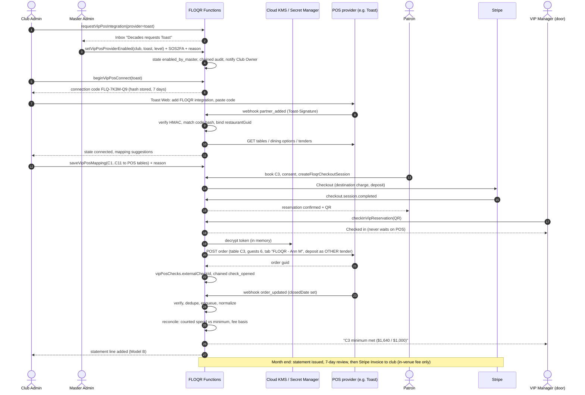

# VIP / Table Reservations — POS integrations (research + design)

Status: **RESEARCH + DESIGN ONLY — nothing built, published or deployed.** No Firestore, Functions, rules, Stripe, Secret Manager or POS-vendor accounts were created or called.
Date: Oct 15 2026 · Companion to `reports/vip-reservations-proposal.md` and `.cursor/rules/design-notes-vip-reservations.mdc` (this file does not edit either) · Resume: `@vip$` / `$vip-tables$`

> Part A holds **facts**, each with a source link (vendor docs read on Oct 15 2026). Part B holds **recommendations** (FLOQR's design). Where a fact is uncertain or only reported by a third party, it says so.
> Not legal advice: every partner-agreement or payments-terms note is a checklist item for counsel.

---

## 0. The short version (for the owner)

**What a POS integration does for a club.** When a patron books table C3 through FLOQR and pays a deposit, the club's bar system (the POS) should know about it. When the party arrives, a tab opens on table C3 in the POS with the deposit already credited, so staff do not charge it twice. At the end of the night, FLOQR reads what the table actually spent, checks it against the table minimum, and, if the club is on the percentage plan (Model B), works out FLOQR's fee from real numbers.

**Top 4 POS systems to connect first (US nightclubs / lounges):**

| # | POS | One-line reason |
|---|---|---|
| 1 | **Toast** | Runs on about half of US bars that show their tech (48%). Its API can open a tab on a specific table and push "check closed" events. Partner approval and a signed agreement are required. |
| 2 | **Square (for Restaurants)** | #2 in bars. The API is fully open: any developer can start today and each club approves access with one click. The catch: its public API **cannot open a tab on a table**, so FLOQR can only read closed checks. |
| 3 | **SpotOn** | #3 in bars, sold hard to bars and nightclubs. It has a dedicated **Reservations API**: seating a FLOQR reservation opens a POS ticket on the table, and every change to that ticket is pushed to FLOQR. Partner-only, with certification and a 5–10 venue pilot. |
| 4 | **Clover** | Largest small-restaurant footprint in the US (20% per Baird). The API is open after app approval and can create open orders and record an outside payment. Weaker fit for tables: orders do not appear on Clover Dining's table map. |

Runners-up, supported later or on request: **Lightspeed Restaurant (K-Series)** (very good reservation API, small US footprint, partner-only) and **Oracle MICROS Simphony** (hotel and casino nightclubs, enterprise partner program). Venues on any other POS get the **Generic** path from day one: CSV export, a manual end-of-night close-out form, and signed webhooks for Zapier-style tools.

**Recommended order.**
- **Build first: the shared adapter framework, the Generic fallback, then Square.** Square needs no approval, so FLOQR can prove the whole loop (connect, map tables, read closed checks, reconcile, fee statement) in Square's sandbox right away.
- **Apply first: Toast and SpotOn, on day one.** Their approval queues are the longest lead time, and Toast is where most DC clubs will be. Toast becomes the second adapter the moment sandbox credentials arrive.
- **Faster Toast pilot:** a beta club already on Toast can ask its Toast rep for a "custom integration" naming FloqMedia as its technology partner (§A3.1).

**Owner actions** (only the owner can do these; details in §B9):
1. Ask each beta venue (Decades, Lima Twist, Heist, Zebbies, Aurelia) which POS they run.
2. Apply to the **Toast Integration Partner** program.
3. Submit the **SpotOn Partner Integration Intake Form**.
4. Open a **Square Developer** account and a **Clover Global Developer** account under FloqMedia.
5. Have counsel review each vendor's partner or developer terms, especially **payment clauses that may conflict with FLOQR collecting deposits through Stripe** (§A4.2).

---

# Part A — Facts (with sources)

## A1. Which POS systems US bars and nightclubs actually run

| Source (date) | What it measured | Result |
|---|---|---|
| Baird, reported by Payments Dive (Jan 2026) [S1] | Card-processing POS share in US restaurants *outside the top 250 chains* (~75% of the market) | **Clover 20%** (175k locations) · **Toast 17%** (145k) · **Square 13%** · Global Payments 11%. NCR Voyix and Oracle MICROS named as the other heavyweights (mostly enterprise) |
| RestaurantTools.ai bar scan (Sep 2026) [S2] | 2,904 US bars whose public website exposes their tech | **Toast 48.1%** · Square 9.0% · SpotOn 4.6% · Clover 1.4% (plus OpenTable 25.9% / Resy 13.1% reservation tools) |
| RestaurantTools.ai restaurant scan (Sep 2026) [S3] | 8,962 US restaurants with detectable tech | Toast 41.8% · Square 17.4% · SpotOn 3.6% · Clover 3.1% · Lightspeed 0.03% |
| POSAdvice "Best POS for bars and nightclubs 2026" [S4] | Editorial ranking | Toast #1 for bars and nightclubs; Square budget; Lightspeed "nightclubs"; Revel multi-location; Clover full-service bars |
| TablelistPro (nightlife reservation platform) [S5] | POS systems a nightlife booking tool chose to integrate | Toast, Billfold, NCR Aloha, Micros 3700, **Micros Simphony**, CBS NorthStar, Brink, Maitre'D |
| SevenRooms (reservations + CRM, nightlife edition) [S6][S7] | POS integrations advertised | Toast, **Square** (Square: "seat a reservation and have checks automatically created", "self-updating table statuses") |

Caveats:
- The website scans only detect a POS that leaks onto a public site (online ordering, gift cards). Nightclubs often run no online ordering, so the scans undercount them.
- Baird measures card processing, not nightlife fit.
- **No public DC-specific nightclub POS data was found.** That is why owner action 1 (ask the venues) matters.

Nightlife reservation platforms (SevenRooms, UrVenue, TablelistPro, Fourvenues, Discotech) are **FLOQR's competitors**, not POS systems. Ticketing marketplaces (Eventbrite, Dice, Shotgun, Tixr) sell tickets and are not bar POS. Both groups are out of scope for "connect to the POS" [S5][S8].

## A2. Picking the top 4 — scoring

| Candidate | US bar share signal | Nightlife fit | Can open a tab on a POS table via API | Closed-check data for minimum spend | API access |
|---|---|---|---|---|---|
| **Toast** | Highest (48% bars; 17% small restaurants) | Strong (pre-auth tabs, handhelds, offline) | **Yes** (order with `table` GUID) | Yes (orders webhook) | Partner program + signed agreement; or a club's own "custom integration" |
| **Square** | #2 bars (9%); 13% small restaurants | Good for small and mid venues | **No** (public API cannot assign tables) | Yes (paid orders) | **Open**: self-serve OAuth, sandbox |
| **SpotOn** | #3 bars (4.6%) | Strong (bar tabs, incremental auth, handhelds) | **Yes** (Seat Reservation opens a ticket) | Yes (full ticket snapshot webhooks) | Partner-only; certification + 5–10 venue pilot |
| **Clover** | 20% small restaurants; 1.4% bars | Medium | Partial (open order on Orders/Register, **not** Dining tables) | Yes | Open after developer-account and app approval |
| Lightspeed K-Series | Very low US signal | Good (upscale, nightclubs) | Yes (reservation seat opens a table order) | Yes | Partner-only, or a paid merchant add-on |
| Oracle MICROS Simphony | Enterprise, hotels and casinos (Vegas-style clubs, hotel rooftops) | Strong at large venues | Yes (STS Gen2 checks + tables) | Yes | Customer-created API account; Oracle PartnerNetwork for a validated listing |
| NCR Aloha / Voyix | Legacy enterprise | Medium | Via NCR enterprise APIs | Yes | Enterprise partner program (not researched in depth) |
| TouchBistro, Revel | Small signals | Medium | Not researched in depth | — | Partner programs |

**Determination: Toast, Square, SpotOn, Clover.** They are the four with real US bar and lounge share in both independent datasets. Two of them (Toast, SpotOn) are the best functional fit for opening a tab on a table. Two (Square, Clover) are open enough to build without waiting for a partnership. Lightspeed and Simphony sit next in line because of their nightlife and hotel-club fit, not their US share.

## A3. Provider fact sheets

### A3.1 Toast

| Topic | Fact | Source |
|---|---|---|
| API type | REST/JSON; outbound "integration APIs" Toast calls on you (tender, loyalty, gift card); **webhooks** | [T1] |
| Integration types | **Partner** (tech provider, many restaurants) · **Custom** (a Toast customer's own developers *or trusted technology partner*; read **and write**, including `POST /orders`) · **Standard API access** (read-only, bought by the restaurant in Toast Shop) · Analytics API | [T1][T2] |
| Auth | API client `clientId` + `clientSecret` → `POST /authentication/v1/authentication/login` → Bearer token (example `expiresIn: 86400`, i.e. 24 h). Every call sends `Toast-Restaurant-External-ID: <location GUID>`. **Not per-merchant OAuth**: a restaurant grants a partner access by adding the integration in **Toast Web → Integrations / My Integrations**, which fires a `partner_added` webhook | [T3][T4] |
| Linking a location to FLOQR | The `partner_added` / `partner_updated` payload carries `externalRestaurantRef` and `externalGroupRef`, values **the restaurant administrator types in** when configuring the partner connection. FLOQR can give the club a one-time connection code to paste there | [T4] |
| Reservations | "**Toast does not have a reservation API.**" Read-write reservation integrations `POST /orders/v2/orders` **at check-in** with `diningOption` (DINE_IN), `revenueCenter`, **`table` GUID** (from config `/tables`), `numberOfGuests`, `tabName` (`{Partner} - {First} {Last initial}`), optional `server`, optional `appliedServiceCharges`. Config must be polled once per location per day | [T5] |
| Deposits | "If your system collects deposits… you must communicate this… so that the guest is not asked to repay their deposit amount. **You must use the Toast Payments API to authorize the payment.**" Coordinate a deposit-tracking menu item. The same page's example applies the deposit as `payments: [{type: "OTHER", amount, otherPayment: {guid: <alternative payment type>}}]` | [T5] |
| Scopes (reservation integration) | `config:read`, `menus:read`, `orders.channel:read`, `orders:read`, `orders.orders:write` (read-write only), `restaurants:read`, optional `labor:read` / `labor.employees:read`. Scopes are assigned by Toast based on the certified use case | [T5][T6] |
| Webhooks | `orders` → `order_updated` / `channel_order_updated` with the **full order JSON** on every change (incl. `closedDate`); `partners` → `partner_added` / `partner_removed` / `partner_updated`. Subscriptions are created in the developer portal / by Toast support | [T7][T4][T8] |
| Webhook security | `Toast-Signature` = Base64(HMAC-SHA256(secret, body + timestamp)); the secret is unique per subscription per environment. Toast says IP allowlisting is not proof | [T9] |
| Rate limits | 20 req/s and 10,000 req / 15 min per location (global and default API); `GET /menus` 1 req/s per location; `GET /ordersBulk` 5 req/s per location; account-level limits for large integrators; 429 + `Retry-After`. Toast recommends the orders webhook over polling | [T10] |
| Menu / bottles | Menus API (V2 for non-ordering partners), config API (menu groups, items, service charges, alternative payment types), Stock API | [T1][T6] |
| Partner process | Apply (accept API Documentation License Agreement → emailed application form) → discovery → **approval by Toast compliance, privacy, security and legal + signed partner agreement** → sandbox credentials → certification call → alpha / beta pilot → GA. "High volume of applications"; no timeline published | [T11][T12] |
| Costs | Not published; set in the partner agreement. A 2019 report put it at a **30% ongoing revenue share** on joint customers (historical, third-party). Restaurants generally need a **Restaurant Management suite** subscription to use integrations | [T13][T14] |
| Data / PCI | Order payloads can include guest info (separate scope) and payment details. The Credit cards (`ccpartner`) API authorizes cards, which would put FLOQR in card-data scope | [T1][T6] |

### A3.2 Square (Square for Restaurants)

| Topic | Fact | Source |
|---|---|---|
| API type | REST/JSON (`connect.squareup.com/v2`), versioned by `Square-Version` header; webhooks | [Q1] |
| Auth | **OAuth 2.0 per seller** (code flow for server apps; PKCE for public clients). Auth codes expire in 5 min. **Access tokens expire after 30 days**; code-flow refresh tokens do not expire until access is revoked. Marketplace requirement: refresh asynchronously every 7–14 days | [Q1][Q4] |
| Approval | **None needed to build or connect sellers.** Any developer creates an app, gets sandbox test accounts, and sellers authorize via OAuth. App Marketplace *listing* needs ≥ 5 active sellers, and in Sep 2026 Square paused marketplace onboarding for developers without a Square Partnerships contact. That pause does not affect API access | [Q1][Q5][Q6] |
| Sandbox | Yes (`squareupsandbox.com`), separate credentials and tokens | [Q1] |
| Tables / open tabs | Square staff (Aug 2026): the public API "**does not support direct interaction with the floor plan, sections, tables, and seats**"; unpaid orders created through the API do not appear reliably on Restaurant POS ("can't recommend building on it today"). POS-created orders become visible to the API **once paid**. `ticket_name` set via API does not show on the POS | [Q2][Q3][Q7] |
| External deposit | `EXTERNAL` payment type can pay down an **API-created** order. It does not attach to a POS-created ticket | [Q8] |
| Closed checks | Orders API (search / retrieve) + webhooks (`order.*`, `payment.*`) for paid orders; Customers API for guest profiles; Catalog API for menu / bottles | [Q1] |
| Webhook security | `x-square-hmacsha256-signature` = HMAC-SHA256 over **notification URL + raw body** with the subscription's signature key; constant-time compare. Subscribe to `oauth.authorization.revoked` | [Q9][Q1] |
| Rate limits | No fixed numbers published; apps must use exponential backoff on rate-limit errors (marketplace requirement) | [Q4] |
| Costs | No API fee for this use (Square charges processing fees on payments it processes; FLOQR's deposits go through Stripe) | [Q1] |
| Note | SevenRooms advertises "seat a reservation and have checks automatically created" on Square [S7], which suggests deeper partner capabilities than the public API. Ask Square Partnerships | — |

### A3.3 SpotOn

| Topic | Fact | Source |
|---|---|---|
| Openness | "Does SpotOn have an open API? **No.**" Developers submit the **Partner Integration Intake Form** to be considered as a Preferred Integration Partner; "does not guarantee an integration, partnership, or timeline" | [P1][P2] |
| API type | REST "Central API" (CAPI) + webhooks | [P3] |
| Auth | "Sign In With SpotOn" OAuth 2; scopes assigned per integration agreement (`reservation:all:write`, `reservation:all:read`, `menu:all:read`, `reporting:orders:read`, `order:submit:write`, `loyalty:*`, `labor:all:read`, `business:all:read`). User tokens 1 h (no refresh); **service tokens 24 h**. **US-only**, may block non-US traffic | [P4] |
| Reservations | **Activate Location** once (SpotOn location `BL-XXXX-XXXX-XXXX` ↔ your `external_restaurant_id`, fixed mapping) → **List Tables** (`id`, `name`) → **Seat Reservation** (`external_reservation_id`, `party_size`, `scheduled_time`, `customer` first name + phone, optional table names, server, notes, flags like `VIP`) → Reseat / Change Party Size / Unseat / Cancel. Statuses Seated / Unseated / Cancelled / Completed | [P3] |
| Ticket events | "When you seat a reservation… SpotOn **opens a POS ticket** against it and delivers a webhook (`EVENT_CATEGORY_FOH`) **every time the ticket changes** — items added, payments recorded, **ticket closed**. Each event is a full snapshot" | [P3] |
| Deposits | Applying an outside prepaid deposit to the ticket is **not described** in the public reservation docs. Ask SpotOn during intake | [P3] |
| Webhook security | `X-Spoton-Webhook-Signature` = lowercase hex HMAC-SHA256 of the raw body, key = Base64-decoded `signature_key`; version header `v1`; 5xx is retried | [P5] |
| Rate limits | 50 req/s and 1,500 req/min per API, per partner | [P6] |
| Certification | Live demo of scenarios → certified → **pilot with 5–10 merchants** → GA | [P7] |
| Costs | Not published | — |

### A3.4 Clover (Fiserv)

| Topic | Fact | Source |
|---|---|---|
| API type | REST v3 (`/v3/merchants/{mId}/…`); webhooks; Android SDK for on-device apps | [C1] |
| Auth | OAuth 2 **v2 flow with expiring tokens**: `/oauth/v2/authorize` → `/oauth/v2/token` → `/oauth/v2/refresh`. Access tokens are short-lived; refresh tokens are **single-use and also expire**; active refresh tokens per merchant are capped. Merchants install the app from the **Clover App Market** | [C2][C3] |
| Approval | An approved **production developer account per region**, plus app approval. Production calls must use OAuth tokens (merchant API tokens are sandbox-only); `externalId` record-keeping is required | [C4] |
| Sandbox | Yes (`apisandbox.dev.clover.com`) | [C5] |
| Open orders | Orders created with `state: "open"` show in the merchant's **Orders and Register** apps. They are **not compatible with Clover Dining** ("private data schema for table mapping and guest seating") | [C5][C6] |
| External deposit | `POST /orders/{orderId}/payments` with a merchant `tenderId` "references external tenders and logs them for bookkeeping"; a custom tender is another option | [C7][C6] |
| Webhooks | HTTPS callback; each event type needs the matching read permission (merchant must reinstall to pick up new permissions); verification via a static **`X-Clover-Auth`** code (a shared token, **not** a per-message HMAC); must answer 200 within seconds | [C8][C3] |
| Rate limits | 50 req/s per app, 16 req/s per token; concurrent 10 per app, 5 per token; 429 → wait ≥ 1 s then exponential backoff | [C9] |
| Costs / terms | App Market: Clover keeps a **30% transaction fee** on app revenue billed through Clover (developer gets 70%). Monetization doc: "All app fees, merchant app usage payments, and **merchant-customer payment processing must be implemented within the Fiserv or Clover platforms**" | [C10][C11] |

### A3.5 Runners-up (short)

| | Lightspeed Restaurant K-Series | Oracle MICROS Simphony |
|---|---|---|
| API | REST; OAuth 2 authorization code; scopes `orders-api`, `financial-api`, `reservation-{platform-code}`, `items`, `offline-access` [L1] | STS Gen2 REST: `POST /api/v1/checks` (with `tenders`), `POST /checks/{ref}/round`, config API for **tables**, menu, tenders, service charges; idempotency id per request [M1][M2] |
| Reservations | "Reservations for Platforms": create a platform profile (webhook URLs + webhook auth), activate per business location, send a reservation with status `SEATED` → **"an order will be opened in the POS on the specified table"** + order webhooks [L2][L3] | Create a check on a revenue center and table; apply a tender of type `payment` [M1][M3] |
| Access | Developer Portal **only for approved partners**; merchants can buy custom API access through their account manager; production needs a validation demo [L4][L5] | The **customer** creates a "Simphony Transaction Services" API account in Reporting & Analytics; auth = OpenID Connect with PKCE. Validated marketplace listing needs Oracle PartnerNetwork enrollment + Simphony Integrations Program + validation testing [M4][M5] |

## A4. Cross-cutting facts that shape the design

### A4.1 Who can put a FLOQR reservation onto a POS table

| Capability | Toast | Square | SpotOn | Clover |
|---|---|---|---|---|
| Read the POS table list (for mapping) | Yes (config `/tables`) | **No** | Yes (List Tables) | **No** (Dining schema private) |
| Open a tab/check on a table at check-in | **Yes** | **No** | **Yes** (Seat Reservation) | Partial (open order, no table) |
| Credit FLOQR's deposit on that check | Yes as "other" payment type (Toast's text says deposits must go through Toast Payments: negotiate) | No (POS tickets) | Undocumented: ask | Yes as external tender (terms risk, §A4.2) |
| Match the closed check to the reservation automatically | Yes (FLOQR created the order) | No: semi-automatic or manual | Yes (`external_reservation_id`) | Yes if FLOQR created the order |
| Closed-check totals pushed to FLOQR | Webhook | Webhook (paid orders) | Webhook (full snapshot) | Webhook (IDs only, then fetch) |
| Webhook authenticity | HMAC-SHA256 | HMAC-SHA256 | HMAC-SHA256 | Static shared code |
| Per-club connect | Club adds FLOQR in Toast Web (+ connection code) | OAuth | OAuth ("Sign In With SpotOn") + activate | OAuth via App Market install |

### A4.2 Payments-terms conflict (counsel must review)

FLOQR's proposal collects deposits with **Stripe Connect** (proposal §11). Two vendors' own words lean toward deposits going through *their* payment rails:

- **Toast:** "You must use the Toast Payments API to authorize the payment" for reservation deposits [T5]. Its own example also shows an `OTHER` alternative payment type, which is how an outside prepaid deposit would normally be recorded.
- **Clover:** "merchant-customer payment processing must be implemented within the Fiserv or Clover platforms" (in the context of paid apps) [C10].

Using Toast's card API would also pull FLOQR into card-data (PCI) scope, which the proposal avoids today (SAQ A via Stripe Checkout). **This is the first question to settle in partner talks.** Square has no such restriction (`EXTERNAL` payments are documented). SpotOn's terms are not public.

---

# Part B — Recommendations and design

## B1. What "connected" means: capability levels

Each club connection runs at the highest level its POS supports. The UI shows the level in plain words.

| Level | Name | What happens | Toast | Square | SpotOn | Clover | Generic |
|---|---|---|---|---|---|---|---|
| **L0** | Manual | CSV export for the door; VIP Manager types the final check total at close-out | ✔ | ✔ | ✔ | ✔ | ✔ |
| **L1** | Read & reconcile | FLOQR receives closed checks and matches them to reservations (auto or one-tap manual link) → minimum-spend status + fee basis | ✔ | ✔ (manual or semi link) | ✔ | ✔ | ✔ (inbound webhook / CSV import) |
| **L2** | Open the tab | At door check-in FLOQR opens the check on the mapped POS table, with party size and tab name | ✔ | — | ✔ | ◐ (no table) | ◐ (outbound webhook to the club's middleware) |
| **L3** | Deposit on the tab | The deposit appears as a paid tender on that check, so the guest is never charged twice | ◐ (pending Toast terms) | — | ◐ (ask SpotOn) | ◐ (pending Clover terms) | — |
| **L4** | Catalog | Bottle/package menu synced from the POS into section packages (`includes[]`) | ✔ | ✔ | ✔ | ✔ | — |

**POS is optional for VIP certification.** A club can go live at L0. A POS connection at L1 or higher is required only if the club chooses **Model B with a fee on in-venue spend** (proposal open question §20 Q4), because that fee needs trustworthy totals.

## B2. Architecture

### B2.1 Provider adapters (Cloud Functions, us-central1)

```
functions/
  pos/
    pos-core.js              // state machine, normalization, reconciliation math, fee calc (pure, unit-tested)
    pos-credentials.js       // KMS envelope encrypt/decrypt, Secret Manager reads; only module that sees tokens
    pos-webhook-verify.js    // per-provider signature checks, constant-time compare, replay/idempotency
    pos-functions.js         // callables, HTTP endpoints, schedules, task queue (wires adapters to Firestore)
    posAdapters/
      toast.js  square.js  spoton.js  clover.js  generic.js
      lightspeed.js  simphony.js      // later, same contract
```

Every adapter exports the same contract. The core never branches on provider names; it reads `capabilities`.

```js
module.exports = {
  id: "toast",
  connectType: "partnerGrant",            // "oauth" | "partnerGrant" | "apiAccount" | "none"
  capabilities: { readTables: true, openCheck: true, depositTender: "pendingTerms",
                  closedCheckWebhook: true, menuSync: true, customerProfiles: false },
  hosts: ["ws-api.toasttab.com", "ws-sandbox-api.eng.toasttab.com"], // egress allowlist (exact hosts confirmed at build)
  buildAuthorizeUrl(ctx), exchangeCode(ctx, code), refresh(ctx), revoke(ctx),
  verifyWebhook(rawBody, headers, secret),        // → { ok, eventId, externalLocationId }
  normalizeWebhook(body),                         // → [{ kind: "check.updated"|"check.closed"|"connection.removed"|..., externalCheckId }]
  listTables(ctx), listTenders(ctx), listDiningOptions(ctx), listMenu(ctx),
  openCheck(ctx, reservation, mapping),           // → { externalCheckId }
  applyDeposit(ctx, externalCheckId, deposit),
  getCheck(ctx, externalCheckId),                 // → NormalizedCheck
  listClosedChecks(ctx, { fromMs, toMs })         // nightly safety net for missed webhooks
};
```

`NormalizedCheck` (the only shape the rest of FLOQR sees): `externalCheckId`, `externalTableId`, `status` `open|closed|voided`, `openedAtMs`, `closedAtMs`, `guestCount`, `currency`, `subtotalCents`, `discountCents`, `serviceChargeCents`, `taxCents`, `tipCents`, `totalCents`, `depositAppliedCents`, `paidCents`, `lineItems[] {name, qty, amountCents, category}` (no guest PII, no card data), `rawSha256` (hash of the provider payload, kept as evidence).

### B2.2 Firestore data (all Functions-write)

| Collection | Key fields | Class. | Read |
|---|---|---|---|
| `vipPosProviders/{provider}` | `programStatus` `notApplied|applied|sandbox|certifying|pilot|live`, `IsProviderEnabled` 0\|1 (platform kill switch), `capabilities`, `webhookHealth {lastEventAtMs, sigFailures24h}`, `revision` | I | Master Admin |
| `vipPosConnections/{clubId}` | `provider`, `state` (§B2.3), `capabilityLevel` L0–L4, `enabledProviders[]` (set by Master Admin), `externalLocationId` (Toast GUID / Square location / SpotOn `BL-…` / Clover mId), `externalMerchantId`, `scopesGranted[]`, `credentialRef` (pointer only), `settings {diningOptionId, revenueCenterId, depositTenderId, serviceChargeId, tabNameTemplate, autoOpenAtCheckIn 0|1}`, `mappingComplete` 0\|1, `lastSyncAtMs`, `lastWebhookAtMs`, `lastError {code, atMs, userMessage}`, `IsPosConnected` 0\|1, `revision` | CC | club manager + VIP staff (no credential fields exist here) + Master Admin |
| `vipPosCredentials/{clubId}` | `kmsKeyVersion`, `ciphertext` (access/refresh tokens or API-account secret, envelope-encrypted), `expiresAtMs`, `rotatedAtMs` | **S** | **nobody** (rules deny all; Functions only) |
| `vipPosMappings/{clubId}__{planVersion}` | `{sectionId: {externalTableId, externalTableName, matchedBy "auto|manual", byUid}}` | CC | club staff + Master Admin |
| `vipPosCatalog/{clubId}` | bottle/package items `{externalItemId, name, priceCents, category}` | CC (P only for items the club publishes in a package) | club staff |
| `vipPosChecks/{reservationId}` | `externalCheckId`, `linkMethod` `auto|semi|manual|generic`, `linkedByUid`, `NormalizedCheck` fields, `minimumSpendCents`, `countedSpendCents`, `minimumMet` 0\|1, `shortfallCents`, `feeBasisCents`, `feeCents`, `reconciledAtMs`, `disputed` 0\|1 | CC (finance) | club staff + Master Admin; patron sees only "minimum met" on their receipt |
| `vipPosUnmatchedChecks/{clubId}__{night}__{externalCheckId}` | closed checks on mapped tables with no reservation link (for one-tap linking) | CC | VIP staff |
| `vipPosStatements/{clubId}__{yyyymm}` | lines (reservation, check, fee basis, fee), totals, `state` `draft|issued|disputed|final`, `stripeInvoiceId` | CC (finance, 7 y) | club owner/admin + Master Admin |
| `vipPosWebhookEvents/{provider}_{eventId}` | `receivedAtMs`, `clubId`, `kind`, `payloadSha256`, `rawPayload` (30-day TTL), `status` `queued|processed|ignored|failed` | I | Master Admin |
| `vipPosSyncRuns/{autoId}` | job type, club, counts, duration, outcome, error | I | Master Admin + club (own) |
| `vipPosOAuthStates/{sha256(state)}` | `clubId`, `uid`, `provider`, `codeVerifier` (encrypted), `expiresAtMs` (10 min), `used` 0\|1 | S | nobody |

Each collection needs a row in the data-classification register (the existing test enforces this). Rules follow the proposal's rule: **clients read, Functions write**.

### B2.3 Connection state machine

```mermaid
stateDiagram-v2
  [*] --> disconnected
  disconnected --> requested: Club Admin requests provider (picker + note)
  disconnected --> enabled_by_master: Master Admin enables proactively
  requested --> enabled_by_master: Master Admin enables provider for club (SOS2FA + reason + chain)
  requested --> disconnected: Master Admin declines (reason)
  enabled_by_master --> oauth_pending: Club Admin presses Connect (OAuth) / gets Toast connection code
  oauth_pending --> connected: token exchange OK / Toast partner_added with matching code
  oauth_pending --> enabled_by_master: abandoned (state expired 10 min) or denied at provider
  connected --> connected: mapping saved / settings changed (revision++)
  connected --> error: token refresh fails, 401/403, repeated webhook signature failures, location removed
  error --> connected: auto-retry or Test connection succeeds
  error --> oauth_pending: Club Admin reconnects
  connected --> revoked: Club Admin disconnects / revoked in POS (oauth.authorization.revoked, partner_removed) / Master Admin suspends
  error --> revoked
  revoked --> enabled_by_master: reconnect allowed (provider still enabled)
  revoked --> disconnected: Master Admin removes provider; credentials destroyed
```



Rules:
- Only the server changes `state`. Every transition is a chained `vip.pos.*` audit event.
- `connected` does not mean "ready". The FLOQR side is ready when `mappingComplete=1` (every bookable section mapped or explicitly marked "not on POS"); until then, auto-open at check-in stays off.
- Revocation is immediate. Credentials are destroyed (KMS ciphertext deleted, OAuth revoke called where the provider has one), and future outbound calls are refused. Reservations and reconciled history stay.

### B2.4 Enable → connect flows by connection type

| Type | Providers | Club Admin experience | Server |
|---|---|---|---|
| `oauth` | Square, Clover, SpotOn, Lightspeed | **Connect Square** → provider login and consent → back to Club Admin → "Connected ✓, now map your tables" | `beginVipPosConnect` → signed `state` (32 random bytes, only SHA-256 stored, 10 min, single use, bound to club + uid) + PKCE where supported → HTTP `vipPosOAuthCallback` → `exchangeCode` → encrypt → `connected`. SpotOn additionally calls **Activate Location** with `external_restaurant_id = clubId` |
| `partnerGrant` | Toast | FLOQR shows a one-time **connection code** (e.g. `FLQ-7K3M-Q9`) and steps: Toast Web → Integrations → find FLOQR → Add → paste code into the partner reference field | `partner_added` webhook → verify signature → look up code hash in `externalRestaurantRef` → bind `restaurantGuid` → `connected`. A code is valid 7 days and single use |
| `apiAccount` | Simphony, Toast **custom integration** | Club's POS admin creates the API account / custom credentials, then types them into a FLOQR form (never email) | Form posts straight to `saveVipPosApiAccount` → KMS encrypt → Test connection → `connected` |
| `none` | Generic | Choose CSV / manual / webhook options | Per-club webhook secret generated (shown once) |

The OAuth redirect URI must be registered on **both** the current Functions URL and the future canonical host (`https://www.floqr.com/…` via a Hosting rewrite) per the cutover rule. The return page link is built with the single canonical-origin helper (`admin.html?tab=vip&sub=integrations`, no `v`).

### B2.5 Secrets and tokens

- **App-level secrets** (one per provider: Square app secret, Toast client secret, Clover app secret, SpotOn client secret, each webhook signing key) live in **Secret Manager** via `defineSecret(...)`, as `STRIPE_WEBHOOK_SECRET` does in `functions/commerce-functions.js` today. Proposed names: `POS_TOAST_CLIENT_SECRET`, `POS_TOAST_WEBHOOK_SECRET_ORDERS`, `POS_TOAST_WEBHOOK_SECRET_PARTNERS`, `POS_SQUARE_APP_SECRET`, `POS_SQUARE_WEBHOOK_KEY`, `POS_CLOVER_APP_SECRET`, `POS_CLOVER_WEBHOOK_AUTH`, `POS_SPOTON_CLIENT_SECRET`, `POS_SPOTON_WEBHOOK_KEY`.
- **Per-club tokens** rotate often. Clover refresh tokens are single-use; Square refreshes weekly. Writing a new Secret Manager version on every refresh would pile up versions and cost. So per-club tokens use **Cloud KMS envelope encryption**: a data key encrypts the token, KMS key `pos-token-kek` (HSM optional) wraps the data key, and the ciphertext sits in `vipPosCredentials` (rules deny all clients). Only `pos-credentials.js` decrypts, in memory, per call.
- Long-lived **club-typed credentials** (Simphony API account, Toast custom-integration client secret) may alternatively get a per-club Secret Manager secret `pos-{provider}-{clubId}` if the owner prefers. Either way, plaintext never touches Firestore.
- Credentials are never returned to any client, never logged (`redactSecrets`), and never shown again after entry.

### B2.6 Webhook receivers

One HTTP function per provider (`vipPosWebhookToast`, `vipPosWebhookSquare`, `vipPosWebhookSpotOn`, `vipPosWebhookClover`, `vipPosWebhookGeneric`), each doing:

1. Read `req.rawBody` and verify the signature with a **constant-time** compare: Toast (body + timestamp, Base64), Square (URL + body, Base64), SpotOn (body, lowercase hex), Generic (per-club HMAC + timestamp ≤ 5 min). Clover only sends a static `X-Clover-Auth`, so FLOQR also **never trusts Clover payload values** and re-fetches the object by ID from the API.
2. **Idempotency**: create `vipPosWebhookEvents/{provider}_{eventId}` in a transaction. An existing doc means a duplicate: return 200 and stop. Event IDs: Toast `guid`, Square `event_id`, SpotOn delivery id, Clover = SHA-256 of payload.
3. Return **200 fast**, then enqueue processing on a Cloud Tasks queue (`onTaskDispatched`, retries with backoff, per-provider rate config matching §A3).
4. The worker maps `externalLocationId` → club. Unknown location → `ignored`. It normalizes the payload, updates `vipPosChecks` / `vipPosUnmatchedChecks`, and runs reconciliation when a check closes.
5. Signature failures are logged unchained and throttled (same pattern as denials today) and count toward `webhookHealth.sigFailures24h`. A spike raises an alert.

### B2.7 Sync jobs

| Job | Schedule | What |
|---|---|---|
| `vipPosConfigSync` | daily per connected club (Toast asks for daily config polling) + on demand | tables, dining options, revenue centers, tenders, service charges → refresh mapping suggestions; flag mapped tables that disappeared |
| `vipPosCatalogSync` | daily + menu webhooks where offered | bottles / packages for L4 |
| `vipPosTokenRefresh` | Square every 7 days; Clover just-in-time before expiry; Toast/SpotOn token cache refreshed before 24 h; Lightspeed via `offline-access` | failure → `error` + Club Admin Inbox |
| `vipPosNightReconcile` | each club's night close + grace (e.g. 6 am local) | `listClosedChecks` for the night to catch missed webhooks; build the unmatched list; nudge the VIP Manager |
| `vipPosHealthCheck` | hourly | last webhook age vs. expected activity on open nights; token expiry horizon; error counts → Master Admin alert |
| `vipPosRetentionSweep` | daily (only after owner go-ahead, like other retention sweeps) | §B2.10 |

### B2.8 Section ↔ table mapping

- FLOQR sections come from the published floor plan (`vipSections`, labels printed exactly, e.g. Decades `C1`–`C11`, Lima Twist `101`…`BAR2`). POS tables come from `listTables`.
- **Auto-suggest** by normalized label (`C3` ↔ `C3`, `Table C3`, `T-C3`, `c 3`) with a confidence badge. The admin confirms each suggestion; nothing is silently mapped.
- One FLOQR section can map to several POS tables (a VIP area buyout), and a section can be marked **"Not on POS"**.
- Mappings are stored per **floor-plan version**. Publishing a new plan carries matching labels forward and flags new or renamed sections as unmapped.
- **Square and Clover** cannot list tables. Mapping there is a free-text "POS table name" for staff reference only, and check linking uses §B2.9 (semi or manual).

### B2.9 Linking a closed check to a reservation

| Method | When | How |
|---|---|---|
| **auto** | Toast, SpotOn, Clover L2 (FLOQR created the check) | FLOQR stores `externalCheckId` when it opens the check; the close event matches directly |
| **semi** | Square / any POS where staff opened the tab | FLOQR suggests closed checks on the night where (a) the customer attached in the POS is the patron FLOQR synced to the seller's Customers list, or (b) the tab/ticket name contains the reservation code (`FQ-4821`), or (c) time window + amount ≥ deposit. A VIP Manager confirms with one tap |
| **manual** | anything left over | VIP Manager → reservation → **Link check** → pick from tonight's unmatched closed checks |
| **generic** | Generic | inbound webhook carries `reservationId`; CSV import matches the reservation-code column; or the close-out form |

Every link records `linkMethod` + `linkedByUid` and writes a chained `vip.pos.check_linked` event (money depends on it).

### B2.10 Minimum-spend reconciliation and fees (ties to billing Model B)

When a linked check closes:

```
countedSpend = subtotal − discounts (+ serviceCharges if club policy counts them)   // tax and tips excluded by default
minimumMet   = countedSpend ≥ minimumSpendCents
shortfall    = max(0, minimumSpendCents − countedSpend)       // club settles on its own terminal per its Terms
feeBasis     = per agreement: depositOnly | countedSpend | totalExTip
feeCents     = round(feeBasis × feeBps / 10000)
```

- **Deposits** (money through Stripe) keep using `application_fee_amount` on the charge, exactly as the proposal (§11) says. Nothing changes.
- **In-venue spend** (money through the club's POS) never touches Stripe, so FLOQR cannot take an application fee on it. If the owner wants a percentage of it, the fee goes on a **monthly statement** (`vipPosStatements`). After a 7-day club review window, the statement is billed as a **Stripe Invoice** to the club's Stripe customer (the same customer used for the Model A subscription).
- Each statement line shows reservation, section, night, POS check number, counted spend, fee basis and fee. The club can **dispute a line**, which pauses it, notifies the Master Admin, and requires a reason on both sides.
- **Provenance tiers.** Lines from `auto` / `semi` links are high trust. `manual` / `generic` lines are marked "club-reported". The owner decides whether club-reported lines count toward the fee or are fee-exempt (open question).
- The agreement defines the basis. "What counts toward the minimum and toward the fee" goes into the VIP Subscription Agreement and the club's patron Terms clause 3 (proposal §17), so counsel must approve.

### B2.11 Failure handling and alerts

| Failure | Behavior | Who is told |
|---|---|---|
| Open-check call fails at door check-in | Check-in **always succeeds** in FLOQR (the door never waits on the POS); task retries ×5 with backoff; then badge "Open the tab manually on the POS — table C3, party 6, deposit $500 paid" | VIP Manager on the door screen |
| Token refresh fails / 401 | `error`; outbound calls paused; reconnect banner | Club Admin Inbox + email; Master Admin dashboard |
| Webhooks stop on an open night | health check flags "no POS events since 23:10"; nightly reconcile backfills | Master Admin alert; Club Admin banner |
| Signature failures spike | requests rejected; alert on threshold | Master Admin |
| Provider outage or 429 | queue holds, honours `Retry-After`; global per-provider kill switch | Master Admin |
| Table deleted in POS | mapping row flagged; auto-open disabled for that section | Club Admin |
| Duplicate / out-of-order events | idempotency doc + `closedAtMs` / version compare; last-writer-wins only for newer snapshots | — |

### B2.12 Disconnect and revoke

- Club Admin **Disconnect** opens `FLOQRReasonPrompt`, then calls the provider's revoke (Square/Clover OAuth revoke; Toast/SpotOn: the club removes FLOQR in their POS, and the help text says how). FLOQR deletes the credential ciphertext and moves to `revoked`. Mappings and history stay, so reconnecting does not redo the mapping.
- Provider-side revocation (`oauth.authorization.revoked`, `partner_removed`) does the same automatically and notifies the Club Owner.
- Master Admin **Suspend** does the same with SOS2FA + reason + passkey step-up (★, money-adjacent), and notifies the club owner.

### B2.13 Data classification, retention, logging

| Data | Keep | Then | Why |
|---|---|---|---|
| Raw webhook payloads | **30 days** | delete; keep `payloadSha256` | debugging only; minimization (GDPR Art. 5(1)(c), CPRA) |
| Normalized check totals + links + statements | **7 years** | delete | financial records (same as proposal §10.2 finance row) |
| Guest names coming from the POS (tab names, customer names) | **not stored**: stripped at normalization; FLOQR already has its own reservation PII under the 24-month rule | — | minimization |
| Card data (last4, brand, auth codes) | **never stored**: stripped at normalization | — | keeps FLOQR out of PCI scope (SAQ A unchanged) |
| Credentials | until disconnect | crypto-delete | NIST SC-12/SC-28; ISO 27001 A.8.24 |
| Connection state changes, mappings, links, statements, enable/suspend | 7 years in `vipAuditLogs` chain | per chain policy | ISO 27001 A.8.15; NIST AU-2/3/9/10/11, CM-3 |
| Per-event webhook log, sync runs | 13 months | aggregate | NIST AU-6 review; abuse investigation |

**Chained audit events** (state changes only; webhook traffic stays unchained, like denials today): `vip.pos.requested`, `vip.pos.provider_enabled|disabled`, `vip.pos.connect_started`, `vip.pos.connected`, `vip.pos.settings_changed`, `vip.pos.mapping_changed`, `vip.pos.check_opened`, `vip.pos.check_linked`, `vip.pos.reconciled`, `vip.pos.statement_issued|disputed|finalized`, `vip.pos.error`, `vip.pos.revoked`, `vip.pos.suspended`, `vip.pos.test_run`, `vip.pos.kill_switch`. Master Admin actions on a club's POS connection notify the Club Owner, the same transparency rule as the proposal's §3.6.

**Security checklist (built into the design):**
- HMAC verification with constant-time compare.
- Outbound egress **allowlist** of provider hosts (prevents SSRF). Generic outbound webhooks only to `https` URLs that do not resolve to private or link-local IPs.
- Least-privilege scopes per provider.
- App Check enforced on callables (not on webhooks or OAuth callbacks).
- `assertFeatureAccess("vipReservations")` + club-manager checks on Club Admin callables; SOS2FA + reason on Master Admin callables.
- CSV exports neutralize formula injection (prefix `'` on cells starting with `= + - @`).
- Rate-limit inbound generic webhooks per club.

## B3. End-to-end sequence



For **Square**, steps 8–12 become OAuth (Connect → consent → callback). Steps 21–25 (opening the tab) do not exist; the VIP Manager links the closed check in one tap (§B2.9).
For **SpotOn**, step 22 is **Seat Reservation**, and ticket snapshots arrive as `EVENT_CATEGORY_FOH` webhooks.

## B4. Generic fallback (any other POS)

| Option | What the club does | FLOQR side |
|---|---|---|
| **Door CSV** | Download tonight's list before doors open | `exportVipPosCsv({night})`: section label, mapped POS table name, lead guest (first name + last initial), party, deposit paid, reservation code. Logged export; formula-safe |
| **Close-out form** | VIP Manager types POS check number + subtotal / tax / tip per table at night's end | `recordVipPosCloseout`; marked *club-reported*; Club Admin approves within 48 h; editable with reason until the statement is issued |
| **Closed-checks CSV import** | Upload the POS's sales export (most POS systems export CSV) | Column-mapping wizard (saved per club); matches on reservation code or table + time window; preview before commit |
| **Outbound webhooks** | Point Zapier / Make / their own middleware at FLOQR events | `reservation.confirmed|changed|cancelled|checked_in|no_show` POSTed with `X-Floqr-Signature` = HMAC-SHA256(per-club secret, timestamp + "." + body), `X-Floqr-Timestamp`, `X-Floqr-Event-Id` (idempotency); retries with backoff; per-club delivery log |
| **Inbound "check closed" webhook** | Their middleware posts totals back | `vipPosWebhookGeneric` with the same signing scheme; schema `{reservationCode, externalCheckId, subtotalCents, discountCents, serviceChargeCents, taxCents, tipCents, totalCents, closedAt}`; strict validation; *club-reported* unless the owner grants a club "trusted integration" status |

## B5. UX

### B5.1 Master Admin — Features & Services → VIP Reservations → **POS Integrations**

The panel is SOS2FA-gated like the rest of the VIP panel. Every write goes through `FLOQRReasonPrompt` and the chained audit, with the club owner notified.

1. **Providers** (platform):
   - One row per provider: program status (Not applied → Applied → Sandbox → Certifying → Pilot → Live), "App credentials configured" yes/no (values never shown), webhook health (last event, signature failures 24 h), connected clubs count.
   - **Kill switch** per provider (pauses all outbound calls and auto-open; ★ passkey step-up).
2. **Clubs** (table on PC; label/value cards ≤ 900 px):
   - Columns: club · requested provider · state chip · level · mapping x/y · last webhook · errors 24 h.
   - Actions: **Enable provider** (provider picker + allowed level checkboxes L1–L4) · **Test connection** (read-only call: location name + table count) · **Resync** · **Suspend** ★ · **View logs** · **Open club view** (read-only mirror of what the Club Admin sees, so both can look at the same screen on a call).
3. **Integration checklist** (shared with the club; this is how Master Admin "works with the club admin"):
   - Per club, an ordered list with an owner per step: *Club confirms POS* → *Master Admin enables* → *Club connects* → *Club maps tables* → *Test booking opens a tab* → *First night reconciled* → *Signed POS Data Authorization* (§B8) → *Done*.
   - Each step has a status and a comment thread delivered as Inbox messages (`type: vipPosIntegration`, CTA **Open integration** → `admin.html?tab=vip&sub=integrations` on the Club Admin side, `master-admin.html?…` on the Master Admin side; no `v`).
4. **Logs**: per-club sync runs + webhook events (status, kind, hash, error), filters, CSV export (logged).

### B5.2 Club Admin — VIP Reservations → **Integrations** subtab

The subtab is shown through `FLOQRTabGates` when the club's VIP subscription is at least `applied`.

- **Empty state:** "Which POS runs your bar?" with Toast · Square · SpotOn · Clover · Lightspeed · Oracle MICROS · Other → **Request integration**. Choosing *Other* opens Generic options immediately.
- **Waiting for FLOQR:** checklist + "FLOQR will enable this for you; you'll get an Inbox message."
- **Connect:** Square / Clover / SpotOn → **Connect** button (OAuth). Toast → connection code + 4 illustrated steps for Toast Web.
- **Settings:**
  - Dining option, revenue center, deposit tender ("FLOQR Deposit"), service charge (optional), tab name template (`FLOQR - {first} {lastInitial}`).
  - **Open the tab automatically at check-in** on/off (off until mapping is complete).
- **Table mapping:** two columns (FLOQR section as printed ↔ POS table dropdown), suggestion badges, "Not on POS", unmapped warning, plan-version selector. Phone layout: one card per section.
- **Health:** status chip, last event, last matched check, **Test connection**, recent errors in plain words ("Toast says FLOQR was removed from your account on Oct 20 — reconnect?").
- **Reconciliation:** tonight's tables (linked / unlinked / minimum met); monthly statement (Model B) with **Dispute line** (reason prompt).
- **Disconnect** (reason prompt + plain explanation of what stops and what is kept).

### B5.3 VIP Manager — `vip-door.html`

- After check-in, a small status line appears: **"Tab open on POS · Table C3"**, or **"Open the tab manually"** with the details to type.
- End-of-night **Unmatched checks** list with one-tap **Link**. Generic clubs get a **Close-out** form.
- The patron's receipt in My Profile shows only "Table minimum met ✓" (or the shortfall settled at the venue), never POS line items unless the club opts in.

### B5.4 Help topics (FloqAi repository + `?` via `FLOQRHelpAttach`)

English during beta; tier B translation later (`vip-reservations-translation-incomplete.mdc`).

| Id | Audience | Topic |
|---|---|---|
| `help-vip-pos-overview` | venueAdmin | What connecting your POS does; levels L0–L4 |
| `help-vip-pos-connect-toast` | venueAdmin | Adding FLOQR in Toast Web with your connection code |
| `help-vip-pos-connect-square` | venueAdmin | Connecting Square; why tabs are linked, not opened |
| `help-vip-pos-connect-spoton` | venueAdmin | Connecting SpotOn |
| `help-vip-pos-connect-clover` | venueAdmin | Installing FLOQR from the Clover App Market |
| `help-vip-pos-table-mapping` | venueAdmin | Matching sections to POS tables; plan versions |
| `help-vip-pos-deposits-on-tab` | venueAdmin | How the deposit shows on the tab; never charge twice |
| `help-vip-pos-reconciliation` | venueAdmin | Minimum spend, statements, disputing a line |
| `help-vip-pos-generic` | venueAdmin | CSV, close-out form, webhooks for other POS systems |
| `help-vip-pos-disconnect` | venueAdmin | Disconnecting and what is kept |
| `help-vip-door-pos-tabs` | serviceMember (VIP Manager) | Tab status at the door; linking checks at close |
| `help-master-vip-pos` | masterAdmin | Enabling providers, kill switch, logs, checklist |

FloqAi phrases: "connect my POS", "Toast integration", "link Square", "SpotOn", "Clover app", "table minimum tracking", "bottle service minimum", "POS tab", "reconcile minimum spend", "POS not syncing".

## B6. Callables and endpoints (additions to proposal §8)

| Name | Kind | Who | Gate |
|---|---|---|---|
| `requestVipPosIntegration({clubLocationId, provider, note})` | onCall | Club Admin | club manager + feature access |
| `setVipPosProviderEnabled({clubLocationId, provider, levels, enabled, reason})` | onCall | Master Admin | SOS2FA + reason + chain |
| `beginVipPosConnect({clubLocationId})` | onCall | Club Admin | state `enabled_by_master` |
| `vipPosOAuthCallback` | onRequest | provider redirect | signed single-use state |
| `saveVipPosApiAccount({clubLocationId, fields})` | onCall | Club Admin | apiAccount providers only |
| `listVipPosExternalTables` / `listVipPosTenders` | onCall | Club Admin | connected |
| `saveVipPosSettings({…, reason})` / `saveVipPosMapping({planVersion, mappings, reason})` | onCall | Club Admin | connected |
| `testVipPosConnection({clubLocationId})` | onCall | Club Admin, Master Admin | read-only |
| `resyncVipPos({clubLocationId, what})` | onCall | Master Admin, Club Admin | throttled |
| `linkVipPosCheck({reservationId, externalCheckId})` | onCall | VIP Manager / Club Admin | `isVipStaff` |
| `recordVipPosCloseout({reservationId, totals, posCheckNo})` | onCall | VIP Manager | Generic / fallback |
| `importVipPosChecksCsv({uploadId, columnMap})` | onCall | Club Admin | Generic |
| `exportVipPosCsv({night})` | onCall | VIP staff | logged |
| `disputeVipPosStatementLine({statementId, lineId, reason})` | onCall | Club Owner / Admin | review window |
| `issueVipPosStatement` / `finalizeVipPosStatement` | schedule + onCall | system / Master Admin | chain |
| `disconnectVipPos({clubLocationId, reason})` / `suspendVipPos({…, reason})` ★ | onCall | Club Admin / Master Admin | reason / SOS2FA + passkey |
| `setVipPosKillSwitch({provider, on, reason})` ★ | onCall | Master Admin | SOS2FA + passkey |
| `vipPosWebhook{Toast,Square,SpotOn,Clover,Generic}` | onRequest | providers / club middleware | signature |
| `vipPosOutbound` | onTaskDispatched | system | per-provider rate |
| `vipPosConfigSync`, `vipPosCatalogSync`, `vipPosTokenRefresh`, `vipPosNightReconcile`, `vipPosHealthCheck`, `vipPosRetentionSweep` | onSchedule | system | — |

## B7. Phasing and effort

POS work starts **after proposal Phase 2 (Booking MVP)**, because it needs reservations and check-in to exist. It can run in parallel with proposal Phases 3–5. The estimates use the same basis as the proposal: one agent-led developer, tests included (TDD, ≥ 80% on new modules).

| Phase | Scope | Effort | Calendar dependency |
|---|---|---|---|
| **POS-0 Framework + Generic** | adapter contract, `pos-core` (normalize, reconcile, fee math), KMS credentials, webhook verify + idempotency + task queue, state machine, Master Admin POS panel + checklist, Club Admin Integrations tab, mapping UI, CSV export / close-out / CSV import / signed webhooks, statements | **3–4 wks** | none |
| **POS-1 Square** | OAuth, Customers sync for semi-linking, orders/payments webhooks, closed-check linking, catalog | **1.5–2 wks** | none (self-serve sandbox) |
| **POS-2 Toast** | partner-grant connect, config sync, open check at check-in, deposit tender (per agreed terms), orders + partners webhooks, certification fixes | **2–3 wks** build | **Toast approval + signed agreement** (unknown, plan for months); certification + pilot |
| **POS-3 SpotOn** | OAuth + Activate Location, Seat/Reseat/Cancel, FOH webhooks | **2 wks** build | intake acceptance; certification; **5–10 venue pilot** |
| **POS-4 Clover** | App Market app (OAuth v2, expiring tokens), open order + external tender, webhooks with re-fetch | **1.5–2 wks** | production developer-account + app approval; terms review |
| Later | Lightspeed, Simphony adapters | ~2 wks each | partner / customer API accounts |

Total for the top 4 + Generic: **~10–13 engineering weeks**, plus vendor approval time that FLOQR does not control.

**Why Square first to build, Toast first to apply:**
- Square lets FLOQR ship and test POS-0 for real, with OAuth, signed webhooks, linking, reconciliation and statements, without waiting on anyone.
- Toast is where the business is (about half of bars), but no code can run against Toast until it approves FloqMedia, so the application must start on day one.
- If a beta venue runs Toast, the **custom-integration** path (the club asks its Toast rep for API credentials for its trusted technology partner) can pilot L1–L2 at that one venue before the partnership is signed. Confirm with Toast that this is allowed for a vendor serving many clubs.
- If the beta venues turn out to run SpotOn or Clover, swap the order. The framework does not change.

## B8. Legal workflow tie-in

Two new document types are proposed for the proposal's `legalDocuments` machine (§9.2):
- `posPartnerAgreement` (scope `platform`): FloqMedia ↔ Toast / SpotOn partner agreements, which are signed contracts. Square's and Clover's developer terms are click-through but are still filed as versions so counsel has the exact text. Each records the payment-rail clause decision (§A4.2), revenue-share terms, data-use limits, and termination effects (what happens to clubs' connections).
- `posDataAuthorization` (scope `club`, Club Owner signs): the club authorizes FLOQR to read check totals for the mapped tables, defines the fee basis for in-venue spend (if any), the dispute window, and data retention. It is **required before `capabilityLevel ≥ L1` counts toward fees**, and is listed in the integration checklist.

Partner agreements may also bring obligations FLOQR must reflect: security questionnaires (Toast compliance/privacy/security review), data-use restrictions, and pilot commitments (SpotOn 5–10 merchants). Counsel should map each clause to a control in this design.

## B9. Owner actions

| # | Action | Why / note |
|---|---|---|
| 1 | **Survey the beta venues' POS** (Decades, Lima Twist, Heist, Zebbies, Aurelia): system, plan (Toast Restaurant Management suite? SpotOn plan?), who administers it | Decides build order and whether the Toast custom-integration pilot applies |
| 2 | **Apply: Toast Integration Partner** at the Integration Partner Application page (accept the API Documentation License Agreement → complete the emailed form) under FloqMedia | Longest lead time; needs a signed agreement and Toast compliance/legal approval [T11][T12] |
| 3 | **Apply: SpotOn Partner Integration Intake Form** | Partner-only; certification + 5–10 venue pilot [P1][P7] |
| 4 | **Create a Square Developer account** (free) under FloqMedia; optionally ask for a Square Partnerships contact (marketplace listing + whether table-level reservation capabilities like SevenRooms' exist) | Enables POS-1 immediately [Q1][Q6] |
| 5 | **Create a Clover Global Developer account** and request production developer-account approval (US) | App approval needed before any live merchant [C4] |
| 6 | **Counsel review** of Toast / SpotOn partner agreements and the Square / Clover developer terms, especially: deposits through Stripe vs. Toast Payments / Clover-Fiserv processing clauses; revenue share (Toast historically 30%; Clover 30% on App Market billing); data-use limits | §A4.2 |
| 7 | **Decide the in-venue fee question** (proposal §20 Q4): is there a % on POS-reported spend at all? Basis (subtotal pre-tax/pre-tip recommended)? Do club-reported (manual) lines count? | Drives statements and `posDataAuthorization` |
| 8 | Approve GCP items: Cloud KMS key `pos-token-kek`, Secret Manager secrets, Cloud Tasks queue (small monthly cost) | Infrastructure |
| 9 | Later, on demand: Lightspeed partner application; Oracle PartnerNetwork enrollment for Simphony (needed only for a validated listing; a single venue can create an API account without it) | Hotel/casino clubs |

## B10. Risks

| Risk | Impact | Mitigation |
|---|---|---|
| Partner approval delays or rejection (Toast, SpotOn) | No L2/L3 for most clubs | Apply day one; Square + Generic first; Toast custom-integration pilot; L0/L1 always available |
| Payment-rail clauses (Toast Payments, Clover/Fiserv) | Deposit-on-tab (L3) blocked, or the Stripe model must change | Raise first in partner talks; L1 reconciliation works without L3; worst case the deposit is noted in the tab name/notes and staff apply it manually |
| Square cannot place tabs on tables | More manual linking at Square clubs | Semi-automatic matching (customer + reservation code); one-tap link; ask Square Partnerships |
| Clover webhooks only carry a static auth code | Spoofed events | Never trust payload values; always re-fetch by ID |
| Wrong check linked → wrong fee | Club disputes, trust loss | Link method recorded; manual links chained; 7-day statement review; dispute flow |
| Token leakage | Access to a club's POS | KMS envelope encryption, no client access, minimal scopes, revoke on disconnect, redaction |
| Webhook gaps on busy nights | Missed reconciliation | Nightly backfill (`listClosedChecks`), health alerts |
| Vendor API changes / rate limits | Breakage | Adapter isolation, per-provider kill switch, backoff + queue, contract tests per adapter |
| Partner revenue share | Margin | Price POS-level features into the plan; counsel negotiates |
| Club staff never map tables | No auto-open | Checklist step owned by Club Admin; Master Admin nudges; auto-suggest |

## B11. Open questions

1. Which POS do the five beta venues run? (owner action 1)
2. In-venue spend fee: yes/no, basis, club-reported lines? (owner action 7)
3. If Toast insists deposits go through Toast Payments, is it acceptable for Toast clubs to stay at L1/L2 (no deposit on the tab)?
4. Should the patron ever see POS line items (itemized receipt), or only "minimum met"? (default: only the status)
5. Per-club Secret Manager secrets vs. KMS envelope encryption for long-lived credentials (default: KMS for all per-club tokens)?
6. Should Lightspeed or Simphony jump the queue if a target venue (e.g., a hotel rooftop lounge) needs it?

## B12. How this wires into the proposal (for whoever edits it next)

This file deliberately does not edit the proposal. Suggested touch points:
- **Proposal §3.4:** add subtab 10 "Integrations".
- **§3.5:** door tab status + unmatched checks.
- **§3.6:** "POS Integrations" in the Master Admin VIP panel.
- **§6:** collections in §B2.2.
- **§8:** callables in §B6.
- **§9.1 certification:** POS is optional; `posDataAuthorization` is needed only for in-venue fees.
- **§10:** retention rows in §B2.13.
- **§11.1:** in-venue fee via monthly Stripe Invoice.
- **§15:** help ids in §B5.4.
- **§18:** POS phases after Phase 2.
- **§20:** questions in §B11.
- **§21:** risks in §B10.

---

## Sources

Market
- [S1] Payments Dive, "Toast, Clover battle for small eateries" (Baird, Jan 2026): https://www.paymentsdive.com/news/toast-clover-battle-for-small-eateries/809108/
- [S2] RestaurantTools.ai, "Best POS for Bars in 2026: What 16,346 Bars Actually Run": https://restauranttools.ai/blog/best-pos-for-bars-2026
- [S3] RestaurantTools.ai, "Restaurant Technology Statistics 2026": https://restauranttools.ai/blog/restaurant-technology-statistics-2026
- [S4] POSAdvice, "Best POS for Bars and Nightclubs 2026": https://posadvice.com/best-pos-systems-bars-nightclubs-2026/
- [S5] TablelistPro, "Nightclub Reservation Software" (POS integrations list): https://www.tablelistpro.com/nightclub-reservation-software
- [S6] SevenRooms Nightlife: https://sevenrooms.com/nightclubs-bars/
- [S7] SevenRooms + Square: https://sevenrooms.com/partner/square/
- [S8] TablelistPro, "Best Nightclub Software in 2026": https://www.tablelistpro.com/blog/best-nightclub-software

Toast
- [T1] API overview: https://doc.toasttab.com/doc/devguide/apiOverview.html
- [T2] Integration types: https://doc.toasttab.com/doc/devguide/apiIntegrationTypes.html
- [T3] Submitting your first order (auth, headers): https://doc.toasttab.com/doc/devguide/apiOrdersFirstOrder.html
- [T4] Partners webhook: https://doc.toasttab.com/doc/devguide/apiPartnersWebhook.html
- [T5] Building a reservation integration: https://doc.toasttab.com/doc/cookbook/apiIntegrationChecklistReservation.html
- [T6] Scopes: https://doc.toasttab.com/doc/devguide/apiScopes.html
- [T7] Orders webhook: https://doc.toasttab.com/doc/devguide/devOrdersWebhookRef.html
- [T8] Webhook basics / developer portal: https://doc.toasttab.com/doc/devguide/apiWebhookBasics.html · https://doc.toasttab.com/doc/devguide/apiDeveloperPortal.html
- [T9] Message signing: https://doc.toasttab.com/doc/devguide/apiMessageSigning.html
- [T10] Rate limiting: https://doc.toasttab.com/doc/devguide/apiRateLimiting.html
- [T11] Integration partnership process: https://doc.toasttab.com/doc/devguide/integrationDevProcess.html
- [T12] Become a Toast Integration Partner: https://support.toasttab.com/en/article/Customer-Requesting-API-Credentials
- [T13] Reforming Retail (2019, third-party, historical revenue share): https://reformingretail.com/index.php/2019/07/16/as-we-predicted-toast-has-greatly-increased-their-pos-integration-fees/
- [T14] Toast Partner Connect setup (Restaurant Management suite): https://support.toasttab.com/article/Toast-Partner-Connect-Setting-Up-Integrations-with-Toast

Square
- [Q1] OAuth API overview: https://developer.squareup.com/docs/oauth-api/overview
- [Q2] Forum (Square staff): tables/floor plan not supported, unpaid API orders not shown: https://developer.squareup.com/forums/t/inquiry-regarding-adding-unpaid-order-to-table-getting-floor-section-tables-information/21815
- [Q3] Forum (Square staff, Aug 2026): open-ticket workflow not supported: https://developer.squareup.com/forums/t/create-open-order-open-ticket-from-api/27237/3
- [Q4] App Marketplace requirements changelog (backoff, 7–14 day refresh): https://developer.squareup.com/docs/changelog/requirements/change-log/2024-08-23
- [Q5] Forum: minimum 5 sellers for listing: https://developer.squareup.com/forums/t/app-does-not-meet-the-minimum-seller-count-requirement-to-submit/21729
- [Q6] Forum (Sep 2026): marketplace onboarding paused without a Partnerships contact: https://developer.squareup.com/forums/t/square-app-marketplace-integration-review-timeline/27453
- [Q7] Forum: `ticket_name` not shown on POS: https://developer.squareup.com/forums/t/where-does-order-ticket-name-appear-on-the-pos/18856
- [Q8] Forum: EXTERNAL payments on API orders: https://developer.squareup.com/forums/t/seeking-clarity-on-the-orders-api/11882
- [Q9] Validate webhook notifications: https://developer.squareup.com/docs/webhooks/step3validate

SpotOn
- [P1] Integrations FAQ ("no open API"): https://www.spoton.com/integrations/
- [P2] Developer center / intake form: https://www.spoton.com/developer-center/
- [P3] Reservations overview: https://developers.spoton.com/central-api/docs/reservations-overview
- [P4] SpotOn OAuth integration guide: https://developers.spoton.com/central-api/docs/spoton-oauth-integration-guide
- [P5] Webhook delivery and signatures: https://developers.spoton.com/central-api/reference/webhookevent_delivery-1
- [P6] Rate limiting: https://developers.spoton.com/central-api/docs/rate-limiting
- [P7] Certification process: https://developers.spoton.com/central-api/docs/certification-process

Clover
- [C1] Clover developer docs home: https://docs.clover.com/dev/docs
- [C2] OAuth flow overview: https://docs.clover.com/dev/docs/oauth-flows-in-clover
- [C3] OAuth and tokens FAQs: https://docs.clover.com/dev/docs/oauth-and-tokens-faqs
- [C4] App approval: https://docs.clover.com/dev/docs/approval
- [C5] Create custom orders: https://docs.clover.com/dev/docs/creating-custom-orders
- [C6] Orders FAQs (Dining incompatibility, external payments): https://docs.clover.com/dev/docs/orders-faqs
- [C7] Create a payment record on an order: https://docs.clover.com/dev/reference/ordercreatepaymentfororder
- [C8] Use webhooks: https://docs.clover.com/dev/docs/webhooks
- [C9] API usage and rate limits: https://docs.clover.com/dev/docs/api-usage-rate-limits
- [C10] Monetize your apps: https://docs.clover.com/dev/docs/monetizing-your-apps
- [C11] Clover developer agreement (§9 transaction fee): https://www.clover.com/developer-agreement

Lightspeed / Oracle
- [L1] K-Series authentication and scopes: https://api-docs.lsk.lightspeed.app/authentication
- [L2] Reservation platform setup: https://api-portal.lsk.lightspeed.app/guides/integration-guides/reservations/reservations-setup
- [L3] Platform profile (webhook auth): https://api-docs.lsk.lightspeed.app/operation/operation-reservation-servicesetbyplatformcode
- [L4] Developer portal (approved partners only): https://api-portal.lsk.lightspeed.app/guides/tutorials/developer-portal
- [L5] Custom integrations (paid merchant add-on): https://api-portal.lsk.lightspeed.app/quick-start/custom-integrations
- [M1] Simphony STS Gen2: post a new check: https://docs.oracle.com/en/industries/food-beverage/simphony/omsstsg2api/op-api-v1-checks-post.html
- [M2] STS Gen2 REST endpoints (tables, tenders, configuration): https://docs.oracle.com/en/industries/food-beverage/simphony/omsstsg2api/rest-endpoints.html
- [M3] STS Gen2 tender collection: https://docs.oracle.com/en/industries/food-beverage/simphony/omsstsg2api/op-api-v1-tenders-collection-get.html
- [M4] STS Gen2 authentication: https://docs.oracle.com/en/industries/food-beverage/simphony/omsstsg2api/authenticate.html
- [M5] Oracle Simphony integration partners (OPN + validation): https://www.oracle.com/food-beverage/restaurant-pos-systems/pos-integrations/partners/
