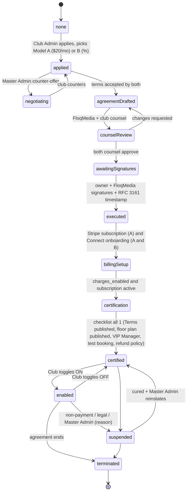
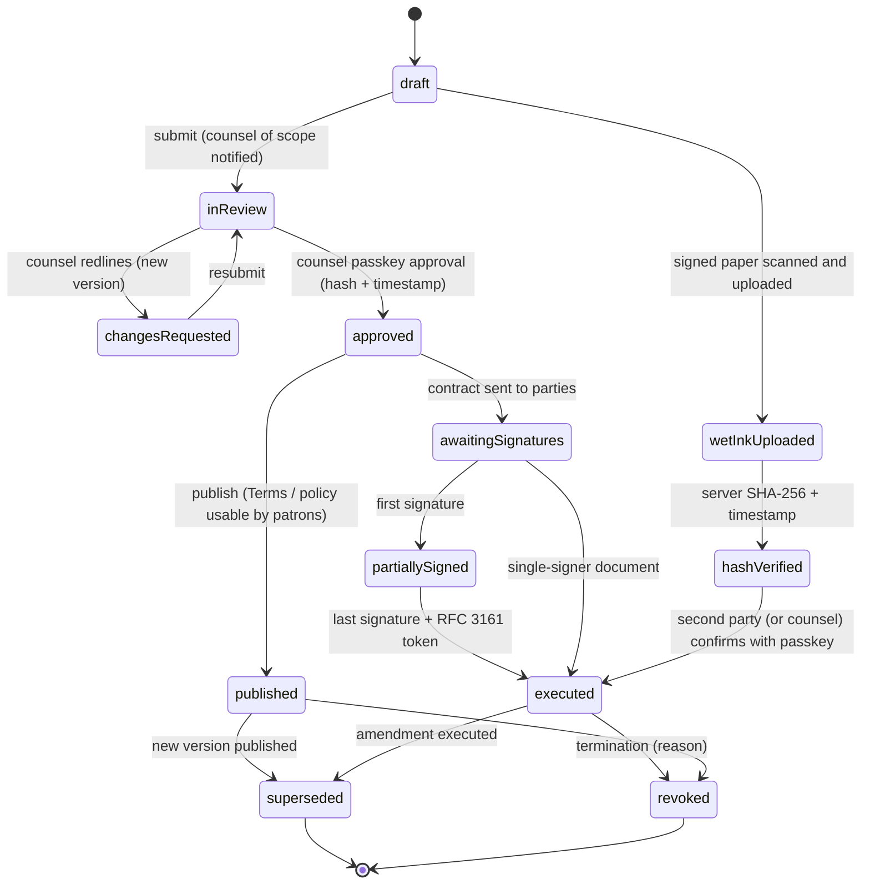
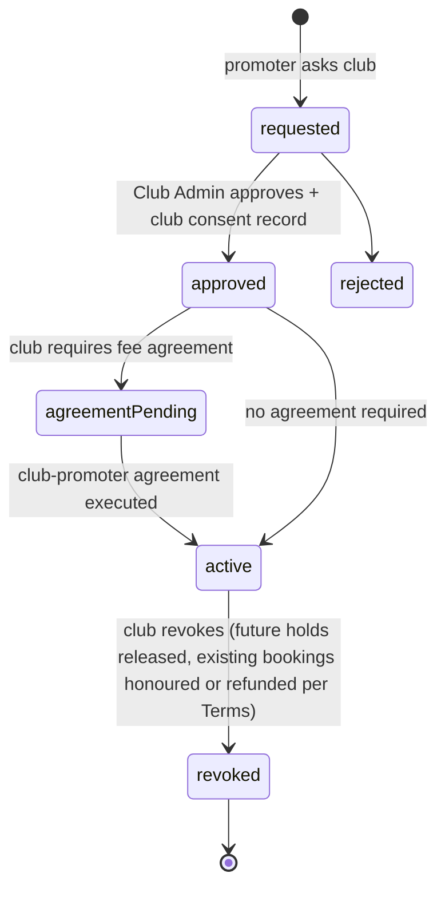
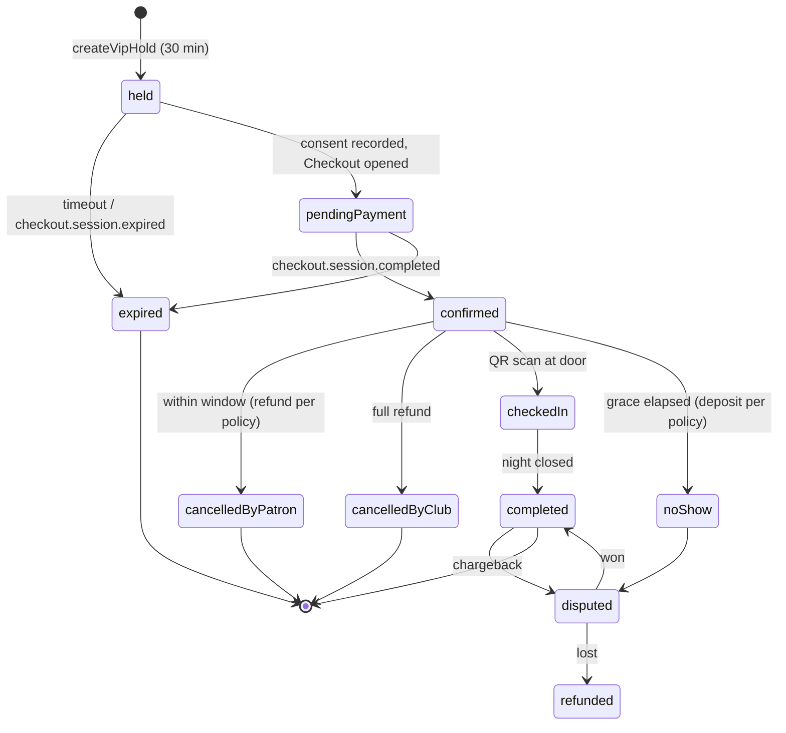
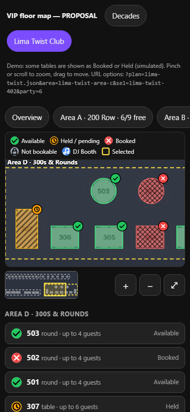
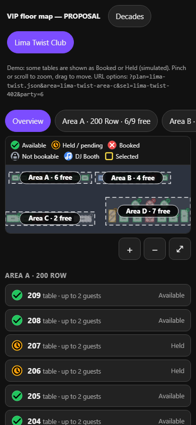
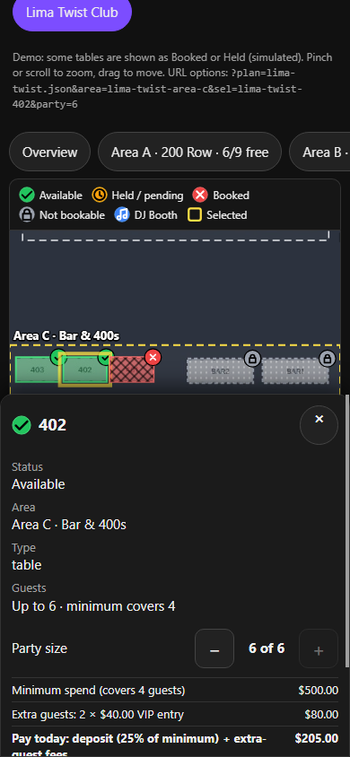
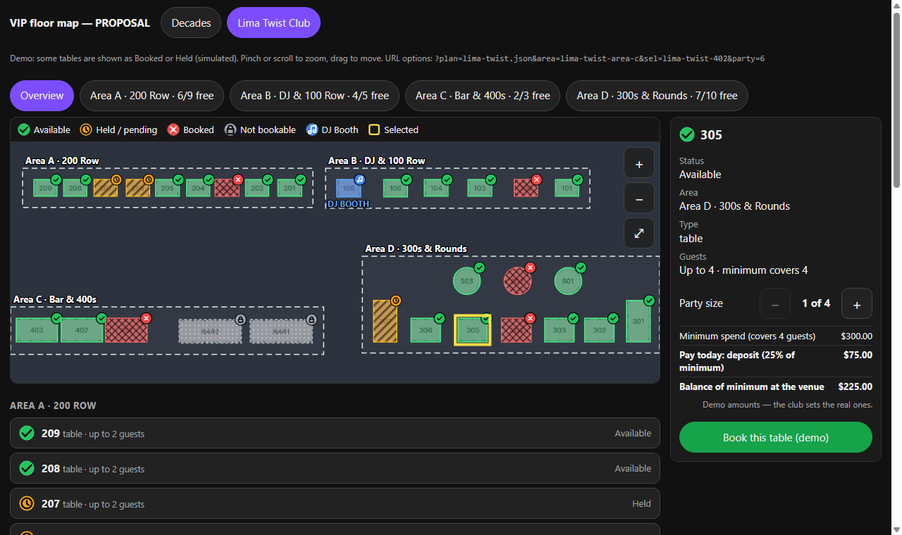
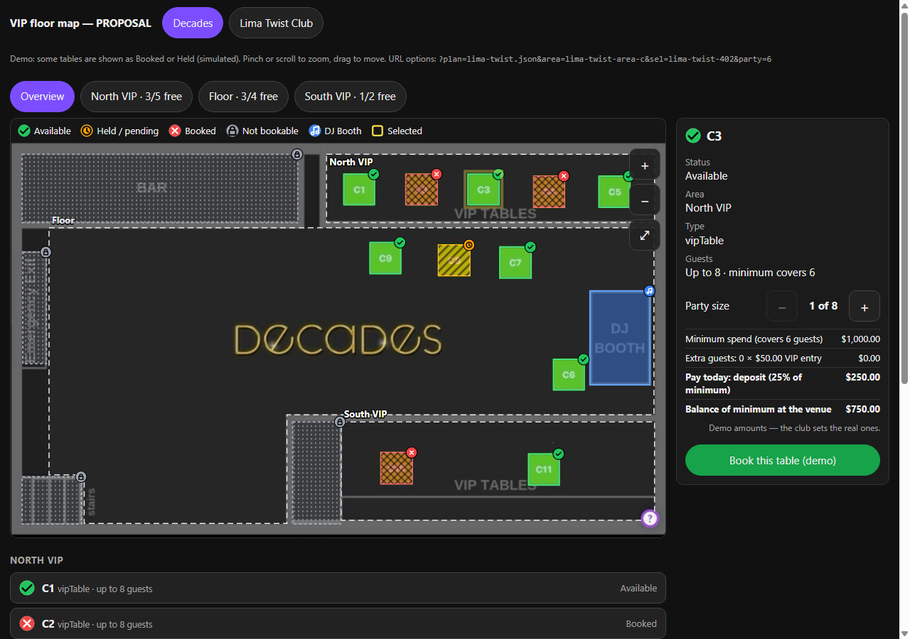
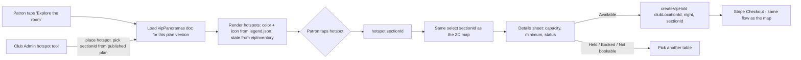

# VIP / Table Reservations — design proposal (beta)

Status: **PROPOSAL — awaiting owner approval. Nothing is built, published or deployed.** No Firestore, Functions, rules or Stripe changes were made.
Date: Oct 15 2026 · Workspace package at writing: s3.1.42 · Resume: `@vip$` / `$vip-tables$`
Companion files: `reports/vip-floorplans/` (floor-plan JSON + overlay preview), `.cursor/rules/design-notes-vip-reservations.mdc`, `.cursor/rules/vip-reservations-translation-incomplete.mdc`.

**Related documents**

- [`vip-notifications-billing.md`](vip-notifications-billing.md) — notifications, receipts, invoicing and the AR/AP ledger
- [`vip-pos-integrations.md`](vip-pos-integrations.md) — POS integrations (Toast, Square, SpotOn, Clover + generic)
- [`vip-aurelia-demo/`](vip-aurelia-demo/) — Aurelia demo walkthrough (separate work in progress)
- [`vip-floorplans/`](vip-floorplans/) — floor-plan JSON, viewer, screenshots and [`photo-match.md`](vip-floorplans/photo-match.md); ingest procedure `.cursor/rules/vip-floorplan-ingest.mdc`

> Not legal advice. Every legal / compliance statement below is a checklist for the owner's counsel to confirm, not a conclusion.

---

## 1. Executive summary (1 page)

**What it is.** Patrons (and club-approved promoters) book a VIP table, booth or section from the venue's own floor map — the same path as a ShoutOut: sign in → ad splash → venue → **floor map** → pick a section → night / event → party size → accept the venue's Terms → pay a deposit or minimum → confirmation with a QR code for the door. Tables always belong to the club.

**How it ships.** As a **beta feature** `vipReservations` in Master Admin → Features & Services (`IsFeatureEnabled=1`, `IsTestFeature=1`): Search tile only for beta testers granted it, page guard on `vip.html`, and `assertFeatureAccess` on every paid / stateful callable. Nothing new is invented for gating — it reuses the Features & Services matrix, `FLOQRTabGates`, `FLOQRSessionShell`, `FLOQRReasonPrompt`, SOS2FA, and the chained audit pattern.

**Who runs it.**

| Role | One-line duty |
|---|---|
| Club Owner / Club Admin | **Ultimate admin**: subscribes, picks the billing model, signs agreements, uploads floor plans, sets Terms + minimums, appoints VIP Managers, approves promoters |
| VIP Manager (new, per club) | Nightly ops: availability, holds, door check-in, no-shows, refunds within policy |
| Promoter (club-approved + subscribed) | Books tables for their guests at clubs that approved them |
| Club Counsel / FloqMedia Counsel (new) | Draft, review, approve, publish and sign legal documents |
| Master Admin | Administers everything — every access and change SOS2FA-gated, reason-prompted, chained and visible to the club owner |

**Money.** Recommendation: **Stripe Connect is required for any club that takes deposits through FLOQR**, whichever model it picks — patron money goes to the club's connected account (destination charges, already used by FLOQR commerce), never sits in FloqMedia's balance.
- **Model A — $20/month**: Stripe Billing subscription (same pattern as Staff Scheduling), `application_fee_amount = 0`.
- **Model B — % of collected fees**: no subscription; `application_fee_amount = feeBps × amount` on each reservation charge. Master Admin can negotiate `feeBps` per club.
- Promoters subscribe too (Model A by default) and may have fee agreements with FloqMedia and with each club.

**Legal.** No club goes live until a **signed agreement** (subscription model + fees) and **counsel-approved Terms** exist. Signatures: in-app **passkey (WebAuthn) signing** over the document's SHA-256 + an **RFC 3161 trusted timestamp** + the chained audit (beta); an e-sign provider (Dropbox Sign / DocuSign / Adobe) for contracts that need a provider certificate; physical signature upload with hash verification as a fallback. IP is recorded as supporting evidence; location only with explicit opt-in — neither is the signature itself.

**Floor maps.** The two attached maps are already broken down: **Decades = 11 bookable tables (C1–C11) in 3 areas (North VIP, Floor, South VIP), 5 non-bookable elements incl. the DJ BOOTH**; **Lima Twist Club = 27 bookable sections (24 tables + 3 rounds 501–503) in 4 areas (A–D); 106 = DJ BOOTH and BAR1 / BAR2 are not bookable** (owner: bars cannot be booked; Decades BAR likewise). Each section has `maxCapacity`, `includedGuests`, `minimumAmount` and an optional per-guest `extraGuestFee` (VIP entry beyond the included guests). Every floor plan goes through Master Admin processing and club review before it is loaded (always-on ingest procedure `.cursor/rules/vip-floorplan-ingest.mdc`). One shared color legend everywhere: **DJ booth blue, Available green, Booked red**, Held amber, Not bookable grey, Selected yellow outline — always with an icon + pattern + text too. The viewer is phone-first: on a phone you pick an area, then tap tables at ≥ 44 px. Overlays verified pixel-aligned at 390 / 820 / 1280 px (§13). An optional **"Explore the room" 360° view** (Could, after beta) opens the same table booking from photo hotspots (§13.6).

**Effort.** ~13–18 engineering weeks in 6 phases, beta with 2 DC venues after Phase 2 (~6–7 weeks). Translation is last (two tiers), tracked by an always-on INCOMPLETE rule.

**Biggest owner decisions** (full list §20): finish principle 14; merchant of record + Connect for Model A; what "% of collected fees" covers (deposits only vs in-venue spend); deposit vs full prepay default; e-sign provider budget; Master Admin read access to patron PII; `floqr.com` vs `floqr.app` origin for booking links.

---

## 2. Principle coverage map

| # | Owner principle | Where answered |
|---|---|---|
| 1 | Beta via Features & Services | §4.1, §8 |
| 2, 11, 17, 23 | Clubs + promoters subscribe; must subscribe before enable | §9 state machine, §11 Stripe |
| 3 | Club owner ultimate admin; Master Admin changes logged non-repudiably | §5 RBAC, §10 audit |
| 4 | VIP Manager role | §5 |
| 5 | Venue T&C, minimums per section | §3.4, §17 legal checklist |
| 6 | Master Admin page under Services & Features | §3.6 |
| 7, 8 | Encrypted legal papers, lawyer signatures, IP / location, stronger signing | §9.3, §9.4 |
| 9 | Counsel roles publish / transfer / share | §5, §9.2 |
| 10 | Logging per compliance standards | §10 |
| 12, 13 | Floor-plan upload + section tool; the two maps | §13 |
| 14 | Cut-off sentence | §20 Q1 |
| 15, 16 | Public page, club-embed, feed, API keys | §12 |
| 18 | Billing choice, negotiation, certification, document exchange | §9 |
| 19 | Translation last, two tiers | §16 + rule file |
| 20 | Stripe architecture | §11 |
| 21, 22 | Promoter consent + fee agreements | §3.3, §9.5 |
| 24 | Additional capabilities | §19 |

---

## 3. UX flows

All pages follow existing contracts: satellites load `floqr-session-shell.js` (signed-out → general sign-in with `returnTo`, never a Google-only card), `?` help via `FLOQRHelpAttach`, conditional tabs via `FLOQRTabGates`, reasons via `FLOQRReasonPrompt`, Inbox CTAs type-aware, page links never carry `?v=`.

### 3.1 Patron — from Search (like ShoutOut)

1. **Search** → VIP tile (icon: an open book with "VIP" on the cover; `data-feature-key="vipReservations"`, hidden unless `linkState("vipReservations",{surface:"search"}).show`; Beta pill for testers).
2. Signed out → `./?profileRequired=sign-in&returnTo=vip.html…` (Welcome card, every provider).
3. **Ad splash** — same in-app splash header as ShoutOut (FloqMedia house card or the picked venue's header).
4. **Venue picker** — only venues with `vipReservationsEnabled=1` (and not suspended). FloqAi "book a table near me" resolves here.
5. **Night / event** — calendar of open nights (`vipNights`), events overlaid; sold-out nights greyed.
6. **Floor map** — published plan image with the clickable overlay (as in `reports/vip-floorplans/preview.html`). Colors from the shared legend (§13.4): Available green, Held amber, Booked red, Not bookable grey, DJ booth blue, each with an icon + pattern. On phones the map opens on an area, with area chips and ≥ 44 px targets (§13.5). Optional "Explore the room" 360° view (§13.6). **List view** toggle (accessible alternative: every section as a row with label, capacity, minimum).
7. **Section sheet** — label (exact), description, confirmed photos (`photo-match.md`), "Up to {maxCapacity} guests · minimum covers {includedGuests}", minimum spend, extra-guest fee (if any), deposit, what's included (bottle package — Should).
8. **Party size** — a stepper from 1 to `maxCapacity` (the server rejects anything higher), defaulting to `includedGuests`. Fee lines update live:
   - Minimum spend (covers N guests) …… $X
   - Extra guests: k × $fee VIP entry …… $Y (shown only when the section has an `extraGuestFee`)
   - **Pay today:** deposit + extra-guest fees …… $Z
   - Balance of minimum at the venue …… $B

   Guest names are optional (guest-list integration). Demo: `preview-lima-twist-390-book.png` (§13.5).
9. **Hold** — server creates a 30-minute hold (Stripe Checkout's minimum `expires_at`), countdown shown.
10. **Terms & consent** — the venue's counsel-approved Terms (versioned, hash shown in the footer), with separate required checkboxes: Terms + refund/cancellation, no-show/forfeit, age 21+ with valid ID, minimum-spend / gratuity disclosure; optional marketing opt-in. Consent is recorded server-side before checkout.
11. **Pay** — Stripe Checkout (deposit or full minimum, per section), destination charge to the club's connected account.
12. **Confirmation** — page + Inbox (`type: vipReservation`, CTA **View reservation**), email, SMS/WhatsApp when available; QR code (signed token) for the door; add-to-calendar; "Invite guests" (Should).
13. **My Profile → Reservations** tab (via `FLOQRTabGates`): upcoming / past, cancel within window (refund preview before confirming), receipt.

### 3.2 Patron — from the club public page / club-embed

`club-profile` / club public page and `club-embed.html` show **"Book a VIP table"** when `vipReservationsEnabled=1` and `vipPublicListing=1`. The button deep-links to `vip.html?location=<id>&night=<yyyy-mm-dd>&from=club` on the canonical origin (no `v`). From there the flow joins step 2 above (sign-in, splash, map preselected to the club). The embed itself never takes payment and never shows PII.

### 3.3 Promoter booking

Preconditions (server-checked): active promoter VIP subscription **and** `clubPromoterApprovals/{clubId}_{uid}.status == "approved"` **and** the club–promoter fee agreement executed (if the club requires one).

1. Promoter tools (`promoter-admin.html` → **VIP Tables** tab) → club (only approving clubs listed) → night → map.
2. Club may give the promoter an **allocation** (e.g., C7–C9 held for "Promoter X" until 6 pm) — promoter sees those first.
3. Book for a named lead guest: either **promoter pays** (promoter's card) or **send pay link** to the guest (guest signs in, consents to the Terms personally, pays). The guest's own consent is always required — a promoter cannot accept Terms for someone else.
4. Reservation carries `bookedByType: "promoter"`, `promoterUid`; promoter commission per the fee agreement is computed at settlement (§9.5).

### 3.4 Club Admin setup (Club Admin → new **VIP Reservations** tab)

Subtabs (each a `FLOQRTabGates` panel, gated by subscription state):

1. **Subscription** — Apply → choose model (A $20/month or B %) → see Master Admin counter-offer (if any) → sign the agreement → Stripe (subscription checkout and/or Connect onboarding via existing `createFloqrConnectOnboardingLink`) → certification checklist → **Enable** toggle (only after `certified`).
2. **Floor plans** — the club admin **uploads**, and a Master Admin **processes** it (labels, sections, areas, preview; procedure `vip-floorplan-ingest.mdc`).
   - The club admin then **reviews**: confirms labels, renames areas, and sets per section `maxCapacity`, `includedGuests`, `minimumAmount`, optional `extraGuestFee` and deposit in the section editor (§13.2).
   - The Master Admin **loads / publishes** the plan.
   - A club cannot take bookings on a plan until it is published. Each publish is a new version.
3. **Nights & pricing** — default weekly nights, per-event overrides, per-section minimum spend + deposit per night, cut-off times, blackout dates.
4. **Terms & policies** — structured Terms builder (clauses from §17 checklist) → submit to counsel → see approval / signatures → publish version. Patron-facing preview.
5. **Team** — appoint / remove **VIP Managers** (people picker from the club roster, like Employee Network; confirm dialog; reason prompt).
6. **Promoters** — requests, approve / revoke, allocations, fee agreements.
7. **Reservations** — the same board the VIP Manager uses.
8. **Website & API** — "Book a table" on the public page on/off, embed snippet, request an API key (Master Admin issues).
9. **Activity** — club-visible audit: every change, including **every Master Admin access** to this club's VIP data (transparency, §10).

### 3.5 VIP Manager — daily ops (`vip-door.html`, satellite, phone-first)

- Tonight board: map + list, status per section, arrivals timeline.
- Open / close nights, block a section (house hold / comp), extend a hold, move a party to another section (patron notified).
- **Door check-in**: scan QR (camera) → shows reservation, party size, "ID 21+ checked" toggle (no ID images stored) → Checked in. **Offline door mode** (Should): tonight's reservations cached with token hashes; check-ins queue and sync.
- No-show: after grace period, mark no-show (policy decides forfeit) — or automatic sweep.
- Refunds **within the published policy** only; anything beyond policy → Club Admin.
- Notes per reservation (club-confidential).

### 3.6 Master Admin — Features & Services → **VIP Reservations** administration

Inside Master Admin → Features & Services (the F&S row keeps the flags; the **Administer** link opens a VIP panel, SOS2FA-gated like the rest of Entity Management):

- Venues & promoters: subscription state, model, negotiated fee, certification, suspend / reinstate.
- Negotiate: counter-offer `feeBps` / flat price → generates the agreement draft.
- Legal: queue of documents awaiting FloqMedia counsel; counsel assignments; bar-number verification record.
- API keys: issue / rotate / revoke per club (scopes, origins, rate).
- Audit: VIP chain viewer, **Verify integrity**, export (logged), daily timestamp anchors.
- Beta testers: uses the existing tester grants (`betaTesters.features.vipReservations`).

Every write: SOS2FA session + `FLOQRReasonPrompt` (≥ 8 chars) + chained audit; high-risk actions (fee change, suspend, Terms override, PII export) add a **passkey step-up** (§10.3) and notify the club owner by Inbox.

### 3.7 Counsel document workflow (`legal-docs.html`, satellite)

Counsel sign in like everyone else (passkey strongly recommended), see only documents in their scope (FloqMedia counsel: platform + all FloqMedia-party docs; club counsel: their club). Create / upload a version → review with redlines as new versions → **Approve** (passkey signature) → **Publish** (makes it usable as Terms) / **Share** with the other party's counsel / **Transfer** ownership to another counsel of the same scope. Full state machine in §9.

---

## 4. Integration with existing systems

### 4.1 Features & Services

- Catalog row (both `functions/feature-services-core.js` and `floqr-feature-services.js`, parity test): `{key: "vipReservations", label: "VIP Tables", patronGate: "", route: "./vip.html?from=search", sortOrder: 70, IsFeatureEnabled: 0, IsTestFeature: 1}`; `BETA_ELIGIBLE_KEYS` picks it up automatically.
- Guarded pages: `<body data-floqr-feature="vipReservations">` on `vip.html`, `vip-door.html`, `legal-docs.html` (counsel workspace stays usable for Master Admin when the feature is `test`).
- Server: `assertFeatureAccess(auth, "vipReservations")` in every patron / promoter / VIP Manager callable and in `createFloqrCheckoutSession` for `orderType: "vipReservation"` (`CHECKOUT_FEATURE_KEYS`).
- During beta, a club's subscription + enablement is a **second gate** on top: a beta tester can only book at clubs that are certified and enabled.

### 4.2 Reused building blocks

| Need | Reuse |
|---|---|
| Sign-in on satellites | `FLOQRSessionShell` |
| Club Admin identity | `isClubManager` (rules) / `canManageClub` (Functions) |
| People pickers | `getPeopleDirectory` (`club` mode) |
| Reasons | `FLOQRReasonPrompt` |
| Admin step-up | SOS2FA (`assertSos2faSession`) |
| Audit | `buildAuditRecord` + hash chain (new chain `vipAuditLogs`, §10) |
| Payments | `createFloqrCheckoutSession`, `stripeFloqrWebhook`, Connect v2 onboarding (`getFloqrConnectStatus`, `createFloqrConnectOnboardingLink`) |
| Subscription pattern | Staff Scheduling `$20/month` (`schedulingSubscriptions`, `staffSchedulingPaid` 0\|1) |
| Public feed | `venuePublicFeed` + `venueIngestSecrets` + `club-embed.html` |
| Guests | `guest-list.html` / `guestListRequests` |
| Notifications | Inbox `inboxNotifications` (server types), SendGrid, Twilio SMS / WhatsApp |
| Data classification | register rows for every new collection (test enforces) |

### 4.3 POS integrations

- POS integration options (table status sync, minimum-spend tracking, check close-out) are in a separate report: [`vip-pos-integrations.md`](vip-pos-integrations.md).

---

## 5. RBAC

### 5.1 New roles and where they live

| Role | Source of truth (server-written) | Scope | Granted by |
|---|---|---|---|
| Patron | Firebase Auth | own records | sign-in |
| Promoter (VIP) | `clubPromoterApprovals/{clubId}_{uid}` status `approved` + `vipSubscriptions/promoter_{uid}` active | per club | Club Admin approves; promoter subscribes |
| **VIP Manager** | `vipManagerAssignments/{clubId}_{uid}` status `active` (mirrored as `rolePermissions: ["manageVip"]` on the club designation) | per club | Club Admin / Owner (reason + confirm) |
| Club Admin | existing `isClubManager` sources | per club | existing |
| **Club Owner** | `clubLocations.ownerUids` (new, server-written; subset of admins) | per club | Master Admin at onboarding (with signed agreement); owner can add co-owners |
| **Club Counsel** | `counselAssignments/club_{clubId}_{uid}` status `active`, `barVerified` 0\|1 | per club | Club Owner nominates; Master Admin verifies bar number |
| **FloqMedia Counsel** | `counselAssignments/platform_{uid}` | platform | Master Admin (two-person rule recommended) |
| Master Admin | claim `masterAdmin` / verified listed email (existing) | platform | existing |

Disjointness: a Master Admin cannot be a beta tester (existing rule). Counsel of club A has no rights at club B. Promoters are never VIP Managers of the same club without the owner's explicit acknowledgement (conflict of interest flag).

Custom claims (Should, aligns with data-classification Phase 2): `vipRoles: {clubId: "manager|owner|counsel"}` written by a trigger so rules avoid extra reads.

### 5.2 Permission matrix

Legend: ✔ allowed · ◐ limited (see note) · — no. Every Master Admin ✔ = SOS2FA + reason + chained + club notified.

| Action | Patron | Promoter | VIP Mgr | Club Admin | Club Owner | Club Counsel | FloqMedia Counsel | Master Admin |
|---|---|---|---|---|---|---|---|---|
| View published floor map / availability | ✔ | ✔ | ✔ | ✔ | ✔ | ✔ | ✔ | ✔ |
| Book a section | ✔ | ◐ approved clubs | ◐ on behalf (walk-in phone booking) | ✔ | ✔ | — | — | — |
| Cancel own reservation | ✔ within policy | ◐ own bookings | — | — | — | — | — | — |
| View reservation list (names, party) | own | own bookings | ✔ club | ✔ club | ✔ club | — | — | ◐ break-glass |
| View patron contact (phone/email) | own | — (masked) | ◐ tonight only | ✔ club | ✔ club | — | — | ◐ break-glass |
| Check-in / no-show | — | — | ✔ | ✔ | ✔ | — | — | ✔ |
| Refund within policy | — | — | ✔ | ✔ | ✔ | — | — | ✔ |
| Refund beyond policy / waive | — | — | — | ✔ | ✔ | — | — | ✔ |
| Open/close nights, holds, blocks | — | — | ✔ | ✔ | ✔ | — | — | ✔ |
| Edit floor plan / sections / minimums | — | — | ◐ draft only | ✔ | ✔ | — | — | ✔ |
| Publish floor plan | — | — | — | ✔ | ✔ | — | — | ✔ |
| Draft Terms | — | — | — | ✔ | ✔ | ✔ | ◐ templates | ✔ |
| Approve / sign Terms (legal) | — | — | — | — | — | ✔ | — | — |
| Publish Terms to patrons | — | — | — | ◐ after counsel approval | ✔ after approval | ✔ | — | ◐ break-glass |
| Appoint VIP Managers | — | — | — | ✔ | ✔ | — | — | ✔ |
| Approve / revoke promoters | — | — | — | ✔ | ✔ | — | — | ✔ |
| Choose billing model, sign subscription agreement | — | ◐ own sub | — | ◐ propose | ✔ sign | ✔ review | ✔ review/sign for FloqMedia | ✔ negotiate |
| Enable / disable VIP at club | — | — | — | ✔ after certified | ✔ | — | — | ✔ suspend |
| Issue / rotate API key | — | — | — | ◐ request | ◐ request | — | — | ✔ |
| View club Activity (audit) | — | — | ◐ own actions | ✔ | ✔ | ◐ legal docs | ◐ legal docs | ✔ all |
| Verify / export audit | — | — | — | — | ◐ own club export | — | — | ✔ |

"Break-glass" = Master Admin opens patron PII for a club only with SOS2FA + passkey step-up + reason; the club owner gets an Inbox notice ("FloqR Master Admin viewed reservation contacts for Fri Oct 17 — reason: …").

---

## 6. Data model

Conventions: owner's `0|1` datapoints on flags; `…AtMs` numbers + server timestamps; ids deterministic where uniqueness matters. Classification levels from `design-notes-data-classification.mdc`: **P**ublic · **I**nternal · **CC** club confidential · **R** restricted · **S** secret. Every collection below gets a register row (test enforces).

### 6.1 Entitlement & subscription

**`clubLocations/{id}` (new fields, all server-written)** — P unless noted

| Field | Type | Meaning |
|---|---|---|
| `vipReservationsSubscribed` | 0\|1 | Active subscription / agreement in force |
| `vipReservationsCertified` | 0\|1 | Certification checklist passed |
| `vipReservationsEnabled` | 0\|1 | Club toggle (only settable when the two above are 1) |
| `vipPublicListing` | 0\|1 | Show "Book a VIP table" on public page / embed |
| `vipReservationsSuspended` | 0\|1 | Master Admin suspension (reason in audit) |
| `ownerUids` | uid[] (I) | Club Owners (subset of admins) |

**`vipSubscriptions/{subjectType}_{subjectId}`** (subjectType `club` \| `promoter`) — CC; Master Admin + subject admins read; Functions write

`state` (§9.1), `billingModel` `flat|percent`, `flatMonthlyCents` (2000 default), `feeBps` (e.g. 1000 = 10 %), `proposedBy`, `negotiationHistory[]`, `agreementDocId`, `stripeCustomerId` (R), `stripeSubscriptionId` (R), `connectAccountId` (R), `connectChargesEnabled` 0\|1, `IsVipSubscribed` 0\|1, `certification {termsApproved, floorPlanPublished, vipManagerAppointed, testBookingPassed, connectReady, refundPolicyPublished}` each 0\|1, `certifiedByUid`, `certifiedAtMs`, `revision`.

### 6.2 Floor plans & inventory

**`vipFloorPlans/{planId}`** — P when `status=published`, CC while draft

`clubLocationId`, `name` ("Main room"), `version`, `status` `uploaded|processing|review|approved|published|rejected|archived` (Master Admin processes and loads; club admin reviews — `vip-floorplan-ingest.mdc`), `processedByUid`, `reviewedByUid`, `reviewedAtMs`, `openQuestions[]`, `sourceFormat` `png|jpg|webp|heic|pdf|svg`, `sourceSha256`, `sourcePath` (Storage, CC), `renderPath` (public PNG/WebP), `widthPx`, `heightPx`, `nonBookable[]` (label, type, polygon), `areas[]`, `publishedAtMs`, `publishedByUid`.

`areas[]` entries (schema `floqr.vipFloorPlan/2`): `id`, `label` (exact printed text or `null`), `name` (club-editable display name, e.g. "Area D · 300s & Rounds"), `shape` `rect|polygon` + `rect`/`polygon` (normalized outline), `bounds` (normalized bounding box), `viewBox` (normalized zoom target with padding — what a phone zooms to when the area chip is tapped), `sectionIds[]`, `nonBookableIds[]`, `description`. `nonBookable[]` entries carry `type` (`djBooth|bar|exit|stairs|enclosure|…`), `state` (`djBooth` or `notBookable`), `bookable: false`, `areaId?`. Every bookable section must belong to exactly one area (publish validation).

**`vipSections/{sectionId}`** — P

`planId`, `clubLocationId`, `label` (exact printed text), `type` `table|booth|bar|round|vipArea|standing`, `shape` `rect|polygon|circle`, `rect`, `polygon`, `circle`, `areaId`, **`maxCapacity`** (max guests allowed), **`includedGuests`** (guests covered by the minimum, 1..maxCapacity), **`minimumAmountCents`**, **`extraGuestFeeCents`** (optional VIP entry fee per guest beyond includedGuests; null = none), `depositMode` `fixed|percent|full`, `depositCents`/`depositBps`, `currency`, `description`, `photos[]` (references into club media with rights, privacy review and match confidence — field list in `reports/vip-floorplans/photo-match.md`), `IsBookable` 0\|1, `IsAccessible` 0\|1 (step-free), `includes[]` (package text), `sortOrder`. Schema = the JSON in `reports/vip-floorplans/*.json`.

**`vipNights/{clubId}__{yyyy-mm-dd}`** — P (availability only)

`open` 0\|1, `eventId`, `bookingOpensAtMs`, `cutoffAtMs`, `sectionOverrides {sectionId: {minimumAmountCents, extraGuestFeeCents, includedGuests, depositCents, IsBookable}}` (`maxCapacity` is never raised per night — occupancy limit), `promoterAllocations {sectionId: promoterUid}` (CC → stored in a sibling CC doc, not on the public doc).

**`vipInventory/{clubId}__{night}__{sectionId}`** — status only is P (via feed); doc itself Functions-only

`status` `available|held|booked|blocked`, `holdId`, `holdExpiresAtMs`, `reservationId`, `version`. **One doc per section-night = the transaction lock** that prevents double booking.

### 6.3 Reservations & consent

**`vipReservations/{id}`** — R (PII). Read: patron (own), promoter (own bookings, contact masked), club staff with `manageVip` / Club Admin, Master Admin. Writes: Functions only.

`clubLocationId`, `night`, `eventId`, `sectionId`, `sectionLabel`, `planVersion`, `partySize` (planned guests, ≤ the section's `maxCapacity` at booking), `includedGuests` (snapshot), `extraGuests` (= max(0, partySize − includedGuests)), `extraGuestFeeCents` (snapshot, per guest), `extraGuestFeeTotalCents` (computed server-side), `patronUid`, `leadGuestName` (R), `contactPhone`/`contactEmail` (R, copied at booking for door contact), `guests[]` (R, optional), `bookedByType` `patron|promoter|staff`, `promoterUid`, `status` (§9.6), `termsDocId`, `termsVersion`, `termsSha256`, `consentId`, `amounts {minimumAmountCents, depositCents, extraGuestFeeTotalCents, chargedCents, applicationFeeCents, refundedCents, currency}`, `stripe {checkoutSessionId, paymentIntentId, chargeId}` (R), `qrTokenHash` (S), `checkIn {atMs, byUid, id21Checked 0|1, method}`, `noShowAtMs`, `cancel {atMs, byUid, reason, refundCents}`, `disputeStatus`, `IsCheckedIn` 0\|1, `IsNoShow` 0\|1, `IsRefunded` 0\|1.

**`vipHolds/{holdId}`** — Functions only (S). `uid`, `inventoryKey`, `expiresAtMs`, `checkoutSessionId`.

**`vipConsents/{consentId}`** — R, immutable (create-only by Functions)

`reservationId`, `uid`, `clubLocationId`, `termsDocId`, `termsVersion`, `termsSha256`, `language`, `checks {terms, refund, noShow, age21, minimumSpend, marketing}` each 0\|1, `acceptedAtMs`, server timestamp, `ipTruncated` (/24 or /48), `ipHash`, `ipFull` (R, 18-month TTL then truncated — kept for chargeback evidence, §10), `userAgent`, `appCheck` verdict, `sessionHash`.

### 6.4 People & roles

`vipManagerAssignments/{clubId}_{uid}` (CC): `status`, `appointedByUid`, `reason`, `appointedAtMs`, `revokedAtMs`.
`clubPromoterApprovals/{clubId}_{uid}` (CC): `status` `requested|approved|revoked|rejected`, `consentDocId` (club's written consent), `feeAgreementId`, `allocationQuota`, `approvedByUid`.
`counselAssignments/{scope}_{uid}` (R): `scope` `platform|club`, `clubLocationId`, `firmName`, `firmDomain`, `barNumber`, `barJurisdiction`, `barVerified` 0\|1, `barVerifiedByUid`, `barVerificationEvidencePath` (screenshot of the bar registry), `officeAddress`, `officeGeo {lat,lng,radiusM}` (optional), `status`.

### 6.5 Legal documents

**`legalDocuments/{docId}`** — R (club + FloqMedia counsel of scope, parties' owners, Master Admin; Functions write)

`type` `vipSubscriptionAgreement|vipFeeAgreement|promoterPlatformAgreement|clubPromoterAgreement|vipTerms|refundPolicy|dpa|other`, `scope` `platform|club`, `clubLocationId`, `parties[] {type, id, name}`, `state` (§9.2), `currentVersion`, `ownerCounselUid`, `sharedWith[]`, `publishedVersion`, `language`, `jurisdiction`, `effectiveAtMs`, `expiresAtMs`, `supersedes`.

`legalDocuments/{docId}/versions/{n}`: `storagePath`, `sha256`, `sizeBytes`, `mime`, `uploadedByUid`, `tsaToken` (RFC 3161, base64), `tsaTimeMs`, `tsaProvider`, `note`.
`legalDocuments/{docId}/signatures/{sigId}`: `version`, `sha256`, `signerUid`, `signerRole`, `onBehalfOf` (firm / club / FloqMedia), `method` `passkey|esignProvider|wetInkUpload`, `webauthn {credentialId, authenticatorData, clientDataJSON, signature, userVerified}`, `provider {name, envelopeId, certificatePath}`, `wetInk {scanPath, scanSha256, witnessUid}`, `ip` (R), `ipTruncated`, `userAgent`, `geo {lat, lng, accuracyM, consented: 1}` (only with opt-in), `withinOfficeGeofence` 0\|1\|null, `emailOtpVerified` 0\|1, `signedAtMs`, `tsaToken`.

### 6.6 Promoter fee agreements

`promoterFeeAgreements/{id}` (CC): `kind` `floqmedia-promoter|club-promoter`, `promoterUid`, `clubLocationId`, `model` `percentOfDeposit|flatPerTable|percentOfMinimum`, `bps`/`flatCents`, `payoutMethod` `connect|offPlatform`, `legalDocId`, `state` (same as §9.2), visible to both parties.

### 6.7 API keys, audit, throttles

`vipApiKeys/{keyId}` (S): `clubLocationId`, `prefix`, `secretHash` (SHA-256 + pepper), `scopes[]`, `allowedOrigins[]`, `rateLimitPerMin`, `status` `active|rotating|revoked`, `expiresAtMs`, `createdByUid`, `lastUsedAtMs`, `useCount`.
`vipAuditLogs/{id}` + `vipAuditHead/current` (Master Admin read; club-filtered read via callable; Functions write) — §10.
`vipAuditAnchors/{yyyy-mm-dd}` — daily RFC 3161 timestamp of the chain head.
`vipThrottle/{key}`, `vipApiUsage/{keyId}_{yyyymmddhh}` — Functions only.

---

## 7. Firestore and Storage rules approach

Principle: **clients read, Functions write.** Every money-, consent-, role- or legal-bearing doc is Functions-write-only, like `featureServices`.

| Collection | Read | Write |
|---|---|---|
| `vipFloorPlans` (published), `vipSections`, `vipNights` | public (Search, public page, Display) | Functions only (editor saves through callables so versioning + audit are guaranteed) |
| `vipFloorPlans` (draft) | `isClubManager(clubLocationId)` + VIP Manager + master | Functions |
| `vipReservations` | `resource.data.patronUid == auth.uid` · `promoterUid == auth.uid` · `isVipStaff(clubLocationId)` · master | Functions |
| `vipConsents`, `vipHolds`, `vipInventory`, `vipApiKeys`, `vipThrottle`, `vipApiUsage` | none (Functions only); consent shown to patron via callable | Functions |
| `vipSubscriptions` | subject admins (club manager / promoter self) + master | Functions |
| `vipManagerAssignments`, `clubPromoterApprovals`, `promoterFeeAgreements` | club manager, the subject uid, master | Functions |
| `legalDocuments` (+ subcollections) | `isCounselFor(scope)` / party owners / master | Functions |
| `counselAssignments` | self + master | Functions |
| `vipAuditLogs`, `vipAuditHead`, `vipAuditAnchors` | master | Functions |

New helper `isVipStaff(clubId) = isClubManager(clubId) || exists(vipManagerAssignments/{clubId}_{uid} active)`. Queries must be provable (`where clubLocationId == X`), per the Stage 2–3 lesson; loaders report denials via `FLOQRAccessNotice`.

**Storage**

| Path | Read | Write |
|---|---|---|
| `vipFloorPlans/{clubId}/{planId}/source.*` | club manager + master | club manager + master (≤ 20 MB; image/*, application/pdf, image/svg+xml) — server converts, never served raw |
| `vipFloorPlansPublic/{clubId}/{planId}/{version}.webp` | public | Functions only |
| `legalUploads/{uid}/{uploadId}.pdf` | uploader | uploader (counsel / owner / master), PDF ≤ 25 MB, then Functions hash + move |
| `legalDocuments/{docId}/{version}.pdf` | **no client read** — short-lived signed URL from `getLegalDocumentDownloadUrl` (logged) | Functions only |

"Encrypted channel": uploads/downloads are HTTPS (TLS 1.2+); Google encrypts at rest (AES-256). Recommended upgrades for the legal bucket: a **separate bucket** with **CMEK** (Cloud KMS key, Master-Admin-only IAM), **Object Versioning + Bucket Lock retention policy** (WORM) sized to §10, and signed URLs ≤ 5 min. Storage rules can read at most 2 Firestore docs — the counsel check reads `counselAssignments` + the document only.

---

## 8. Callables and endpoints

All `onCall` in us-central1, App Check verdict recorded (enforced once hubs send tokens), `assertFeatureAccess("vipReservations")` on patron / promoter / staff paths, validation at the boundary, `HttpsError` with user-safe messages, chained audit on every state change.

**Patron / promoter**
- `getVipAvailability({clubLocationId, night})` — sections + status (also served by the public feed).
- `createVipHold({clubLocationId, night, sectionId, partySize, bookedFor?})` — transaction on `vipInventory`; 30 min; one active hold per uid per night; throttle. Rejects `partySize < 1` or `> maxCapacity`. Computes `extraGuests` and `extraGuestFeeTotalCents` from the **published** section and night override; client amounts are never trusted. Snapshots them on the hold.
- `releaseVipHold({holdId})`.
- `recordVipConsent({holdId, termsDocId, termsVersion, checks})` — server re-reads the published Terms hash; captures IP/UA.
- `createFloqrCheckoutSession({orderType: "vipReservation", holdId, consentId})` — extends the existing callable.
- `cancelVipReservation({reservationId})` — policy engine computes refund; patron confirms the preview first.
- `getMyVipReservations()`; `getVipReservationPass({reservationId})` (QR token, rotating).
- `requestClubPromoterApproval({clubLocationId})`; `sendVipPayLink({reservationId, guestContact})` (promoter).

**VIP Manager / Club Admin**
- `listVipReservations({clubLocationId, night})`, `checkInVipReservation({token|reservationId, id21Checked})`, `markVipNoShow`, `refundVipReservation({reservationId, amountCents, reason})` (policy-bound for VIP Managers).
- `setVipNight`, `blockVipSection`, `moveVipReservation`, `setPromoterAllocation`.
- `appointVipManager` / `revokeVipManager` (reason), `approveClubPromoter` / `revokeClubPromoter` (reason).
- `uploadVipFloorPlanSource` → `convertVipFloorPlan({planId})` (render PDF/SVG/HEIC → WebP), `detectVipSections({planId})` (OCR + shape assist, suggestions only), `saveVipFloorPlan({planId, sections, nonBookable, areas})`, `publishVipFloorPlan({planId, reason})`.
- `applyVipSubscription({model})`, `respondVipOffer({accept|counter})`, `setVipEnabled({enabled, reason})`, `setVipPublicListing`.
- `requestVipApiKey`.

**Counsel / legal**
- `createLegalDocument`, `finalizeLegalUpload({uploadId, docId})` (hash + TSA + move), `submitLegalReview`, `requestLegalChanges`, `approveLegalDocument`, `publishLegalDocument`, `shareLegalDocument`, `transferLegalDocument`.
- `beginLegalSignature({docId, version})` → WebAuthn options (challenge = SHA-256(docHash ‖ docId ‖ version ‖ signerUid ‖ nonce)); `completeLegalSignature({assertion, geo?})` verifies, stores, timestamps.
- `recordWetInkSignature({docId, version, scanUploadId, witness})`.
- `importEsignEnvelope({provider, envelopeId})` + webhook `esignProviderWebhook` (signature-verified).
- `getLegalDocumentDownloadUrl({docId, version})` (logged read), `verifyLegalDocument({docId})` (hash, TSA, signatures, chain).

**Master Admin** (SOS2FA + reason; passkey step-up on ★)
- `setVipSubscriptionOffer` ★, `certifyVipVenue`, `suspendVipVenue` ★ / `reinstateVipVenue`, `assignCounsel` / `verifyCounselBar` ★, `issueVipApiKey` / `rotateVipApiKey` / `revokeVipApiKey`, `openVipBreakGlass({clubLocationId, purpose})` ★ (time-boxed 30 min PII read session), `verifyVipAuditChain`, `exportVipAudit` ★.

**Webhooks / schedules / HTTP**
- `stripeFloqrWebhook` (extend): `checkout.session.completed|expired`, `payment_intent.payment_failed`, `charge.refunded`, `charge.dispute.created|closed`, `customer.subscription.updated|deleted`, `invoice.paid|payment_failed`, Connect account requirement updates.
- Scheduled: `sweepVipHolds` (5 min), `sweepVipNoShows` (hourly after night close + grace), `anchorVipAuditChain` (daily RFC 3161), `vipRetentionSweep` (daily; only after owner go-ahead, like data-classification retention).
- HTTP: `venuePublicFeed?dataset=vip` (publish key) and `vipAvailabilityApi` (scoped API keys) — §12.

---

## 9. State machines and legal workflow

### 9.1 Club / promoter subscription → enablement

Rules: `vipReservationsEnabled` can only become 1 from `certified`. Disabling never cancels existing reservations (club must cancel and refund them explicitly). Promoters follow the same machine without floor-plan / VIP Manager checks (their certification = signed promoter platform agreement + subscription active).

### 9.2 Legal document lifecycle

Invariants: a version is immutable once hashed; any edit = new version → back to `inReview`; signatures bind to `(docId, version, sha256)` — a changed byte invalidates every signature; publishing Terms to patrons requires `approved` by **club counsel** (and FloqMedia counsel when the template is FloqMedia's); every transition is a chained audit event and an Inbox notice to the parties. **Share** grants read to the other party's counsel; **transfer** changes `ownerCounselUid` within the same scope (both logged).

### 9.3 Signatures — what is legal, what is strong

**US law (ESIGN 15 U.S.C. §7001 et seq.; UETA, adopted by DC and 48 states; NY uses ESRA).** An electronic signature is valid when there is (1) intent to sign, (2) consent to do business electronically, (3) association of the signature with the record, and (4) retention of an accurately reproducible record. Consumer-facing records add ESIGN §7001(c) disclosure and consent rules (relevant to patron Terms — clickwrap with clear presentation is the norm; counsel to confirm). IP address, email OTP and device data are **evidence of attribution**, not requirements and not signatures by themselves.

**Capturing IP and location — legality and limits.**
- IP: lawful to capture for security, fraud prevention and evidence with notice (GDPR legitimate interest, Recital 49; CCPA/CPRA notice at collection). Keep full IP restricted and time-limited; keep truncated + hashed IP long-term.
- Precise location (browser Geolocation API): requires the browser permission **and** an explicit FLOQR opt-in with purpose; under CPRA precise geolocation is *sensitive personal information* (notice + limit-use rights); under GDPR it needs a clear lawful basis (consent is safest). Never make signing depend on it.
- Accuracy: IP geolocation is city/region at best, often wrong (mobile carriers, VPNs, corporate egress). Browser geolocation can be spoofed. So "authorized mapped location" (law firm office geofence) is a **supporting signal** (`withinOfficeGeofence` 1/0/null), never proof.

**Recommended layered approach (principle 8 improvements).** A hash chain on FLOQR's own server is tamper-*evident* but not a digital signature: FLOQR holds every key, so a signer can claim "the platform did it". Real non-repudiation needs a key only the signer controls or an independent third party:

| Tier | Method | Strength | Use |
|---|---|---|---|
| 1 (beta, Must) | **Passkey (WebAuthn) signing**: user-verified assertion over a challenge derived from the document SHA-256; private key never leaves the signer's device | Strong attribution; signer-controlled key | Counsel approvals, owner signatures, Master Admin high-risk step-up |
| 1 (Must) | **RFC 3161 timestamp** from a trusted TSA (e.g., DigiCert, GlobalSign, Sectigo) on each version hash and signature | Independent proof the document existed unchanged at time T | Every version + signature + daily audit anchor |
| 1 (Must) | **Email OTP / SOS2FA** at signing + IP + UA + chained audit | Supporting evidence | All signatures |
| 2 (Should) | **E-sign provider** (Dropbox Sign, DocuSign, Adobe Acrobat Sign) via API: provider audit trail + completion certificate + PDF signature | Familiar to lawyers, independent third party | Subscription / fee agreements, promoter agreements |
| 2 (Should) | **FLOQR document seal**: PAdES signature on the executed PDF with a Cloud KMS asymmetric key (HSM-backed) + embedded TSA token | Anyone can verify the PDF offline | Executed contracts, exported audit bundles |
| 3 (Could) | **eIDAS AdES / QES** through a Qualified Trust Service Provider | Required-level for some EU contracts; QES = handwritten equivalent in the EU | Only if EU clubs are onboarded |
| Fallback | **Wet ink**: printed, signed, scanned → upload → SHA-256 + TSA → counter-confirmed by the other party's passkey | Acceptable; weaker attribution | When a party refuses e-signature |

**Counsel identity.** Verify bar admission (bar number + jurisdiction against the state bar's public registry; Master Admin records a screenshot as evidence and sets `barVerified=1`), firm email domain (OTP to firm domain), and require a passkey for counsel accounts. Re-verify annually.

### 9.4 Master Admin non-repudiation

SOS2FA session (existing) + reason + chained record with actor uid / email / session hash; **passkey step-up** for ★ actions so the record includes a signer-controlled signature; daily **RFC 3161 anchor** of the chain head; export to a **WORM bucket** (Bucket Lock) so a database admin cannot rewrite history without detection; club owner notified of every Master Admin change or break-glass read on their club.

### 9.5 Promoter workflows

Parallel: promoter ↔ FloqMedia **platform agreement** (subscription + any FloqMedia commission) uses §9.2; both parties see the same document, versions and signatures. Settlement for promoter commissions (Should): if the promoter has a Connect account, FLOQR can `transfer` the commission from the club's share **only if the club's agreement authorizes it**; otherwise commissions are reported for off-platform payment (beta default).

### 9.6 Reservation lifecycle

---

## 10. Audit, logging and retention

### 10.1 Chain

New chain **`vipAuditLogs` + `vipAuditHead/current`** (same `buildAuditRecord` fields as Features & Services: event, outcome, actor uid / email / role, target, before / after, reason, detail, `sos2faSessionHash`, truncated + hashed IP, UA, ISO-UTC + server time, `prevHash`, `seq`, `controlSets`, `retentionYears`, `expireAtMs`). Separate from `featureServiceAuditLogs` so nightly reservation traffic never contends with the platform head; denials unchained + throttled (same as today). Events: `vip.subscription.*`, `vip.offer.*`, `vip.certified`, `vip.enabled|disabled|suspended`, `vip.floorplan.*`, `vip.section.changed`, `vip.night.*`, `vip.terms.*`, `vip.manager.*`, `vip.promoter.*`, `vip.reservation.*` (hold, confirm, cancel, refund, checkin, noshow, dispute), `vip.breakglass.*`, `vip.apikey.*`, `legal.doc.*`, `legal.signature.*`, `vip.audit.verified|exported|anchored`.

### 10.2 Retention table

| Record | Keep | Then | Standard(s) satisfied |
|---|---|---|---|
| VIP audit chain (admin + Master Admin actions, role changes, enable/disable) | **7 years** | delete after anchor check | ISO 27001:2022 A.8.15, A.5.33; NIST 800-53 AU-2/3/9/10/11; matches existing AU-11 policy |
| Executed contracts (subscription, fee, promoter) + signatures + TSA tokens + certificates | **term of agreement + 7 years** | delete | ESIGN §7001(d) / UETA §12 (accurate, reproducible retention); contract limitation periods (DC 3 y, many states 6 y); SOX-like 7 y practice |
| Published Terms / policies (every version) | **7 years after superseded** | delete | ESIGN/UETA; consumer-protection evidence; GDPR Art. 7(1) (demonstrate consent) |
| Consent records (`vipConsents`) | **7 years after the night** (full IP truncated after 18 months) | delete | GDPR Art. 7(1); card-network dispute windows (up to ~540 days); contract limitation periods |
| Financial records (charges, refunds, fees, payouts, invoices) | **7 years** | delete | IRS (3 y general, 6 y underreporting, 7 y bad-debt claims) — 7 y covers all; SOX §802-style 7 y practice |
| Payment card data | **never stored** (Stripe Checkout, SAQ A) | — | PCI DSS v4.0 scope reduction |
| Payment-system logs (who triggered refunds / changes) | ≥ 12 months, 3 months hot (kept 7 y via chain) | — | PCI DSS v4.0 Req. 10.5.1 |
| Reservation PII (lead guest name, contact, guest names) | **24 months after the night** | anonymize (keep amounts + ids for finance) | GDPR Art. 5(1)(c)(e) minimization / storage limitation; CCPA/CPRA retention disclosure |
| Door check-in (21+ checked yes/no, staff uid) | 24 months | anonymize | Alcohol-licensing evidence (counsel to confirm DC ABCA period) |
| ID images | **not collected** | — | Minimization (CPRA sensitive PI avoided) |
| Signer precise geolocation (opt-in) | with the signature record | delete with it | CPRA sensitive PI notice + limit-use; GDPR consent |
| API key usage | 13 months | aggregate | NIST AU-6 review; abuse investigation |

Implementation: `retentionYears` / `expireAtMs` on every record (no Firestore TTL shorter than the table), retention sweep only after owner go-ahead, legal bucket Bucket Lock aligned to the longest row, classification register rows updated.

### 10.3 Compliance controls summary

| Control | How |
|---|---|
| ISO 27001 A.5.15/A.8.2 access control, least privilege | RBAC §5, Functions-only writes, break-glass time box |
| A.5.31 legal requirements, A.5.34 PII protection | Counsel workflow, classification, minimization |
| A.8.15 logging / A.8.16 monitoring | Chain + verify + daily anchor + alert on `*.denied` spikes (Should) |
| A.8.24 cryptography | SHA-256, WebAuthn, KMS seal, TLS, CMEK |
| NIST AU-10 non-repudiation | Passkey signatures + TSA + chain |
| NIST CM-3 / CM-3(2) | Reason prompt, revision counters; two-person rule for fee changes (Should) |
| PCI DSS v4.0 | SAQ A via hosted Checkout, Stripe RAK keys, webhook signature verification |
| GDPR / CCPA-CPRA | Notice at booking, purpose limits, DSAR coverage (existing DSAR tooling must include new collections), opt-in marketing |
| eIDAS | Only if EU clubs: AdES / QES via QTSP |

---

## 11. Stripe architecture

Existing: Checkout Sessions, API `2026-06-24.dahlia`, destination charges with `transfer_data` + `application_fee_amount` for seller-billed products, Connect onboarding on Accounts v2 (`v2.core.accounts`, `accountLinks`), subscription-mode Checkout for Staff Scheduling, `stripeFloqrWebhook`. Use restricted API keys (RAK) for the new code paths; never pass `payment_method_types` (dynamic payment methods).

### 11.1 Why Connect even for Model A

If patrons pay deposits through FLOQR and the money lands in FloqMedia's Stripe balance, FloqMedia is holding and remitting a third party's funds — money-transmission and liability risk, manual payouts, and messy refunds. With Connect the club is onboarded (KYC by Stripe), funds settle to the club, and FLOQR only takes its fee. So:

| | Model A — $20/month | Model B — % of collected |
|---|---|---|
| Club pays FloqMedia | Stripe Billing subscription (Checkout `mode: subscription`, monthly price, customer = club) | `application_fee_amount` on each reservation charge |
| Patron charge | Destination charge to club, `application_fee_amount: 0` (or a small patron booking fee — open question) | Destination charge to club, fee = `feeBps × chargeCents` |
| Connect required | **Yes** (to receive deposits) | **Yes** |
| Refund | `refunds.create({reverse_transfer: true})` | same + `refund_application_fee` per agreement (default: refund the fee on club-caused cancellations, keep it on patron-caused ones — counsel/owner decision) |

**"% of collected fees" scope**: FLOQR can only take a % of money that passes through Stripe (deposits / prepaid minimums). If the owner wants a % of the **in-venue** minimum spend (bar tab), that needs club-reported totals and a monthly **Stripe Invoice** to the club — not recommended for beta (open question).

Charge type: keep **destination charges** (consistent with existing code) with **`on_behalf_of` = club** so the club is the settlement merchant (its name on the card statement, its country's pricing). Destination charges leave FloqMedia liable for disputes and negative balances; the subscription agreement must authorize **transfer reversals** and a reserve. Alternative: **direct charges on Standard accounts** (club fully liable, FloqMedia fee via `application_fee_amount`) — cleaner liability, more onboarding friction. Owner decision §20.

### 11.2 Deposits, holds and no-shows

| Option | How | Beta |
|---|---|---|
| **Deposit captured at booking** | Checkout payment mode; refunds per policy | **Must (default)** — simplest, strongest for no-shows |
| Full minimum prepaid | Same, amount = minimum spend; credited to the tab at the venue | Should (per-section setting) |
| Authorization hold | `payment_intent_data.capture_method: "manual"`; capture at check-in or on no-show. Card authorizations generally expire after ~7 days online (extended authorization only for some card types / eligible users) | Could — only for bookings ≤ 5 days out |
| Card on file for no-show fee | Checkout `setup_future_usage: "off_session"` with explicit no-show mandate text; off-session charge may hit SCA (EU) and decline | Could |
| Split payment among guests | Separate Checkout per guest share against one reservation; reservation confirms when the lead's share (≥ deposit) is paid | Could |

Holds: Checkout `expires_at` minimum is 30 minutes → inventory hold = 30 minutes, released on `checkout.session.expired` or by the sweep.

**Checkout line items (built server-side from the hold snapshot, never from the client):**

| Line | Stripe `line_items[]` | Amount | Shown when |
|---|---|---|---|
| "Table {label} deposit — {club}, {night} (covers {includedGuests} guests)" | `price_data.unit_amount = depositCents`, `quantity: 1` | deposit (or the full minimum when the section prepays) | always |
| "Extra guests — VIP entry" | `price_data.unit_amount = extraGuestFeeCents`, **`quantity: extraGuests`** | k × fee | `extraGuests > 0` and the section has `extraGuestFeeCents` |

- `metadata`: `reservationId`, `sectionId`, `partySize`, `includedGuests`, `extraGuests`. `application_fee_amount` (Model B) is computed on the **total charged**; whether the extra-guest fee counts toward "% of collected fees" is an owner question (§20).
- Refunds follow the venue policy per line. Extra-guest fees for guests who never arrive are refundable only if the Terms say so (counsel checklist §17).
- The confirmation, Inbox, email and receipt repeat the same lines, plus the "balance of minimum due at the venue".

### 11.3 Disputes and fraud

`charge.dispute.created` → reservation `disputed`, club notified, **auto-built evidence pack**: Terms version + SHA-256, consent record (timestamp, checkboxes, IP), confirmation email, QR check-in time / no-show record, refund policy text. Radar rules (Should): block prepaid cards above X, velocity per uid / device, high-risk countries for DC venues. Promoter fraud: per-promoter caps and club allocation limits.

### 11.4 Promoter subscriptions

Promoters: Billing subscription (Model A price, default $20/month — open question) via the same `createFloqrCheckoutSession` subscription path; entitlement doc `vipSubscriptions/promoter_{uid}`. Optional Connect for commission payouts (Should).

### 11.5 Tax

Deposits for alcohol-service minimums may be taxable when the service is delivered; gratuity / service charges have disclosure rules. Stripe Tax optional; **accountant + counsel to confirm** for DC before go-live.

---

## 12. Public page, embed and API

### 12.1 Club public page + embed

- Club public page: "Book a VIP table" button + nights preview when `vipReservationsEnabled=1 && vipPublicListing=1`.
- `club-embed.html?…&sections=vip` (new section): read-only map image + section list with status; button deep-links to `vip.html` on the canonical origin. No Firebase SDK, escaped text, https media only (existing embed rules).
- Feed: `venuePublicFeed?location=&secret=&dataset=vip&night=yyyy-mm-dd` (publish key — public-safe data only).

### 12.2 Scoped API keys (Master Admin issues)

For clubs that want availability on their own site / app, beyond the publish key:

| Aspect | Design |
|---|---|
| Endpoint | `GET vipAvailabilityApi/v1/clubs/{clubId}/availability?from=&to=` · `/floorplan` · `/nights` |
| Auth | `Authorization: Bearer floqr_vip_<prefix>_<secret>`; only `prefix` + SHA-256(secret + pepper) stored; secret shown once |
| Scopes | `availability:read`, `floorplan:read`, `nights:read`; later `holds:create` (returns a FLOQR deep link — payment always happens on FLOQR) |
| Browser vs server | Browser keys: `allowedOrigins` enforced via `Origin` + CORS echo of the exact origin (never `*`); server keys: no CORS |
| Rate limit | Firestore-backed token bucket per key (default 60/min, burst 120) + per-IP; `429` with `Retry-After` |
| Rotation | `rotating` state: old + new valid for 7 days, then old revoked; revoke instantly on leak |
| Data | Section id, label, type, capacity, minimum spend, deposit, status (`available|limited|soldOut|closed`), `bookUrl` — **no PII, no reservation ids, no promoter allocations** |
| Caching | ETag + `Cache-Control: public, max-age=30` |
| Audit | Issue / rotate / revoke chained; usage counters hourly; anomaly alert (Should) |
| Origin | `bookUrl` built from the single canonical-origin helper (cutover-safe; see §20 domain question) |

---

## 13. Floor-plan tool

### 13.1 Upload and render

| Format | Beta handling |
|---|---|
| PNG / JPG / WebP | Direct; strip EXIF; cap 6000 px longest side; store WebP render |
| HEIC (iPhone photos) | Client-side convert (heic2any) before upload — server image libraries usually lack HEIC decode |
| PDF | Render page 1 (page picker for multi-page) at 2× with pdf.js (client preview) and server-side render for the published image |
| SVG | **Sanitize** (strip `script`, `foreignObject`, event handlers, external refs) then rasterize (resvg); raw SVG never served |
| DWG / DXF | **Not in beta** — proprietary CAD; needs Autodesk Platform Services or ODA conversion. Help tells admins to export PDF from their CAD tool (Could later) |

Source hash (`sourceSha256`) stored; every publish creates a new version so past reservations keep pointing at the map they were booked on.

**Ingest workflow (owner Oct 15 2026).** A floor plan moves through **uploaded → processing (Master Admin) → review (club admin) → approved → published**. Club admins cannot use a plan until a Master Admin has processed and loaded it.

- **Processing** follows the always-on procedure `.cursor/rules/vip-floorplan-ingest.mdc`:
  - exact labels and never-bookable classification;
  - sections in 0–1 coordinates and ≤ 4–5 areas;
  - capacity placeholders;
  - JSON, preview, and 390 / 820 / 1280 screenshots with the ≥ 44 px check;
  - photo matches and open questions.
- **Review** — the club admin confirms labels, renames areas, and sets capacity, prices and extra-guest fees.
- **Publish** — the Master Admin loads the approved version, with a reason and a chained audit row.

### 13.2 Section editor

- Canvas = rendered image + SVG overlay in normalized coordinates (exactly the JSON schema in `reports/vip-floorplans/`).
- Tools: rectangle, polygon, circle (round tables), area (group), non-bookable (bar, DJ booth, exit, stairs); select / move / resize; duplicate with auto-increment label (C1 → C2); arrow-key nudge; snap to grid; zoom / pan (pinch on touch); undo / redo.
- Side panel per section: Label (exact), Type, Description, **Max guests (`maxCapacity`)**, **Guests included in the minimum (`includedGuests`)**, **Minimum spend (`minimumAmount`)**, **Extra-guest VIP entry fee per guest (`extraGuestFee`, optional; hidden when included = max)**, Deposit, Photos (from club media, confirmed matches only), Accessible, Area.
  - Bookable is decided by type: bars, DJ booth, exits, stairs, restrooms and stages are never bookable.
  - Inline preview: "Party of {max}: minimum $X + {max − included} × $fee".
  - Validation: `1 ≤ included ≤ max`; the fee must be ≥ 0 when set.
- **Auto-detect assist** (Should): color / brightness segmentation (the method used for the two maps — 11/11 and 30/30 shapes found; on Lima Twist Club the 30 are 27 tables plus 106 DJ BOOTH, BAR1 and BAR2, which are not bookable) + OCR (Tesseract.js in the browser, or Cloud Vision server-side) to propose boxes + labels; admin confirms each one. Never auto-publish.
- Validation before publish: unique labels, no overlap with Emergency Exit / stairs regions, every bookable section has capacity and minimum, map has at least one exit marked (warning).
- Devices: PC / tablet = full editor; phone = view, edit attributes, move existing shapes (drawing new polygons on a phone is error-prone — supported but not the primary path).
- Accessible booking: the list view mirrors the map; keyboard focus order follows labels; shapes carry `aria-label` ("C3, VIP table, up to 8 guests, minimum covers 6, $1,000 minimum").

### 13.3 The two attached maps (owner principle 13)

Files: `reports/vip-floorplans/decades.json`, `lima-twist.json`, `legend.json` (source images copied alongside; `build-plans.js` regenerates all three plus `plans.js`; `preview.html` + `viewer.js` + `viewer.css` are the phone-first demo viewer; `shoot.mjs` takes the screenshots; `detect-shapes.ps1` re-measures). Labels preserved exactly as printed; area **names** are suggestions the club can rename (printed labels never change).

**Decades (1024 × 619)** — 11 bookable · 3 areas · 5 non-bookable (incl. DJ BOOTH, blue)

| Area id | Name (editable) | Printed label | Members |
|---|---|---|---|
| `decades-north-vip` | North VIP | VIP TABLES | C1, C2, C3, C4, C5 |
| `decades-floor` | Floor | — (polygon: the main floor) | C6, C7, C8, C9 + DJ BOOTH (not bookable) |
| `decades-south-vip` | South VIP | VIP TABLES | C10, C11 |

| Label | Type | Area | Normalized rect (x, y, w, h) |
|---|---|---|---|
| C1 | vipTable | North VIP (printed "VIP TABLES") | 0.5088, 0.0792, 0.0469, 0.0775 |
| C2 | vipTable | North VIP (printed "VIP TABLES") | 0.6035, 0.0792, 0.0479, 0.0775 |
| C3 | vipTable | North VIP (printed "VIP TABLES") | 0.6982, 0.0792, 0.0479, 0.0775 |
| C4 | vipTable | North VIP (printed "VIP TABLES") | 0.7988, 0.0840, 0.0469, 0.0792 |
| C5 | vipTable | North VIP (printed "VIP TABLES") | 0.8984, 0.0840, 0.0469, 0.0792 |
| C6 | table (next to DJ BOOTH) | Floor | 0.8291, 0.5477, 0.0469, 0.0775 |
| C7 | table | Floor | 0.7471, 0.2633, 0.0479, 0.0792 |
| C8 | table | Floor | 0.6533, 0.2585, 0.0479, 0.0775 |
| C9 | table | Floor | 0.5488, 0.2520, 0.0469, 0.0792 |
| C10 | vipTable | South VIP (printed "VIP TABLES") | 0.5654, 0.7835, 0.0479, 0.0792 |
| C11 | vipTable | South VIP (printed "VIP TABLES") | 0.7910, 0.7868, 0.0469, 0.0792 |

Non-bookable: **BAR** (owner: bars cannot be booked), **DJ BOOTH**, **Emergency Exit**, **stairs**, one unlabeled enclosure west of the south VIP TABLES (ask the venue). Ignored: the "?" help icon (screenshot artifact).

Guest placeholders: VIP tables `maxCapacity 8 / includedGuests 6`; floor tables `6 / 4` (extra-guest fee applies above the included guests). Totals: 80 max / 58 included. All amounts are placeholders.

**Lima Twist Club (1024 × 382)** — **27 bookable** · 4 areas (none printed; default names, club-editable) · 3 not bookable: **106 = DJ BOOTH** (blue), **BAR1**, **BAR2** (grey — owner: bars cannot be booked). The owner considers this image the complete plan.

| Area id | Default name (club-editable) | Bookable members | Not bookable | maxCapacity / includedGuests (placeholders from chair marks) |
|---|---|---|---|---|
| `lima-twist-area-a` | Area A · 200 Row | 201–209 (9 tables) | — | 2 / 2 |
| `lima-twist-area-b` | Area B · DJ & 100 Row | 101–105 (5 tables) | 106 DJ BOOTH | 2 / 2 |
| `lima-twist-area-c` | Area C · Bar & 400s | 401, 402, 403 | BAR1, BAR2 | 6 / 4 |
| `lima-twist-area-d` | Area D · 300s & Rounds | 301–307 (7 tables), 501–503 (3 rounds) | — | 301 / 307 vertical 6 / 4 · 302–306 4 / 4 · rounds 4 / 4 |

Totals: 90 max / 80 included. The printed labels "106", "BAR1" and "BAR2" are kept exactly; each item is `{label, name?, type: "djBooth" | "bar", bookable: false}`. Display name **"Lima Twist Club"** (spelling Twist); ids and file names stay `lima-twist-*`.

### 13.4 Shared color legend (every floor plan, every surface)

One spec — `reports/vip-floorplans/legend.json` — used by the map, the area chips, the list view, the VIP Manager door view, the 360 hotspots (§13.6) and the club embed. Clubs cannot recolor states (consistency across venues is the point); they can only rename areas.

| State | Fill | Stroke | Icon | Pattern | Text | Stroke contrast on Decades #222 / Lima Twist Club #2d3240 / app #111 |
|---|---|---|---|---|---|---|
| Available | green `#22c55e` | `#4ade80` | ✓ check | none (solid) | "Available" | 9.13 / 7.34 / 10.84 |
| Held / pending (someone is paying) | amber `#f59e0b` | `#fbbf24` | clock | diagonal stripes | "Held" | 9.53 / 7.66 / 11.31 |
| Booked | red `#ef4444` | `#f87171` | ✕ cross | cross-hatch | "Booked" | 5.75 / 4.62 / 6.83 |
| Not bookable (bar, exit, stairs, enclosure) | grey `#9ca3af` | `#9ca3af` dashed | lock | dots | "Not bookable" | 6.27 / 5.04 / 7.44 |
| **DJ booth** (both clubs) | blue `#3b82f6` | `#60a5fa` | music note | none | "DJ Booth" | 6.26 / 5.03 / 7.43 |
| Selected (your pick) | — | yellow `#fde047`, 4 px ring, slow pulse | square | — | name in the details panel | 12.07 / 9.70 / 14.32 |

WCAG 2.2:

- **1.4.1 Use of color** — color is never the only cue. Every state also has an icon badge, a fill pattern and a text status in the list. The on-map legend is attached directly above every map, including on phones.
- **1.4.11 Non-text contrast** — every stroke is at least 3:1 against the map background. `build-plans.js` computes these values and refuses to build if any state drops below 3:1.
- **2.5.8 Target size** — the minimum target is 24 px, and phones use 44 px (see §13.5).
- **2.3.3 / reduced motion** — the Selected pulse stops under `prefers-reduced-motion`.

Fills are translucent (35–55 %), so printed labels stay readable underneath. Area outlines are a light dashed line (`#e5e7eb`); the current area is yellow.

### 13.5 Phone-first viewer

Built as a proposal demo (`preview.html`, `viewer.js`, `viewer.css`). It has no framework, the JS is about 21 KB unminified, and it reads the same JSON the app would store.

| Width | Behavior |
|---|---|
| **≤ 600 px (phone)** | Opens on the **first area**. A row of area chips sits on top ("Area D · 300s & Rounds · 7/10 free"). The map zooms so the narrowest bookable section is **≥ 44 px wide**, and hit areas are padded to 44 × 44. You can pinch to zoom and drag to pan. A **minimap** below the map shows where you are; tap it to jump. Zoom +/−/fit buttons sit under the map, so they never cover tables. The **Overview** chip shows the whole room with one 44 px badge per area ("Area B · 4 free") that opens that area. Table details open in a bottom sheet. |
| 601–900 px (tablet) | Full map with dashed area outlines and names, tap tables directly (≥ 24 px), list below, details below the map. |
| > 900 px (PC) | Full map + side details panel; wheel zoom, keyboard (Tab / Enter / Space on every table). |

Every table is also in an accessible list grouped by area, with rows ≥ 44 px and the same icons. Nothing requires the map.

The demo simulates bookings so the colors can be reviewed:

- **Decades** — C2, C4 and C10 booked; C8 held.
- **Lima Twist Club** — 102, 203, 304, 401 and 502 booked; 206, 207 and 307 held. BAR1 / BAR2 are grey and locked.

Selecting an available table shows the **party-size stepper** (1..`maxCapacity`, starting at `includedGuests`) and live fee lines: minimum, extra guests × fee, pay today, and the balance at the venue. Amounts are demo values. The URL option `party=N` presets the stepper for screenshots.

**Verification.** `shoot.mjs` runs headless Chrome with true device emulation (CDP). For each shot it records the smallest on-screen target in the current view and checks for horizontal overflow:

| Shot | Smallest target | Horizontal overflow |
|---|---|---|
| Decades 390 area / overview / 820 / 1280 | 44 / 44 / 28 / 33 px | 0 |
| Lima Twist Club 390 area / overview / book / 820 / 1280 | 44 / 44 / 44 / 24 / 24 px | 0 |

Lima Twist Club — phone, Area D (390 px):

Lima Twist Club — phone overview (390 px):

Lima Twist Club — phone booking sheet (390 px): table 402, party of 6 (minimum covers 4), so 2 × $40 VIP entry. BAR1 / BAR2 are grey and not bookable:

Lima Twist Club — PC (1280 px), 305 selected; 106 is the blue DJ BOOTH; BAR1 / BAR2 grey:

Decades — PC (1280 px), C3 selected:

Also saved: `preview-decades-390-area.png`, `preview-decades-390-overview.png`, `preview-decades-820.png`, `preview-lima-twist-820.png`.

### 13.6 3D / interactive environment ("Explore the room")

**Owner Oct 15 2026:** the 360° photo shoot is a **yes, later**. Meanwhile the current public photos were checked read-only (`reports/vip-floorplans/photo-match.md`):

- Each venue has only **one** public profile photo and an empty gallery.
- Neither photo can be matched to a table, the DJ booth or a bar with useful confidence.
- The Decades cover shows identifiable patrons; the Lima Twist Club cover is a food close-up.
- Neither is usable for the 360 view or for section thumbnails.
- Next step: ask each club for rights-cleared, closed-venue stills per area and per section (list in `photo-match.md`).
- Per-section photo fields are proposed there too: `photos[]` with `mediaRef`, `kind`, `rights`, `peopleVisible`, `privacyReview` and `match.confidence`. Patrons see only `confirmed` matches.

**Recommendation.** The **2D floor plan stays the primary booking UI** (Must). It is fast and accessible, works on every phone, and is what door staff use. On top of it, add an optional **"Explore the room" 360° panorama view** (**Should**, after the core beta booking loop works). Its table hotspots open **exactly the same section booking**: the same `sectionId`, the same availability colors, and the same `createVipHold`. The 360 view never becomes a second booking path with its own state.

#### Options compared

| Option | What it is | Cost | Fit for dark clubs | Payload / phone performance | Licensing / lock-in | Beta marking |
|---|---|---|---|---|---|---|
| **360° panoramas + hotspots** | Equirectangular photos in Pannellum (MIT), Marzipano (Apache-2.0) or Photo Sphere Viewer (MIT, markers plugin) | Free libraries. A one-shot 360 camera costs a few hundred USD, or use a phone + panorama head | Good — a single position with HDR bracketing handles low light | Multires tiles: ~1–1.5 MB to first view; smooth on mid-tier phones | Open source, our own Storage, no vendor | **Should** |
| Photogrammetry / Gaussian splats | Polycam / Luma / Scaniverse capture → `.ply` / `.splat` / `.spz` → three.js + a splat renderer | Capture apps are free to low-cost; heavy processing | Poor — moving lights, haze, mirrors and LED walls break reconstruction | 20–200 MB (compressed `.spz` smaller); heavy on phone GPUs | Varies by app export terms; check before use | **Could** (research only) |
| Matterport | Commercial capture + hosted digital twin; Showcase SDK | Paid subscription per active space; SDK needs a qualifying plan + SDK key; Pro cameras cost thousands (verify current pricing) | Good with their camera | Hosted by Matterport; heavier iframe | Content lives on Matterport's cloud under their terms; SDK branding / usage limits; lock-in | **Could** — only if a venue already has a tour (link out, no SDK in beta) |
| Stylized three.js extrusion | Extrude our floor-plan JSON (tables as boxes / cylinders, walls if supplied) | Dev time only | N/A (no photos) | Small (three.js ~170 KB gz + JSON); fine on phones | MIT, no photos → no privacy issue | **Could** — needs walls / exits (the Lima Twist Club plan, complete per the owner, does not draw them) and reads "gamey" |

#### How a hotspot books a table

#### Photo capture guide (for the club or a FloqMedia photographer)

| Topic | Guidance |
|---|---|
| Equipment | One-shot 360 camera on a light stand / monopod (preferred), or phone + nodal panorama head. No hand-held stitching. |
| Shots per position | 360 camera: **1 position × 3–5 bracketed exposures** (±2 EV). Phone: **3 rows (−45°, 0°, +45°) × 8–12 shots + zenith + nadir ≈ 26–38 shots**, **30–50 % overlap**. |
| Positions | **One per area** (Decades 3, Lima Twist Club 4), plus the entrance. Place each one central to its tables, **3–6 m from the furthest table** so labels and table numbers are legible. Height ~1.5 m (standing) or ~1.2 m (seated view for VIP booths). Keep ≥ 1 m from LED walls and mirrors. |
| Lighting | Shoot during setup with **service-level lighting** (not house-lights-full, not show mode). Strobes, moving heads and haze / fog off. LED walls on a static brand slide. Fixed white balance for every position. No flash. |
| Privacy | **Venue closed, no patrons.** Staff only with written consent, otherwise blur. Blur faces, POS / phone screens, ID or cash, and license plates visible through windows. No minors. Strip EXIF GPS before upload. |
| Formats | Master: equirectangular **2:1 JPEG, 8192 × 4096** (min 4096 × 2048), sRGB. Published: multires cube tiles (512 px, WebP q80 + JPEG fallback) + a 1024 × 512 preview. Masters are never served. |
| Table numbers | Put a small printed table card on every bookable table for the shoot, so hotspot placement is unambiguous. |

#### Performance budgets

| Surface | Budget |
|---|---|
| 2D map (Must) | Map image WebP ≤ 300 KB; plan JSON ≤ 50 KB; viewer JS ≤ 40 KB gz; LCP ≤ 2.5 s on a mid-tier Android over 4G; interaction ≤ 100 ms |
| 360 view (Should) | Loaded **only** when "Explore the room" is tapped (never on the booking page's first load). Library ≤ 60 KB gz. First view ≤ 1.5 MB, full panorama ≤ 6 MB. Mobile texture cap 4096. Target 60 fps, floor 30 fps. `Save-Data` / low-memory devices get the preview image + map instead. |
| Splats / 3D (Could) | ≤ 25 MB compressed, desktop / high-end only, behind an explicit "Load 3D" button |

#### Accessibility fallback

The 360 view is **supplementary**. Every table can be booked from the 2D map and the list. In the 360 view itself:

- **Hotspots** — focusable buttons using the same aria-label as the map ("C3, VIP table, 4 to 8 guests, Available"). There is also an "All tables in this view" list.
- **Navigation** — arrow keys pan, +/− zoom. A visible "Back to floor plan" link is always shown.
- **Motion** — there is no auto-rotate. Under `prefers-reduced-motion` there is no inertia or transitions either (WCAG 2.2.2 / 2.3.3).
- **Alt text** — each panorama has alt text ("View from the entrance toward North VIP").
- **Colors** — the same legend as the map, including icons and patterns.

#### Storage and data classification

| Item | Where | Class | Retention |
|---|---|---|---|
| `vipPanoramas/{panoId}` doc: `clubLocationId`, `planId`, `planVersion`, `areaId`, `title`, `alt`, `startYaw/Pitch`, `hotspots[] {sectionId, yaw, pitch}`, `status draft\|published`, `sha256`, `privacyReviewedByUid/AtMs` | Firestore, Functions-write | P when published, CC while draft | Life of the plan version + 1 year |
| Master equirect (may contain unblurred people) | Storage `vipPanoramas/{clubId}/{panoId}/master.jpg`, private | **CC** (PII risk) | Deleted 30 days after the published version replaces it |
| Published tiles / preview | Storage public path, cache-busted by version | P | Life of the plan version |
| Publish / unpublish / privacy attestation | `vipAuditLogs` chain (`vip.panorama_published`, reason via `FLOQRReasonPrompt`) | Audit | 7 years |

Classification rows are registered for `vipPanoramas` like every other new collection.

#### Admin upload + hotspot placement tool

This lives in Club Admin → VIP Reservations → Floor plan → **Explore the room** (Should). It is available to VIP Managers and Owners and is phone-usable.

1. **Upload** the equirectangular image. The tool checks the 2:1 ratio and the minimum resolution, and strips EXIF.
2. **Privacy pass.** On-device face detection flags faces, which you blur with the blur brush. A required "No identifiable patrons / consented staff only" checkbox follows.
3. **Set the start view.**
4. **Place hotspots.** Pick a section from the published plan's list (only real `sectionId`s), then tap where it is in the panorama and drag to adjust. Each hotspot previews in its live legend color.
5. **Validate.** Every hotspot must point to a section in the same plan version. Sections without a hotspot get a warning, not an error.
6. **Publish.** You are asked for a reason (`FLOQRReasonPrompt`), then a chained audit row is written.

When the floor plan is re-published, hotspots whose section was removed are flagged, and the panorama drops back to draft until they are fixed.

---

## 14. Notifications

All via existing channels, type-aware CTAs (never "Open Related ShoutOut"):

| Event | To | Channel | CTA → landing |
|---|---|---|---|
| Reservation confirmed / changed / cancelled / refunded | patron (+ promoter) | Inbox `vipReservation`, email, SMS/WhatsApp (opt-in) | **View reservation** → `patron-portal.html?tab=reservations&id=` |
| Day-of reminder + QR | patron | Inbox, email, SMS | **Show my pass** |
| New reservation / cancellation | VIP Managers + Club Admins | Inbox `vipClubOps` | **Open tonight** → `vip-door.html?location=` |
| Promoter request | Club Admins | Inbox `vipPromoterRequest` | **Review promoter** → `admin.html?tab=vip&sub=promoters` |
| Legal: review requested / approved / signature needed | counsel / owners | Inbox `legalDocument`, email | **Review document** → `legal-docs.html?doc=` |
| Master Admin change or break-glass on a club | Club Owners | Inbox `vipAdminAccess`, email | **View activity** → `admin.html?tab=vip&sub=activity` |
| Subscription: payment failed / suspended | Club Owners | Inbox, email | **Update billing** |

Opening a link never mutates state. SMS/WhatsApp marketing needs TCPA-compliant opt-in (transactional reminders still need prior consent for automated texts — counsel to confirm). Club message templates editable under Notifications → Message templates.

---

## 15. Help topics (FloqAi repository + `?` via `FLOQRHelpAttach`)

| Id | Audience | Topic |
|---|---|---|
| `help-vip-book-table` | patron | How to book a VIP table, deposits, what the minimum means |
| `help-vip-floor-map` | patron | Reading the map / list view, colors |
| `help-vip-terms-consent` | patron | Why you accept the venue's Terms, where to find them later |
| `help-vip-cancel-refund` | patron | Cancelling, refund windows, no-show |
| `help-vip-door-pass` | patron | QR pass, ID 21+, arriving late |
| `help-vip-promoter-booking` | promoter (serviceMember) | Getting approved by a club, booking for guests, pay links |
| `help-vip-subscription` | venueAdmin | Subscribing, the two billing models, certification |
| `help-vip-floor-plan-upload` | venueAdmin | Supported formats, exporting from CAD to PDF |
| `help-vip-section-editor` | venueAdmin | Reviewing a processed plan: area names, max guests, guests included, minimums, extra-guest fees |
| `help-vip-nights-pricing` | venueAdmin | Nights, overrides, cut-offs, blocks |
| `help-vip-terms-builder` | venueAdmin | Terms clauses, counsel approval, publishing versions |
| `help-vip-managers` | venueAdmin | Appointing VIP Managers and what they can do |
| `help-vip-promoters-admin` | venueAdmin | Approving promoters, allocations, fee agreements |
| `help-vip-door-ops` | serviceMember (VIP Manager) | Check-in, no-shows, refunds within policy, offline mode |
| `help-vip-website-api` | venueAdmin | Book button, embed, requesting an API key |
| `help-vip-activity-log` | venueAdmin | Reading the activity log incl. Master Admin access |
| `help-legal-docs-counsel` | counsel (venueAdmin audience) | Drafting, reviewing, signing with a passkey, wet-ink upload |
| `help-master-vip-admin` | masterAdmin | Offers, certification, suspension, keys, break-glass |
| `help-vip-floorplan-ingest` | masterAdmin | Processing and loading a club's floor plan (draft below) |

**Draft — `help-vip-floorplan-ingest`** (masterAdmin; register in `floqai-help-repository.js` when the feature is built, not now):

- **title:** "Process and load a club floor plan"
- **body:**
  - "Club admins upload their floor plan (PNG, JPG, WebP, PDF, SVG or an iPhone HEIC photo; ask for a PDF export instead of DWG). It waits in **Uploaded** until you process it. Clubs cannot take table bookings until you have loaded their plan."
  - "1) Open the plan and press **Process**. Every printed label is kept exactly as printed. Bars, DJ booths, exits, stairs, restrooms and stages are marked not bookable; the DJ booth shows in blue. 2) Check each table outline on the preview and group tables into up to five areas so phones can zoom to one area at a time. 3) Look at the phone, tablet and PC previews. Every table must be easy to tap on a phone. 4) Add any questions for the club, then press **Send for review**."
  - "The club admin confirms labels, renames areas if they like, and sets each table's maximum guests, guests included in the minimum, minimum spend, optional extra-guest fee and deposit. When they approve, press **Load** and give a reason. Loading publishes a new version; past bookings keep the version they were made on."
- **searchPhrases:** "floor plan", "load floor plan", "process floor plan", "upload table map", "VIP map", "table map review", "DJ booth blue", "bar not bookable", "club floor plan waiting", "publish floor plan", "areas for phones"
- **links:** Master Admin → Features & Services → VIP Reservations → Floor plans (route decided at build time; no `v=`).

FloqAi intents (`PRODUCT_INTENTS` / `HELP_INTENTS`): "book a table", "VIP table", "reserve a booth", "bottle service", "table reservation", "VIP section", "get a table at {club}", "minimum spend", "cancel my table", "table deposit refund". New audiences must be added to `INTENT_AUDIENCES` and `functions/floqai-content-classes.json` (fail closed).

---

## 16. Translation (last — two tiers)

Per owner principle 19 and `floqr-translation.mdc`: beta ships **English only behind the beta flag**; chrome keys are still created as `vip.*` keys from day one (no hardcoded strings) so translation is a fill-in, not a refactor.

- **Tier A — patrons**: Search tile, `vip.html`, Terms consent chrome, confirmations, My Profile Reservations, patron help.
- **Tier B — club admins, promoters, VIP Managers, venue/event admins, counsel**: Club Admin VIP tab, `vip-door.html`, promoter tools, `legal-docs.html`, their help.
- **Legal Terms text is not machine-translated** — each language version is its own counsel-approved `legalDocuments` version.
- Going **Live** (`IsTestFeature=0`) is blocked until both tiers pass the i18n gate. Tracked by `.cursor/rules/vip-reservations-translation-incomplete.mdc` (always applied).

---

## 17. Legal guidance checklist for venue Terms (for counsel)

> Not legal advice. FLOQR provides the structure; each venue's counsel must approve the wording for their jurisdiction. FloqMedia counsel should approve the **template** and the platform's own role (FLOQR as booking agent / technology provider, not the venue).

**Where it lives:** Club Admin → VIP Reservations → **Terms & policies** (structured clauses + free text) → submitted to club counsel in `legal-docs.html` → approved version published → shown at step 10 of the booking flow, linked in every confirmation and in My Profile.

| # | Clause | What counsel must decide / approve |
|---|---|---|
| 1 | Parties & roles | Venue is the seller; FLOQR / FloqMedia is the booking platform; who to contact |
| 2 | What is booked | Section, night, party size, arrival window, table time limits, relocation rights |
| 3 | Deposit & minimum spend | Amount, whether deposit applies to the minimum, whether minimum includes/excludes tax and gratuity, unspent minimum not refundable (state clearly) |
| 4 | Fees, tax, gratuity / service charge | All-in price display; automatic gratuity / service-charge disclosure (DC rules on service charges and tipped wages; FTC "junk fees" rule for live-event tickets — counsel to confirm applicability; state laws like California SB 478) |
| 5 | Cancellation window & refund policy | By patron (hours before), by venue (always full refund), partial refunds, processing time |
| 6 | No-show & late arrival | Grace period, forfeiture amount, release of the table |
| 7 | Age & ID | 21+ with valid government ID; venue may refuse service / entry; no refund when entry refused for ID / intoxication (counsel: enforceability) |
| 8 | Capacity & occupancy | Party size limits; fire-code occupancy overrides any booking |
| 9 | Dress code & entry policy | Must be content-neutral and non-discriminatory (DC Human Rights Act / federal civil-rights law); venue's right to refuse with reasons |
| 10 | Conduct & removal | Removal for conduct; refund consequences |
| 11 | Alcohol service | Responsible service; no service to intoxicated persons; licensing (DC ABCA) |
| 12 | Chargebacks | Patron should contact the venue first; evidence the venue may submit |
| 13 | Force majeure & event changes | Closures, artist changes, government orders — refund or credit |
| 14 | Promoter bookings | Promoter acts for the guest; guest's own acceptance required |
| 15 | Privacy | Link to FLOQR Privacy Policy (`https://www.floqr.com/privacy.html` per cutover rule) + venue privacy notice; what the venue receives; marketing opt-in separate |
| 16 | Photos / filming | Venue photography; Display board ShoutOut consent if bundled |
| 17 | Accessibility | Accessible seating requests; ADA Title III |
| 18 | Liability limits & disputes | Limitation of liability, governing law, venue for disputes, arbitration (consumer arbitration needs careful drafting) |
| 19 | Electronic records consent | Consent to electronic Terms / receipts (ESIGN consumer disclosure where applicable) |
| 20 | Changes to Terms | Booked reservations keep the version accepted at booking |

**Platform agreements counsel must also approve:** VIP Subscription Agreement (models, fees, payment terms, Connect/merchant-of-record, dispute + transfer-reversal authority, data processing roles — controller/processor, DPA), Promoter Platform Agreement, Club–Promoter Agreement template, Counsel access terms, Privacy Policy update (new data: consents, IP, optional geolocation for signers), Data Processing Addendum.

**Minimum reservation amount per section** is set by the Club Admin in the section editor and per-night overrides; Terms clause 3 must describe how minimums work in general (not each amount).

---

## 18. Beta rollout phases and effort

Estimates = engineering weeks for one agent-led developer with owner reviews; includes tests (TDD, ≥ 80 % on new modules), rules emulator tests, i18n keys (English), help entries.

| Phase | Scope | Effort | Exit criteria |
|---|---|---|---|
| 0 — Approvals | Owner answers §20; counsel engaged; Stripe Connect settings (charge type, on_behalf_of); e-sign provider choice | owner time | Decisions recorded in design notes |
| 1 — Foundations | `vipReservations` feature key; roles (VIP Manager, Owner, counsel stubs); `vipAuditLogs` chain; subscription doc with **Master Admin manual grant** (no billing yet); floor-plan upload (PNG/JPG/PDF) + editor + publish; classification rows; rules + emulator tests | 3 wks | Decades + Lima Twist maps published in test |
| 2 — Booking MVP | `vip.html` flow; nights; inventory holds; Terms (counsel-approved text pasted, signed off offline for beta); consent records; Checkout deposit via Connect destination charges; confirmations; My Profile Reservations; `vip-door.html` check-in + no-show + refunds | 4 wks | **Beta with 2 DC venues** (test mode first, then live with beta testers) |
| 3 — Legal workflow | `legalDocuments`, counsel roles + bar verification, passkey signing, RFC 3161, wet-ink upload, document seal; Master Admin passkey step-up + break-glass | 3 wks (+1–2 wks e-sign provider) | Subscription agreement signed end-to-end in-app |
| 4 — Billing + promoters | Model A subscription, Model B fee, negotiation + certification state machine; promoter approval, subscription, allocations, fee agreements | 3 wks | A club self-serves to `enabled` |
| 5 — Public surfaces | Public page button, `club-embed` VIP section, feed dataset, scoped API keys + rate limit + CORS | 1–2 wks | A club site shows live availability |
| 6 — Hardening → Live | Disputes evidence pack, Radar rules, monitoring/alerts, DSAR coverage, accessibility pass, load test of holds, **translation tiers A + B** | 2 wks + translation | `IsTestFeature=0` |

Total ≈ **13–18 weeks** plus translation. Publishing, Functions deploys and rules releases follow `post-deploy-qc.mdc` (deploy from clean `origin/main` archive only).

---

## 19. Additional capabilities (principle 24)

| Capability | Priority for beta | Note |
|---|---|---|
| Availability calendar per night / event | **Must** | `vipNights` + event overlay |
| Holds with expiry (30 min) | **Must** | Inventory transaction lock |
| Deposit at booking (default) | **Must** | Full prepay = Should |
| QR check-in at door | **Must** | Rotating signed token, hash stored |
| Notifications via Inbox / email / SMS | **Must** | WhatsApp when production sender exists (see WhatsApp INCOMPLETE rule) |
| Policy-based refunds + no-show marking | **Must** | No-show automation sweep = Should |
| Club Activity log incl. Master Admin access | **Must** | Principle 3 |
| Accessibility (list view, keyboard, accessible-seating flag) | **Must** | |
| Floor-plan areas + phone area view (≥ 44 px targets, minimap, pinch / pan) | **Must** | §13.5 |
| Section capacity: `maxCapacity`, `includedGuests`, optional `extraGuestFee`; party-size stepper + fee lines | **Must** | §6.2, §6.3, §11.2 — server computes extra-guest fees from the hold snapshot |
| Floor-plan ingest workflow (uploaded → processing → review → published) | **Must** | `.cursor/rules/vip-floorplan-ingest.mdc`; clubs cannot book until a Master Admin loads the plan |
| Area names editable by club admins (defaults kept) | **Must** | `areas[].defaultName` / `name`; printed table labels never change |
| Per-section / per-area photos matched to the map | **Should** | `vip-floorplans/photo-match.md`; patrons see only `confirmed` matches |
| Shared color legend (DJ blue · Available green · Booked red · Held amber · Not bookable grey) with icons + patterns | **Must** | §13.4, `legend.json` |
| "Explore the room" 360° panorama with booking hotspots | **Should** | §13.6 — after the core loop; hotspots reuse `sectionId` + `createVipHold` |
| Admin panorama upload + privacy pass + hotspot placement | **Should** | Ships with the 360 view |
| Stylized 3D (three.js extrusion) | **Could** | Needs walls / exits in the plan |
| Gaussian-splat / photogrammetry tour | **Could** | Research only — dark rooms reconstruct poorly |
| Matterport embed | **Could** | Link out only if a venue already has one |
| Fraud / chargeback evidence pack | **Should** | Radar rules too |
| Guest list integration (`guest-list.html`) | **Should** | Party names become guest-list entries for the door |
| Waitlist per section / night | **Should** | Auto-offer with hold on cancellation |
| Bottle packages / minimum-spend menus | **Should** | `includes[]` now; menu catalog later (BartR reuse) |
| Offline door mode | **Should** | Clubs have poor reception |
| FloqAi intents | **Should** | "book a table at Decades Saturday" |
| Analytics / revenue dashboard | **Should** | Fill rate, revenue per section, no-show rate, promoter performance |
| Promoter allocations & quotas | **Should** | |
| Split payment among guests | **Could** | |
| Authorization-hold deposits | **Could** | ≤ 5 days out |
| ID verification vendor (21+) | **Could** | Prefer door check; no ID images stored |
| Display board tie-in | **Could** | Optional paid ShoutOut bundled with a VIP package ("Welcome Table C3 — Happy B-Day …"), through the normal ShoutOut approval queue; no PII on the board |
| SupRstar tie-in | **Could** | VIP package includes a supRstar slot on `display2.html` |
| Dynamic pricing (demand-based minimums) | **Could** | Needs owner policy + consumer-law review |
| Table transfer / resale | **Could** | Fraud risk — later |
| Native app passes (Apple / Google Wallet) | **Could** | After cutover (universal links on canonical origin) |
| Server / bottle-staff assignment per table | **Could** | Ties to Staff Scheduling |

---

## 20. Open questions for the owner

1. **Principle 14 was cut off: "Give club admins the capability to …"** — likely intents (pick all that apply or complete the sentence):
   a. block / hold tables for house guests, comps or walk-ins;
   b. set different minimums per night, event or time slot;
   c. approve each reservation manually (request-to-book) instead of instant booking;
   d. override policy — waive fees, refund beyond policy, move parties;
   e. assign tables to servers / bottle staff;
   f. message reserved guests (night-of updates);
   g. export reservations (CSV) for the door or accounting;
   h. set promoter quotas / allocations;
   i. upload their own Terms PDF instead of the clause builder.
2. **Merchant of record / charge type** — destination charges + `on_behalf_of` (FloqMedia carries dispute liability, recovers by transfer reversal) or direct charges on Standard accounts (club fully liable)?
3. **Model A + Connect** — OK that clubs on the $20/month plan must still complete Stripe Connect to receive deposits?
4. **"% of collected fees"** — deposits / prepaid minimums only, or also in-venue spend reported by the club (monthly invoice)? Default % to propose?
5. **Patron booking fee** — any FLOQR fee charged to patrons on top (all-in price display required)?
6. **Default deposit** — deposit (e.g., 25–50 % of minimum) vs full minimum prepay?
7. **Refund of FloqMedia's fee** on cancellations — always, never, or only club-caused?
8. **Promoter subscription price** — also $20/month? Promoter commissions paid through Connect or off-platform?
9. **Master Admin access to patron PII** — break-glass only (recommended) or standing read?
10. **E-sign provider** — budget for Dropbox Sign / DocuSign / Adobe Sign, or passkey + TSA in-app only for beta?
11. **TSA provider** — paid (DigiCert / GlobalSign / Sectigo) vs free (not recommended for evidence).
12. **Signer geolocation** — capture opt-in browser location for counsel signatures at all? (Recommend IP + passkey + bar verification, geolocation optional.)
13. **EU / non-US clubs in scope?** (eIDAS AdES/QES, GDPR as controller, SCA for off-session charges.)
14. **Canonical origin for booking links** — `www.floqr.com` (cutover rule) or `www.floqr.app` (`reports/azure-floqr-app-plan.md`)? The API and embed must use one helper either way.
15. ~~**Lima Twist Club** spelling / bars / full plan~~ — **answered Oct 15 2026:**
    - The name is "Lima Twist Club" (Washington DC).
    - BAR1, BAR2 and the Decades BAR are not bookable.
    - Image 2 is the complete plan.
    - Still open: confirm 106 is the only DJ booth.
16. **Decades** — what is the unlabeled enclosure west of the south VIP TABLES? Are the two VIP TABLES areas bookable as full buyouts?
17. ~~**Area names**~~ — **answered:** club admins name their areas. The current names stay as defaults (`areas[].defaultName`, editable `name`).
18. ~~**360 tour**~~ — **answered:** the shoot will happen later. Current public photos are not usable (`vip-floorplans/photo-match.md`). Still open: who shoots (club staff or a FloqMedia photographer)?
23. **Extra-guest fee** — three questions:
    - (a) Is it prepaid at booking? The demo assumes yes, as a separate Checkout line.
    - (b) Does it count toward the Model B "% of collected fees"?
    - (c) Is it refundable under the same cancellation policy as the deposit, or always refundable for a no-show guest?
24. **Capacity defaults** — the placeholder seats are read from the printed shapes and must be confirmed by each club:
    - Decades VIP 8 / 6 included, tables 6 / 4.
    - Lima Twist Club 2–6 per table.
    - Is `includedGuests` usually equal to `maxCapacity` (no extra-guest fee)?
19. **Beta venues** — Decades and Lima Twist as the first two? Is there an existing `clubLocations` id for each?
20. **Club Owner vs Club Admin** — who at each venue is the Owner (signs agreements) at onboarding?
21. **Translation** — confirm Live is blocked until both tiers pass (recommended), and which languages counsel will approve Terms in first.
22. **Name** — "VIP Tables", "VIP Reservations" or a brand name (protected from translation)?

---

## 21. Risks

| Risk | Impact | Mitigation |
|---|---|---|
| Double booking under load | Patron conflict at the door | One inventory doc per section-night, transaction holds, load test |
| Chargebacks / no-show disputes | Revenue loss, Stripe standing | Clear Terms, consent evidence pack, deposit captured at booking |
| Platform liability for club funds | Legal / financial | Connect for all clubs; agreement authorizes transfer reversals + reserve |
| Unapproved / wrong legal text | Unenforceable Terms | Counsel approval gate; version binding; no machine translation of Terms |
| PII exposure (guest names, phones) | Privacy breach | Restricted classification, scoped rules, break-glass, minimization, retention |
| Promoter abuse (fake holds) | Inventory blocked | Allocation caps, hold limits, per-promoter throttles, club revocation |
| Map accuracy (placeholders, missing exits) | Wrong expectations / safety | Venue validation before publish; exits must be marked |
| CAD formats (DWG) | Upload friction | PDF export guidance; CAD conversion later |
| Signature evidence challenged | Contract dispute | Passkey + TSA + provider option + bar verification |
| Translation lag | Non-English patrons blocked from Live | Two-tier plan + always-on INCOMPLETE rule |
| Scope creep (24 principles) | Delay | Must/Should/Could; beta after Phase 2 |
| Origin decision (floqr.com vs floqr.app) | Broken embeds / API links at cutover | Single canonical-origin helper; re-copy embeds after cutover |

---

## 22. Files in this proposal

- `reports/vip-reservations-proposal.md` — this document
- `reports/vip-floorplans/decades.json`, `lima-twist.json` — section + area breakdowns (normalized coordinates, schema `floqr.vipFloorPlan/2`)
- `reports/vip-floorplans/legend.json` — the shared color legend (states, icons, patterns, contrast ratios)
- `reports/vip-floorplans/preview.html`, `viewer.js`, `viewer.css` (+ `plans.js` generated fallback for opening from disk) — phone-first demo viewer
- `reports/vip-floorplans/decades-floor-map.png`, `lima-twist-table-map.png` — source images
- `reports/vip-floorplans/preview-{decades,lima-twist}{-390-area,-390-overview,-820,}.png` + `preview-lima-twist-390-book.png` — verification screenshots (390 / 820 / 1280 px; booking sheet with party size + fee lines)
- `reports/vip-floorplans/photo-match.md` — public profile photo check, photo → area matches, proposed `photos[]` fields
- `.cursor/rules/vip-floorplan-ingest.mdc` — always-on floor-plan ingest prompt / procedure (workflow, legend, schema)
- `reports/vip-floorplans/build-plans.js`, `detect-shapes.ps1`, `shoot.mjs` — reproducible generation / measurement / screenshots
- `reports/vip-pos-integrations.md` — POS integrations (separate report, linked from §4.3)
- `reports/vip-notifications-billing.md` — notifications, receipts, invoicing, AR/AP ledger (separate report)
- `reports/vip-aurelia-demo/` — Aurelia demo (separate work in progress)
- `.cursor/rules/design-notes-vip-reservations.mdc` — design decisions (PROPOSAL)
- `.cursor/rules/vip-reservations-translation-incomplete.mdc` — always-on translation follow-up
